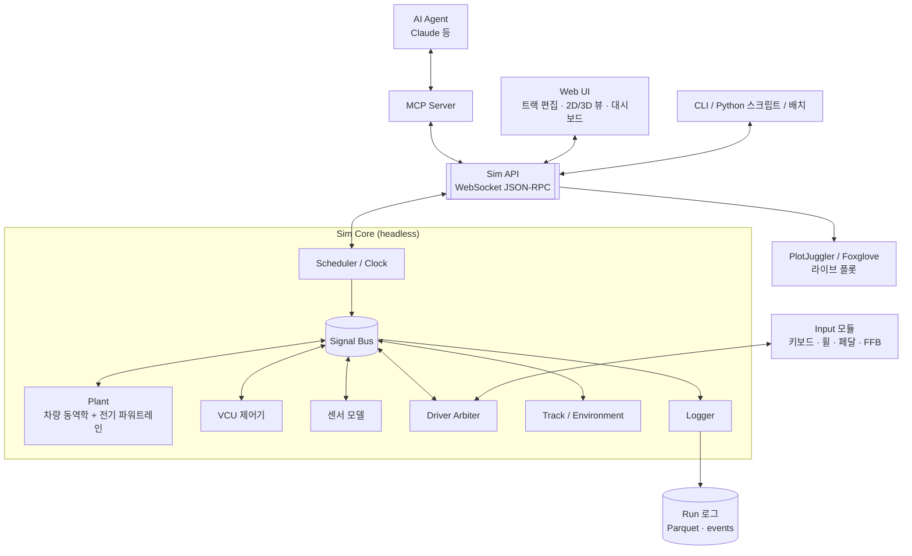
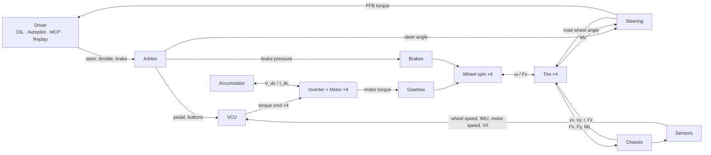

# 전기 포뮬러 차량 시뮬레이터 — 설계 문서

| 항목 | 내용 |
|---|---|
| 상태 | **Draft v0.1** (초안, 검토 대기) |
| 작성일 | 2026-10-21 |
| 초안 | Claude |
| 검토 | @tkdgusqkr-g |

---

## 0. 이 문서 사용법 (리뷰 방식)

이 문서는 **사용자 수정 → Claude 검토 → 반영**을 반복하며 발전시킵니다.

- 모든 항목에 ID가 붙어 있습니다: 요구사항 `R-xx`, 비기능 요구사항 `N-xx`, 설계 결정 `D-xx`, 질문 `Q-xx`, 검증 케이스 `V-xx`.
  대화할 때 "D-05는 C++로 가자"처럼 ID로 부르면 됩니다.
- 결정 상태: 🟢 확정 / 🟡 제안 (검토 필요) / 🔴 미정 (사용자 답변 필요)
- 수정 방법은 아래 중 편한 것을 쓰면 됩니다.
  1. 본문을 직접 고치기 (삭제, 추가, 수치 변경 모두 가능)
  2. 고치기 애매한 곳에 `> 💬 코멘트 내용` 남기기
  3. 채팅으로 "Q-03 답: ..."처럼 보내기
- 다음 라운드에서 Claude가 변경점(diff)을 검토하고, 반영 결과와 답변을 `> 🤖 ...`로 남긴 뒤 정리합니다.
- 변경 이력은 맨 아래 [§18](#18-변경-이력)에 기록합니다.

---

## 1. 요약 (TL;DR)

v0.1에서 제안하는 핵심 설계는 다음과 같습니다.

1. **Headless 코어 + 단일 Sim API**: 시뮬레이션 코어는 UI 없이 돌고, Web UI · MCP 서버 · CLI · Python 스크립트는 모두 **같은 API의 클라이언트**입니다. MCP는 이 API 위의 얇은 어댑터입니다.
2. **Plant와 이산 블록 분리**: 차량 동역학과 전기 파워트레인은 강하게 결합되어 있으므로 하나의 연속계(Plant)로 함께 적분합니다. VCU · 드라이버 · 센서는 각자 주기를 갖는 이산 블록입니다.
3. **차량 모델 기본값은 2-track 7-DOF** (평면 운동 + 4륜 회전, 준정적 하중 이동). 토크 벡터링(TV)과 트랙션 컨트롤(TC) 개발이 가능한 최소 수준이며, 단계적으로 14-DOF까지 교체할 수 있습니다.
4. **전기 모델은 준정적(quasi-static) 수준**에서 시작합니다: 배터리 등가회로(ECM) + 모터/인버터 토크 envelope과 손실맵 + 집중 열모델. 스위칭 수준 전기 모델은 범위 밖입니다.
5. **제어기는 플러그인**입니다: Python / C 공유라이브러리(실차 VCU 코드 SIL) / FMU(Simulink) / 외부 프로세스.
6. **드라이버는 공통 인터페이스 하나**(`DriverCommand`)로 통일합니다. DIL(키보드·휠·페달·FFB), Autopilot, MCP 에이전트, Replay가 모두 이 인터페이스를 출력하고, Arbiter가 채널별로 선택합니다.
7. **MCP는 3단계**로 나눕니다. LLM은 응답 지연(수백 ms~수 s) 때문에 실시간 폐루프 조향이 불가능하므로, (M1) 상위 지휘/실험 자동화와 (M2) 일시정지 후 한 스텝씩 진행하는 턴제 주행을 v1 범위로 제안합니다.
8. **트랙은 센터라인 control point + 좌우 폭**으로 표현하고, **주행 라인은 센터라인 기준 횡방향 오프셋 n(s)**로 저장합니다. 이렇게 하면 트랙을 고쳐도 라인이 따라가고, 트랙 경계 안에 자연스럽게 묶입니다.
9. **기술 스택 제안**: Python 코어(+ Plant 핫패스는 Numba 컴파일) / WebSocket JSON-RPC / TypeScript + three.js Web UI / SDL2 입력·FFB. 언어 선택은 미정입니다(→ Q-04, D-05).

---

## 2. 목표와 범위

### 2.1 목적

전기 포뮬러 차량(Formula Student Electric급으로 가정, → Q-01)을 대상으로 다음을 하나의 시뮬레이터에서 제공합니다.

- 차량 동역학 + 전기 파워트레인 + 제어(VCU)의 결합 시뮬레이션
- 같은 시나리오를 **사람이 운전(DIL)**하거나 **AI 에이전트가 MCP로 운전/실험**
- **트랙과 주행 경로 편집**

### 2.2 사용 시나리오 (Use Case)

| ID | 시나리오 | 예시 |
|---|---|---|
| UC-1 | 제어 개발 | TV 게인을 바꿔 가며 스키드패드를 돌리고 yaw rate 추종 성능 비교 |
| UC-2 | 에너지 전략 | 엔듀런스(약 22 km)에서 power limit / regen 설정별 랩타임–에너지 trade-off |
| UC-3 | 드라이버 훈련 (DIL) | 휠 + 페달로 오토크로스를 주행하고 텔레메트리를 이전 랩과 비교 |
| UC-4 | AI 실험 자동화 (MCP) | "TV Kp를 0.5~2.0으로 sweep해서 스키드패드 랩타임 표로 정리해줘" |
| UC-5 | 트랙 설계 | 대회 트랙 레이아웃을 편집하고 바로 주행 |
| UC-6 | VCU SIL (후순위) | 실차 VCU C 코드를 그대로 컴파일해 시뮬에 연결하고 검증 |

### 2.3 범위 밖 (v1 Non-goals)

- 사실적 그래픽, 사운드, 멀티플레이, 다중 차량
- 멀티바디 서스펜션 (K&C는 룩업 테이블로 근사)
- 인버터 스위칭 수준의 전기 시뮬레이션 (µs 단위)
- 카메라/LiDAR 센서 시뮬레이션 (Driverless 고려 여부 → Q-07)
- 모션 플랫폼
- 실시간 OS 수준의 hard real-time 보장 (soft real-time만)

---

## 3. 요구사항

### 3.1 기능 요구사항

**차량 동역학**

| ID | 요구사항 |
|---|---|
| R-01 | 차량 모델은 fidelity 단계별로 교체할 수 있어야 한다 (kinematic / single-track / 2-track 7-DOF / 14-DOF) |
| R-02 | 타이어는 Pacejka Magic Formula (combined slip)를 지원하고 `.tir` 파라미터 파일을 읽을 수 있어야 한다 |
| R-03 | 공력(Cl, Cd, 압력중심)을 반영하고, 다운포스가 하중 분배에 반영되어야 한다 |
| R-04 | 구동 토폴로지를 config로 선택할 수 있어야 한다 (4WD 인휠 / 후륜 2모터 / 단일 모터 + 디퍼렌셜) |

**전기 파워트레인**

| ID | 요구사항 |
|---|---|
| R-05 | 배터리: 등가회로 모델(OCV–R0–RC), SoC, 전압 강하, 온도 |
| R-06 | 인버터/모터: DC 전압에 따른 토크–속도 envelope, 효율(손실)맵, 열 디레이팅 |
| R-07 | 회생제동, 에너지 계량 (FS 규정상 출력 측정 위치는 배터리 출력단) |

**제어**

| ID | 요구사항 |
|---|---|
| R-08 | VCU 기능: 페달맵, power limit, TC, TV, regen blending, launch control, 규정 안전 로직 |
| R-09 | 제어기 실행 방식 교체 가능: Python / C 공유라이브러리 / FMU / 외부 프로세스 |
| R-10 | 센서 모델(지연, 노이즈, 양자화, 샘플링)을 켜고 끌 수 있어야 한다 |

**드라이버**

| ID | 요구사항 |
|---|---|
| R-11 | 모든 드라이버 소스는 공통 입력 인터페이스를 쓴다 (steer, throttle, brake, buttons) |
| R-12 | DIL: 키보드, 게임패드, 스티어링 휠/페달 입력 및 Force Feedback 출력 |
| R-13 | Autopilot: 경로 추종 + 속도 프로파일 |
| R-14 | MCP: AI 에이전트가 시뮬레이션 제어, 주행, 실험, 분석을 할 수 있어야 한다 |
| R-15 | 입력 기록/재생 (replay) |
| R-16 | 드라이버 소스 혼합·전환 (예: 조향은 사람, 속도는 autopilot / 사람이 개입하면 takeover) |

**트랙/경로**

| ID | 요구사항 |
|---|---|
| R-17 | 트랙 편집: 센터라인 control point, 좌우 폭, 콘, 출발/결승선, 섹터 |
| R-18 | 주행 경로(레이싱 라인) 편집 및 자동 생성 |
| R-19 | Import/Export: 센터라인 CSV, 콘 CSV, GPS 로그(lat/lon), 배경 이미지 트레이싱 |
| R-20 | FS 종목 템플릿: Acceleration, Skidpad, Autocross, Endurance |

**런타임/데이터**

| ID | 요구사항 |
|---|---|
| R-21 | 시간 모드: real-time / fast (최대 속도) / step (lockstep) |
| R-22 | 결정론적 재현: 같은 시나리오 + 같은 입력 → 같은 결과 |
| R-23 | 텔레메트리 로깅, 라이브 플롯, export (CSV / MAT / Parquet) |
| R-24 | 시나리오 파일 = 차량 + 트랙 + 드라이버 + 초기조건 + 종료조건 + 로깅 설정 |
| R-25 | 파라미터 sweep / 배치 실행 |

### 3.2 비기능 요구사항

| ID | 요구사항 | 목표치 (제안) |
|---|---|---|
| N-01 | Real-time 성능 | 물리 1 kHz, 렌더 ≥ 60 Hz, 입력→화면 지연 < 50 ms |
| N-02 | Fast 모드 성능 | 2-track 모델 기준 실시간의 ≥ 20배 (엔듀런스 약 26분 → 80초 이내) |
| N-03 | 플랫폼 | DIL은 Windows 10/11, 배치는 Linux도 지원 (→ Q-05) |
| N-04 | 단위/좌표계 | SI 단위, 각도는 내부 rad, ISO 8855 좌표계 |
| N-05 | 테스트 | 모델별 단위 테스트 + 검증 케이스(§5.5) + 결정론 회귀 테스트 |

---

## 4. 시스템 아키텍처

### 4.1 설계 원칙

| ID | 원칙 | 이유 |
|---|---|---|
| P-1 | **Headless 코어**: 시뮬레이션은 UI 없이 돈다 | 배치/MCP/CI에서 그대로 사용 |
| P-2 | **하나의 Sim API, 여러 frontend** | GUI, MCP, 스크립트가 같은 기능을 갖는다. MCP 전용 로직을 따로 만들지 않는다 |
| P-3 | **Plant는 연속계로 함께 적분, 나머지는 이산 블록** | 휠 회전–모터–타이어가 강하게 결합되어 있어서 분리 적분하면 불안정하다 |
| P-4 | **이름 기반 Signal Bus** | 모든 신호가 이름으로 노출되므로 로깅, 플롯, MCP 조회, sweep이 추가 코드 없이 된다 |
| P-5 | **데이터 주도** | 차량/트랙/시나리오는 파일로 정의하고 코드 수정 없이 교체한다 |
| P-6 | **결정론** | 고정 스텝, 시드 고정, 입력은 sim time 기준으로 기록한다 |

### 4.2 구성도



### 4.3 한 스텝 안의 신호 흐름



### 4.4 프로세스 구성 (v1 제안)

| 프로세스 | 역할 | 비고 |
|---|---|---|
| `sim-core` | 스케줄러, 모델, Sim API 서버, 입력 모듈 | 입력은 지연을 줄이려고 in-process로 둔다 |
| `mcp-server` | MCP ↔ Sim API 어댑터 | 두 가지 배포 방식: (a) 실행 중인 sim에 attach (사람이 DIL 주행 중일 때 AI가 관찰·분석), (b) headless sim을 직접 띄워 배치 실행 |
| 브라우저 | Web UI | `sim-core`가 정적 파일을 서빙하고 WebSocket으로 상태 스트림을 받는다 |

---

## 5. 차량 동역학 모델

### 5.1 좌표계 / 명명

- 차량 좌표계 ISO 8855: x 전방, y 좌측, z 상방, yaw는 반시계 방향이 양수
- 지면 좌표계: ENU (트랙 원점 기준 local)
- 바퀴 인덱스: `fl`, `fr`, `rl`, `rr`

### 5.2 Fidelity 단계

| Level | 모델 | 상태 (DOF) | 용도 |
|---|---|---|---|
| L0 | Kinematic bicycle | x, y, ψ, v | 초기 골격(M0), 저속, 플래너 |
| L1 | Dynamic single-track + 비선형 타이어 | vx, vy, r + 휠 2개 | 빠른 계산, MPC 예측 모델 |
| **L2** | **Two-track 평면 + 준정적 하중 이동** | **vx, vy, r + 휠 4개 = 7 DOF** | **v1 기본값.** TV/TC 개발 가능 |
| L3 | 14-DOF (차체 6 + 비현가 상하 4 + 휠 회전 4) | 14 DOF | 롤/피치 과도 응답, 서스펜션 튜닝 |

(모든 단계에 위치 x, y, ψ의 기구학 적분이 추가됩니다.)

**D-02 제안: v1 기본 모델은 L2.** 이유는 다음과 같습니다.
- TV/TC 개발에는 바퀴별 슬립과 힘이 필요하므로 최소 two-track이어야 한다
- FS 차량은 서스펜션이 단단하고 롤이 작아서 준정적 하중 이동으로도 꽤 정확하다
- 계산이 가벼워 fast 모드 목표(N-02)를 달성하기 쉽다

### 5.3 L2 모델 상세

**하중 (Fz)**
- `Fz_i = 정적 하중 + 공력 다운포스(압력중심으로 앞뒤 분배) + 종방향 하중 이동 + 횡방향 하중 이동`
- 종방향: `ΔFz = m · ax · h_cg / L`
- 횡방향: 앞/뒤 롤 강성 비율로 분배 (롤센터 높이는 L3에서 반영)
- 가속도 → 하중 → 가속도의 algebraic loop는 **가속도에 1차 지연 필터를 넣어** 끊습니다 (서스펜션 동특성의 근사 역할도 함)

**타이어**
- Pacejka MF 6.1 (또는 5.2) combined slip, `.tir` 파일 로딩
- 단순 대안: 단순화 MF(B, C, D, E) + 마찰 타원 (파라미터가 부족할 때)
- **Relaxation length**(슬립의 1차 지연) 적용: 저속 수치 안정성과 과도 응답 현실성 확보
- 저속(약 1~2 m/s 이하)에서는 슬립 정의가 특이해지므로 저속 감쇠 블렌딩 적용
- 노면 μ 스케일: 구간별(surface zone) + 시나리오 전체(예: wet)
- 타이어 데이터 출처 → Q-11 (FSAE TTC 데이터 보유 여부)

**휠 회전**
- `I_w · ω̇ = T_drive − T_brake − Fx · R_eff − T_roll`
- `I_w`에는 모터 로터 관성의 반사분(`J_rotor · i²`)을 포함

**조향**
- 핸들각 → 랙 → 바퀴 조향각: 기어비 + Ackermann 비율 (또는 룩업 테이블)
- 토(toe) 고정값, 조향 컴플라이언스는 v1에서 무시

**공력**
- `F_down = ½ ρ Cl A v²`, `F_drag = ½ ρ Cd A v²`, 압력중심 x 위치
- 차고/피치 민감도 맵은 L3 이후

**브레이크**
- 유압 → 바퀴별 토크 (전후 배분, 디스크 유효반경, 패드 μ), 1차 지연
- 휠 락은 타이어 모델이 자연스럽게 표현함
- 브레이크 온도는 후순위

**적분기 (D-12 관련)**

휠 회전 동역학은 저속에서 stiff합니다. 대략 계산해 보면:

```
고유값 λ ≈ C_κ · R² / (I_w · v)
FS 대표값: C_κ ≈ 20,000 N, R ≈ 0.2 m, I_w ≈ 0.35 kg·m² (반사 관성 포함)
v = 1 m/s → λ ≈ 2,300 1/s
explicit Euler 안정 조건 dt < 2/λ ≈ 0.87 ms
RK4 안정 조건      dt < 2.8/λ ≈ 1.2 ms
```

따라서 **dt = 1 ms + RK4 + relaxation length + 저속 블렌딩**을 기본으로 제안하고, M1에서 정지 상태 출발과 정차 시나리오로 안정성을 검증합니다. 문제가 생기면 휠 회전만 sub-stepping하거나 semi-implicit 방식으로 바꿉니다.

### 5.4 L3 (후순위)

- 14-DOF, 서스펜션 K&C는 룩업 테이블 (캠버 게인, 롤센터 높이, 모션비)
- 비선형 댐퍼 커브, 안티롤바
- 3D 트랙(고도, 뱅크)

### 5.5 검증 케이스

| ID | 케이스 | 기준 |
|---|---|---|
| V-01 | 저속 정상상태 선회 | 해석적 bicycle 모델의 understeer gradient와 비교 |
| V-02 | 직선 가속 0–75 m | 손 계산 (트랙션 한계 구간 → 출력 한계 구간)과 비교 |
| V-03 | 에너지 보존 | 배터리 출력 에너지 = 운동에너지 증가 + 손실 합 (오차 < 1%) |
| V-04 | 결정론 | 같은 시나리오 + 입력 → 로그가 비트 단위로 동일 |
| V-05 | 정지 출발/정차 | 저속에서 진동이나 발산 없음 |
| V-06 | 실측 비교 (데이터가 있으면) | 실차 로그와 비교 (→ Q-11) |

---

## 6. 전기 파워트레인 모델

### 6.1 토폴로지 (config로 선택)

| 값 | 구성 | 비고 |
|---|---|---|
| `4wd_inhub` | 인휠 모터 4개 + 유성기어 | 상위권 FS EV 팀에서 흔한 구성. **v0.1 기본 가정** |
| `2wd_rear` | 후륜 모터 2개 | 후륜 TV |
| `1motor_diff` | 단일 모터 + 디퍼렌셜 (open/LSD) | TV 불가 |

→ 실제 대상 구성은 Q-02

### 6.2 Accumulator (배터리)

- **셀 등가회로**: `V_cell = OCV(SoC, T) − I·R0(SoC, T) − Σ V_RCi`, `dV_RCi/dt = −V_RCi/(R_i C_i) + I/C_i` (RC 1~2개)
- **팩**: 직렬 N_s × 병렬 N_p (v1은 셀 균일 가정, 셀 불균형은 후순위)
- **SoC**: 쿨롱 카운팅 `dSoC/dt = −I_pack / (3600 · Q_cell_Ah · N_p)`
- **열**: 집중 모델 `m·c·dT/dt = I²·R + RC 손실 − h·A·(T − T_amb)`
- **한계**: 셀 전압 상·하한, 방전/충전(회생) 전류 한계, 온도 → BMS 디레이팅 커브
  → `bat.lim.p_dis_max`, `bat.lim.p_chg_max` 신호로 내보내고 VCU가 준수
- **전력 algebraic loop 처리**: 요구 전력 P에 대해 `P = (OCV' − I·R0)·I`를 I에 대한 2차식으로 풀어 해를 구합니다 (`OCV'`는 RC 전압을 뺀 값). 판별식이 음수면 그 전력은 낼 수 없는 것이므로 한계로 처리합니다.
- **에너지 계량**: 배터리 출력단 `P = V_pack · I_pack`, 누적 에너지, 회생 에너지 별도 집계
- **보조 부하**: 냉각 펌프, LV 등은 상수 `P_aux`로 근사

### 6.3 인버터 + 모터

**Level A (v1 기본, 준정적) — D-03**
- 토크 명령 추종: 1차 지연(τ ≈ 1~5 ms) + 변화율 제한
- 토크 envelope `T_max(ω, V_dc)`: 정토크 영역 → 약계자(정출력) 영역. base speed는 V_dc에 비례해 스케일링하므로, 배터리 전압이 처지면 고속에서 토크가 줄어드는 현상이 표현됩니다.
- 손실: 모터 + 인버터 손실맵 `P_loss(T, ω, V_dc)` (또는 효율맵 η)
- `P_dc = T·ω + P_loss` (회생 시 T·ω < 0) → `I_dc = P_dc / V_dc` → 배터리로 전달
- 열: 권선 / 인버터 집중 열모델 → 디레이팅 커브

**Level B (후순위, 선택)**
- dq축 PMSM 모델 + FOC 전류 제어, multi-rate (10~20 kHz sub-stepping)
- 인버터 제어 연구가 목적일 때만 필요. 계산 비용이 큼

**기어박스 / 구동축**
- 기어비, 효율, 반사 관성. 백래시는 후순위
- 구동축 비틀림 강성(스프링–댐퍼)은 선택 옵션 (TC 진동 해석용. 인휠 구성에는 해당 없음)

### 6.4 규정 반영 항목 (대회 확정 후 수치 확정, → Q-01)

| 항목 | 내용 (FS 계열 기준, **룰북 버전 확인 필요**) |
|---|---|
| 최대 전압 | 600 V DC |
| 최대 출력 | 배터리 출력단 80 kW. 판정 방식(이동평균 윈도 등)은 룰북 확인 |
| APPS 불일치 | 두 센서 차이 10% 초과가 일정 시간 지속되면 출력 차단 |
| 브레이크 plausibility | 브레이크 + APPS 25% 초과(또는 일정 출력 초과) → APPS 5% 미만이 될 때까지 출력 차단 |
| 회생 제한 | 저속 회생 금지 등 조건 룰북 확인 |

시뮬레이터는 위반을 **이벤트로 기록**하고, 옵션으로 실제처럼 출력을 차단합니다.

---

## 7. 제어 (VCU)

### 7.1 기능 파이프라인

1. **입력 처리**: APPS 2채널 plausibility, 브레이크 센서, 조향각
2. **드라이버 토크 요구**: 페달맵 `T_req_total = f(pedal, v)`, 브레이크 페달/리프트오프 회생
3. **상태 추정**: 차속 추정(휠속 + IMU), 바퀴별 슬립률. 후순위: 횡슬립각, μ 추정
4. **토크 벡터링**:
   - yaw rate 기준값 `r_ref = vx·δ / (L + K_us·vx²)`, 상한 `|r_ref| ≤ k·μ·g / vx`
   - yaw moment 명령: PI (v1) → LQR/MPC (후순위)
   - 4륜 토크 분배: 규칙 기반 (v1) → 제약 QP (모터 한계, Fz 가중 마찰 한계) (후순위)
5. **트랙션 컨트롤**: 바퀴별 목표 슬립률, PI로 토크 감소 (회생 시 ABS 유사 동작 포함)
6. **Power limit**: `Σ P_elec ≤ min(80 kW, BMS 한계)`. 전기 출력은 모터 손실모델로 예측하고, 측정된 팩 전력으로 피드백 보정합니다.
7. **출력**: 모터별 토크 명령. 기계식 브레이크는 페달 직결이고, regen blending은 옵션입니다.
8. **안전 로직**: 규정 plausibility(§6.4), Ready-to-Drive 상태 머신, 타임아웃

### 7.2 제어기 실행 방식 (플러그인, R-09)

| 방식 | 설명 | 용도 |
|---|---|---|
| Python | `Block` 인터페이스 구현 | 빠른 알고리즘 실험 |
| C 공유라이브러리 (SIL) | 정해진 C ABI로 실차 VCU 코드를 컴파일 | 실차 코드 검증 |
| FMU (FMI 2.0/3.0 Co-Simulation) | Simulink / Modelica에서 export | MATLAB 사용 팀 |
| External (UDP/CAN) | 별도 프로세스 또는 실제 ECU | HIL (후순위) |

C ABI 초안:

```c
typedef struct {
    double t;
    double apps[2], bse, steer_angle;
    double wheel_speed[4], motor_speed[4];
    double imu_ax, imu_ay, imu_yaw_rate;
    double v_dc, i_dc, p_dis_max, p_chg_max;
    /* 버튼, 모드 등 */
} VcuInputs;

typedef struct {
    double torque_cmd[4];
    int    status;   /* 비트 플래그: RTD, fault 등 */
} VcuOutputs;

int vcu_init(const char *param_json);
int vcu_step(const VcuInputs *in, VcuOutputs *out);
```

실차 코드는 CAN 신호를 입력으로 받으므로 adapter 계층에서 매핑합니다. 장기적으로는 신호 목록 하나에서 구조체를 생성하는 방식(single source of truth)을 고려합니다.

### 7.3 센서 모델 (R-10)

- 센서별 샘플링 주기, 지연, 가우시안 노이즈, 바이어스, 양자화, (dropout)
- 기본값은 꺼짐(이상적인 센서)으로 두고, 강건성 테스트에서 켭니다

### 7.4 실행 주기

- VCU 기본 100 Hz (실차 VCU 주기에 맞춰 1 kHz까지 설정 가능), 출력은 zero-order hold

---

## 8. 드라이버 시스템

### 8.1 공통 인터페이스

```python
@dataclass
class DriverCommand:
    steer: float      # 핸들각 [rad]
    throttle: float   # 0..1 (APPS)
    brake: float      # 0..1 → 페달맵으로 브레이크 압력 변환
    buttons: Buttons  # regen_level, tc_mode, tv_mode, launch, ready_to_drive
```

모든 소스(DIL, Autopilot, MCP, Replay)는 이 형식만 출력하므로, **VCU 입장에서는 누가 운전하는지 구분할 수 없습니다.** 공정한 비교를 위한 의도적인 설계입니다.

### 8.2 Arbiter

- **채널별 소스 선택**: steer / longitudinal(throttle+brake) / buttons를 각각 다른 소스에서 받을 수 있음
  - 예: 조향은 사람, 속도는 autopilot (조향 연습용)
- **Takeover**: autopilot 주행 중 사람 입력이 임계값을 넘으면 사람에게 전환
- 전환 시 급변을 막기 위한 블렌딩

### 8.3 DIL (Driver-in-the-Loop)

**입력**
- SDL2 기반: 키보드, 게임패드, 휠/페달 축
- 장치별 매핑 프로필: 축 번호, 반전, 데드존, 캘리브레이션, 응답 커브. UI에 캘리브레이션 마법사 제공
- 키보드: 디지털 입력을 변화율 제한 램프로 아날로그화 (조향 속도, 센터 복귀, 속도 감응 조향 제한)

**Force Feedback**
- 핸들 토크 = (앞바퀴 Mz + 기계적 트레일 × Fy) / 조향비 × 게인 + 댐핑 + 마찰, 클리핑 및 저역통과 필터
- SDL haptic의 constant force 효과로 출력, 갱신 100~500 Hz
- 장치 호환성(G29/G923/Fanatec 등)은 초기에 실기 테스트 필요 → Q-08

**시각**
- 3D 추적 시점 / 콕핏 시점, HUD (속도, SoC, 출력, TC/TV 상태, 랩타임, 델타)
- 후순위: 이전 랩 고스트카

**성능**
- DIL 세션은 항상 real-time 모드
- 지연 예산: 입력 샘플 → 물리 → 렌더 < 50 ms (목표)

### 8.4 Autopilot

- **횡방향**: Pure Pursuit (v1), Stanley, MPC(후순위, L1 모델을 예측 모델로 사용)
- **종방향**: 경로 곡률과 g-g-v envelope으로 속도 프로파일 생성 (forward/backward pass, 다운포스에 따른 속도별 횡가속 한계 반영) + PI 속도 추종
- **공격성 파라미터**(그립 한계의 몇 %까지 쓸지)로 숙련도가 다른 드라이버를 흉내 낼 수 있음
- 출력은 `DriverCommand`이므로 VCU는 사람과 똑같이 취급합니다

### 8.5 MCP 연동

**핵심 제약**: LLM의 응답 지연(수백 ms~수 s) 때문에 100 Hz~1 kHz 실시간 폐루프 조향은 불가능합니다. 그래서 단계를 나눕니다.

| 단계 | 이름 | 에이전트가 하는 일 | 시간 모드 | v1 |
|---|---|---|---|---|
| M1 | Supervisor | 시나리오 실행, 파라미터 변경, autopilot 목표(경로/속도/공격성) 지정, 결과 분석 | 모두 | ✅ |
| M2 | Step driver | sim을 멈춘 상태에서 입력 설정 → `step(Δt)` → 상태 관찰을 반복 (턴제) | step | ✅ |
| M3 | Policy driver | 에이전트가 정책 파라미터(예: 게인, 속도 프로파일 테이블)를 올리면 sim이 실시간으로 실행 | 모두 | 파라미터형만 |

M3에서 임의 코드 업로드는 보안 문제로 v1에서 제외합니다.

**MCP Tool 초안**

| 그룹 | Tool | 설명 |
|---|---|---|
| 세션 | `sim_load_scenario(path \| yaml)` | 시나리오 로드 |
| | `sim_control(action)` | start / pause / reset |
| | `sim_set_time_mode(mode, speed_factor?)` | realtime / fast / step |
| | `sim_step(duration_s \| steps)` | 진행 후 상태 요약 반환 |
| | `sim_get_state(signals?)` | 현재 상태 |
| 드라이버 | `driver_set_source(channel, source)` | 채널별 소스 지정 |
| | `driver_set_command(steer, throttle, brake, hold_s)` | M2 입력 |
| | `autopilot_configure(path_id, speed_scale, lookahead, ...)` | M1/M3 |
| 파라미터 | `param_get(path)` / `param_set(path, value)` / `param_list(prefix)` | 예: `control.tv.kp` |
| 트랙 | `track_list()` / `track_load(id)` / `track_get(id, format)` | |
| | `track_edit(ops[])` | add_point, move_point, delete_point, set_width, place_cone, from_template |
| | `path_generate(track_id, method)` | centerline / min_curvature |
| 분석 | `run_laps(n, overrides?)` | 랩타임, 에너지(Wh), 최대 출력, 최고 온도, 규정 위반 요약 |
| | `sweep(param, values, metrics)` | 결과 표 |
| | `telemetry_query(signals, t0, t1, max_points)` | 다운샘플링해서 반환 |
| | `telemetry_stats(signals, lap?)` | min/max/mean 등 |
| | `plot(signals, ...)` | PNG 이미지 반환 (에이전트가 그래프를 직접 보고 판단) |

**Resource 초안**: `sim://vehicles/*`, `sim://tracks/*`, `sim://scenarios/*`, `sim://runs/{id}/summary`

**기타**
- Transport: stdio (로컬 Claude Code / Desktop) + Streamable HTTP (원격)
- **제어권 잠금**: 사람이 DIL로 주행 중일 때 MCP는 읽기 전용과 분석만 허용 (설정으로 변경 가능)
- **안전**: `param_set`은 허용 목록 방식, 작업 디렉터리 밖 파일 쓰기 금지, 코드 실행 금지
- **토큰 효율**: 원시 배열 대신 요약, 통계, 다운샘플, 이미지 위주로 반환

---

## 9. 트랙 & 경로 편집

### 9.1 데이터 모델

```text
Track
  id, name, closed: bool
  centerline: [ControlPoint{x, y, z?, w_left, w_right, bank?}]
  interpolation: periodic_cubic_spline | catmull_rom | clothoid
  surface_zones: [{s_start, s_end, mu_scale, name}]
  cones: [{x, y, color: blue | yellow | orange | big_orange}]
  start_finish: s,  sectors: [s, ...]
  geo_ref: {lat0, lon0}                       # GPS import 시
  background: {image, m_per_px, offset, rot}  # 편집기 전용

Path (주행 라인)
  id, track_id, name
  offset: [n(s) control points]   # 센터라인 기준 횡방향 오프셋
  speed_profile?: v(s)            # 선택, 없으면 autopilot이 생성
```

**D-10 제안: 주행 라인을 Frenet 오프셋 n(s)로 저장**
- 트랙 센터라인을 고쳐도 라인이 따라 움직임
- `−w_right ≤ n ≤ w_left` 제약으로 트랙 경계 안에 자연스럽게 묶임
- 최소 곡률 최적화(QP)의 결정변수와 형태가 같음

**런타임 표현**: Δs = 0.25~0.5 m로 재샘플링한 배열 `(s, x, y, ψ, κ, w_l, w_r)` + 차량 위치의 Frenet 투영 `(s, n)`
→ 랩 카운트, 코스 이탈 판정, autopilot에 사용

**콘 처리**: v1은 **센터라인 우선**(센터라인과 폭을 편집하면 콘이 일정 간격으로 자동 생성)으로 제안합니다. 콘 배치에서 센터라인을 역산하는 방식은 후순위입니다 (→ Q-09).
- 콘 충돌 판정 (차량 footprint vs 콘) → 이벤트 기록 (FS 페널티 계산용)

### 9.2 편집기 기능 (v1)

- 2D 탑뷰 캔버스: pan/zoom, 그리드, 축척
- Control point 추가 / 사이에 삽입 / 드래그 / 삭제 / 루프 닫기
- 점별 폭 핸들 (드래그 또는 숫자 입력)
- 곡률 색상 표시, 검증: 자기 교차, 경계 겹침, 최소 폭, 최소 회전반경
  (예: FSG 트랙 가이드라인의 최소 폭 3 m, 헤어핀 외경 9 m 이상 등. **룰북 버전 확인 필요**)
- 템플릿: Acceleration(75 m 직선), Skidpad(8자, 표준 치수), 파라메트릭 생성
- 주행 라인: 오프셋 핸들 편집, 자동 생성(센터라인 / 최소 곡률, 후자는 후순위)
- Undo/Redo, 저장/불러오기
- **편집 연산은 command 패턴**으로 구현해서, UI 편집과 MCP `track_edit`가 같은 연산(과 undo 이력)을 공유
- 편집은 sim 일시정지 상태에서만 허용 (v1)

### 9.3 파일 형식

| 형식 | 용도 |
|---|---|
| `*.track.json` | 네이티브 포맷 (스키마 버전 포함) |
| CSV `x_m, y_m, w_tr_right_m, w_tr_left_m` | 센터라인 (TUMFTM racetrack-database 호환) |
| CSV `x, y, color` | 콘 맵 |
| CSV / GPX (lat, lon) | GPS 로그 → `geo_ref` 기준 ENU 변환 |
| PNG / JPG + 축척 | 위성사진 배경 트레이싱 |

---

## 10. 시뮬레이션 코어 (런타임)

### 10.1 스케줄러와 시간

**주기 (기본값 제안, 모두 설정 가능)**

| 태스크 | 주기 | 비고 |
|---|---|---|
| Plant 적분 | 1 ms (RK4) | 컴파일된 함수 안에서 sub-step |
| 센서 | 센서별 | 지연 버퍼 포함 |
| VCU | 10 ms (100 Hz) | 1 ms까지 가능 |
| Driver | 10 ms | DIL은 최신 입력 샘플 |
| 로깅 | 10 ms (고속 신호는 1 ms 옵션) | |
| 상태 publish (UI) | 16.7 ms (60 Hz) | |
| FFB 출력 | 2~10 ms | |

**한 tick 안의 실행 순서 (결정론 보장용, 고정)**
1. 입력 소스 샘플링
2. 센서가 Plant 출력을 샘플링 (지연 버퍼 반영)
3. Driver 태스크 → `DriverCommand`
4. Arbiter
5. VCU 태스크 → 액추에이터 명령 (ZOH)
6. Plant를 tick 길이만큼 진행 (내부 1 ms sub-step)
7. 이벤트 처리 (랩 통과, 코스 이탈, 콘 충돌, 규정 위반)
8. 로깅, publish (주기가 된 경우)

**시간 모드 (R-21)**
- `realtime`: 벽시계에 맞춤 (고정 스텝 누적기 방식). 처리 시간이 넘치면 overrun을 기록하고, 옵션으로 슬로모션
- `fast`: 대기 없이 최대 속도
- `step`: API의 `step(n)` 호출 때만 진행 (MCP M2)
- 런타임 중 모드 전환 가능 (예: DIL 주행 → 일시정지 → MCP가 step으로 분석)

**결정론**: 입력은 벽시계가 아니라 sim time 기준으로 기록합니다. DIL 입력도 driver tick마다 샘플한 값을 저장하므로 replay가 정확히 재현됩니다.

### 10.2 블록 인터페이스

```python
class Plant(Protocol):
    """연속계. 순수 함수로 작성 → 컴파일(Numba/C++)·MPC 재사용·FMU화가 쉬움."""
    def derivatives(self, t: float, x: Array, u: Array, p: Params) -> Array: ...
    def outputs(self, t: float, x: Array, u: Array, p: Params) -> Array: ...
    def advance(self, x: Array, u: Array, p: Params, dt: float, n: int) -> Array: ...

class Block(Protocol):
    """이산 블록 (VCU, Driver, Sensor 등)."""
    name: str
    period: float
    def init(self, params: Params, ctx: Context) -> None: ...
    def step(self, t: float, bus: SignalBus) -> None: ...   # bus에서 읽고 bus에 씀
```

**성능 설계 포인트**: 순수 Python으로 L2 모델을 1 kHz RK4로 돌리면 대략 실시간의 2~3배 속도밖에 안 나와서 N-02(≥ 20배)를 만족하기 어렵습니다. 그래서 **Python은 tick(보통 10 ms) 단위로 오케스트레이션만 하고, Plant는 컴파일된 `advance()` 안에서 1 ms sub-step을 몰아서 처리**합니다. 이 경계만 지키면 Plant 구현 언어는 나중에 바꿀 수 있습니다 (→ D-05).

### 10.3 Signal Bus와 명명 규칙

- 형식: `<domain>.<component>.<signal>[.<corner>]`
  - 예: `veh.chassis.vx`, `veh.tire.fl.fz`, `pt.motor.rl.torque`, `bat.soc`, `ctrl.tv.yaw_ref`, `drv.cmd.steer`
- 신호 메타데이터: 단위, 설명, 주기
- 로깅/조회 대상은 glob 패턴으로 선택 (예: `veh.tire.*.fz`)

### 10.4 파라미터 & 설정

- YAML + 스키마 검증 (pydantic)
- 레이어링: 기본 차량 → 차량 variant → 시나리오 override → 런타임 `param_set`
- 파라미터 경로로 접근: `vehicle.aero.cl`, `control.tv.kp` (MCP와 sweep에서 사용)
- 파라미터별 **런타임 변경 가능 여부** 플래그 (예: 질량은 reset 필요, 제어 게인은 즉시 반영)

### 10.5 시나리오 예시

```yaml
scenario: skidpad_tv_test
vehicle: data/vehicles/fs_ev_2026.yaml
overrides:
  control.tv.enabled: true
  control.tv.kp: 1.2
track: data/tracks/fs_skidpad.track.json
driver:
  steer: autopilot
  longitudinal: autopilot
  autopilot: {path: racing_line, aggressiveness: 0.9}
initial: {s: 0.0, v: 0.0, soc: 0.95}
environment: {ambient_temp_c: 25, mu_scale: 1.0}
time: {mode: fast, dt: 0.001, t_end: 120}
stop: ["laps >= 4", "bat.soc < 0.05"]
logging: {signals: ["veh.*", "pt.*", "bat.*", "ctrl.*"], rate_hz: 100}
```

---

## 11. 시각화, UI, 데이터

### 11.1 Web UI (D-08)

- 트랙 편집기 (Canvas2D / SVG)
- 라이브 2D 맵: 차량 자세, 궤적, 경로
- 3D 뷰 (three.js): DIL용 추적/콕핏 시점 + HUD
- 대시보드: 주요 게이지, 실행 제어 버튼
- 3D 품질이나 지연이 부족하면 같은 상태 스트림을 구독하는 Godot / Unity 클라이언트로 교체 (API가 같으므로 코어 변경 없음)

### 11.2 텔레메트리 플롯

- 플로팅 도구를 직접 만들지 않고 기존 도구를 활용: **PlotJuggler**(오픈소스) 또는 **Foxglove**(라이브 WebSocket)
- 오프라인 분석: Python 노트북, MATLAB (MAT export)

### 11.3 Run 산출물 (D-11)

```text
runs/2026-10-21T14-03-12_skidpad_tv_test/
  scenario.resolved.yaml   # 모든 override가 적용된 최종 파라미터
  log.parquet              # 시계열
  events.jsonl             # 랩, 섹터, 위반, fault, 모드 전환, 콘 충돌
  inputs.jsonl             # replay용 DriverCommand
  summary.json             # 랩타임, 에너지, 최대 출력, 최고 온도, 최저 SoC, 위반 횟수
```

Export: CSV, MAT

---

## 12. 기술 스택 (제안)

| 영역 | 제안 | 대안 | 이유 |
|---|---|---|---|
| 코어 | **Python 3.12+ / NumPy, Plant 핫패스는 Numba** | C++17 + pybind11, Rust + PyO3 | 개발 속도, MCP SDK, 과학 계산 생태계, 팀 접근성. 성능은 M1에서 측정 |
| Sim API | WebSocket + JSON-RPC 2.0 (스트림은 msgpack) | gRPC, ZeroMQ | 브라우저에서 바로 사용 |
| MCP | 공식 MCP Python SDK | — | 코어와 같은 언어 |
| 입력 / FFB | SDL2 (pysdl2) | pygame, 제조사 SDK | 크로스 플랫폼, haptic 지원 |
| Web UI | TypeScript + Vite + three.js | Godot 4 (3D 전용) | 편집기와 뷰어를 한 스택으로 |
| FMU | FMPy | — | |
| 설정 | YAML + pydantic | TOML | |
| 로그 | Parquet (pyarrow) | MCAP, HDF5 | pandas / MATLAB 호환 |
| 테스트 | pytest + golden-run 회귀 | — | |

**Python 코어의 리스크와 대응**
- GIL로 인한 jitter: 물리 루프는 전용 스레드, I/O는 asyncio. M0에서 jitter 측정
- Numba의 제약: 클래스 사용이 어렵고 디버깅이 불편함 → Plant를 순수 함수 + 배열 파라미터로 설계
- 그래도 부족하면 Plant만 C++/Rust로 옮김 (§10.2의 경계 유지)

---

## 13. 저장소 구조 (제안)

```text
vehicle_simulation/
├─ docs/
│  └─ design.md
├─ sim/                      # Python 패키지 (코어)
│  ├─ core/                  # scheduler, clock, bus, params, scenario
│  ├─ models/
│  │  ├─ vehicle/            # chassis, tire, aero, steering, brakes
│  │  ├─ powertrain/         # battery, inverter, motor, gearbox
│  │  └─ sensors/
│  ├─ control/               # VCU 블록 + adapter (c_abi, fmu, external)
│  ├─ driver/                # dil, autopilot, replay, arbiter
│  ├─ track/                 # 트랙 모델, spline, frenet, io, templates
│  ├─ api/                   # WebSocket JSON-RPC 서버
│  └─ logging/
├─ mcp_server/               # MCP → Sim API 어댑터
├─ ui/                       # Web UI (editor, viewer, dashboard)
├─ data/
│  ├─ vehicles/
│  ├─ tires/
│  ├─ tracks/
│  └─ scenarios/
├─ tests/
└─ tools/                    # 캘리브레이션, 변환 스크립트
```

---

## 14. 마일스톤 (제안, 순서 조정 가능)

| 단계 | 내용 | 완료 기준 |
|---|---|---|
| **M0** Walking skeleton | 스케줄러, bus, L0 kinematic, 키보드 입력, 2D 웹 뷰, 로깅, 오벌 트랙 1개 | 키보드로 오벌을 돌고 로그가 남는다 |
| **M1** 차량 + 전기 v1 | L2 7-DOF, MF 타이어, 파워트레인 Level A, 배터리 ECM, 기본 VCU(페달맵, power limit), autopilot(pure pursuit + 속도 프로파일) | V-01~V-05 통과, fast 모드 ≥ 20배 |
| **M2** 트랙 편집기 v1 | 편집기, 템플릿, Frenet, 랩 타이밍, run summary | 스키드패드/오토크로스를 만들어 바로 주행 |
| **M3** MCP | M1 Supervisor + M2 Step, sweep, telemetry 조회, plot | 에이전트가 sweep을 돌리고 결과 표를 만든다 |
| **M4** DIL 완성 | 휠/페달(SDL2), FFB, 3D 뷰, HUD, real-time 튜닝 | 휠로 주행, 지연 < 50 ms |
| **M5** 제어 스위트 | TC, TV, regen blending, launch, C ABI / FMU 플러그인, 센서 모델 | TV on/off 비교 실험 재현 |
| **M6** 고충실도 | L3 14-DOF, 열 디레이팅, 최소 곡률 라인, 실측 검증 | V-06 |

---

## 15. 리스크

| 리스크 | 영향 | 대응 |
|---|---|---|
| Python 실시간 성능 / GIL jitter | DIL 품질, fast 모드 목표 | M0~M1에서 측정, Plant 컴파일, 필요하면 C++ 전환 |
| 저속 타이어 수치 불안정 | 정지·출발 시 발산 | relaxation length, 저속 블렌딩, sub-step (§5.3) |
| 타이어/모터 데이터 부재 | 정확도 | 문헌 대표값으로 시작, μ·효율 스케일로 튜닝 |
| FFB 장치 호환성 | DIL 체감 | M0 직후 실기 spike 테스트 |
| 브라우저 3D 지연 | DIL 체감 | 측정 후 Godot 전환 옵션 |
| MCP 토큰 비용 | 에이전트 실험 비용 | 요약, 다운샘플, 이미지 반환 |
| 범위 확장 | 일정 | fidelity 단계화, 마일스톤 완료 기준 엄수 |

---

## 16. 설계 결정 목록

| ID | 주제 | 제안 | 상태 |
|---|---|---|---|
| D-01 | 대상 차량 | FS Electric급, 기본 토폴로지 4WD 인휠, config로 교체 | 🔴 Q-01, Q-02 |
| D-02 | 기본 차량 모델 | L2: two-track 7-DOF + 준정적 하중 이동 | 🟡 |
| D-03 | 모터/인버터 모델 | Level A: 준정적 envelope + 손실맵 + 집중 열모델 | 🟡 |
| D-04 | 배터리 모델 | ECM (R0 + RC 1~2개) + 집중 열모델 | 🟡 |
| D-05 | 코어 언어 | Python + NumPy, Plant는 Numba | 🔴 Q-04 |
| D-06 | Sim API | WebSocket + JSON-RPC 2.0 | 🟡 |
| D-07 | MCP 범위 (v1) | M1 Supervisor + M2 Step, M3는 파라미터형만 | 🟡 Q-06 |
| D-08 | UI | Web (TypeScript + three.js), 3D 엔진은 M4에서 재평가 | 🟡 Q-10 |
| D-09 | 입력/FFB | SDL2, sim-core 프로세스 안에서 처리 | 🟡 Q-08 |
| D-10 | 트랙/경로 표현 | 센터라인 control point + periodic cubic spline + 폭, 주행 라인 = Frenet 오프셋 n(s) | 🟡 Q-09 |
| D-11 | 로그 형식 | Parquet + events.jsonl, 라이브는 PlotJuggler/Foxglove | 🟡 |
| D-12 | 적분/주기 | dt 1 ms, RK4, VCU 100 Hz 기본 | 🟡 |
| D-13 | 좌표계/단위 | ISO 8855, SI | 🟡 |

---

## 17. 열린 질문 (답변 필요)

**우선순위 높음 (설계 방향이 바뀜)**

- **Q-01 대상 차량/대회**: 어떤 대회와 규정을 기준으로 하나요? (KSAE 대학생 자작자동차대회 EV / FSAE / FSG 등) 실제 팀 차량이 있나요? 질량, 휠베이스, 모터 기종, 배터리 구성 같은 파라미터를 구할 수 있나요?
- **Q-02 구동 토폴로지**: 4WD 인휠 / 후륜 2모터 / 단일 모터 중 어떤 건가요? (TV 설계 범위가 달라짐)
- **Q-03 최우선 용도**: 순위를 매겨 주세요. 제어 알고리즘 개발 / 드라이버 훈련 / 에너지·랩타임 전략 / VCU SIL 검증 / AI 에이전트 연구
- **Q-04 언어와 팀**: Python 중심이어도 괜찮나요? C++ 가능한 인원이 있나요? MATLAB/Simulink를 쓰나요? (쓴다면 FMU 지원 우선순위가 올라감)
- **Q-06 MCP**: Model Context Protocol(Claude 같은 AI 에이전트가 tool로 시뮬을 조작하는 방식)이 맞나요? 에이전트가 직접 조향까지 해야 하나요(M2), 아니면 상위 지휘와 실험 자동화(M1)면 충분한가요?

**그 외**

- **Q-05 OS**: DIL은 Windows인가요? 배치 실행은 Linux 서버에서도 하나요?
- **Q-07 Driverless**: 자율주행 부문까지 고려하나요? (그렇다면 콘 인식, 인지 센서 모델, steer-by-wire 액추에이터가 필요)
- **Q-08 DIL 하드웨어**: 갖고 있는 휠/페달 기종은? FFB가 필수인가요? 모니터는 1대인가요, 3대인가요?
- **Q-09 "경로 편집"의 의미**: 트랙 레이아웃(콘/경계) 편집, 주행 라인 편집, 둘 다 중 어느 것인가요? 콘을 먼저 찍는 방식이 필요한가요?
- **Q-10 3D 그래픽 수준**: 단순한 박스 차량 + 콘 정도면 충분한가요?
- **Q-11 검증 데이터**: 실차 로그나 타이어 데이터(TTC)가 있나요?
- **Q-12 일정과 인원**: 언제까지 어디까지 필요한가요? 몇 명이 개발하나요?

---

## 18. 변경 이력

| 버전 | 날짜 | 내용 |
|---|---|---|
| v0.1 | 2026-10-21 | 초안 작성 (Claude) |
