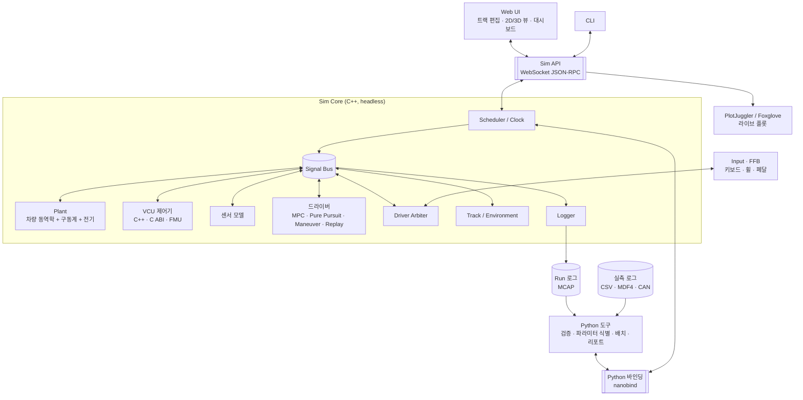
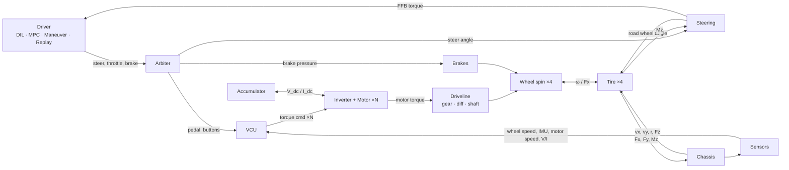
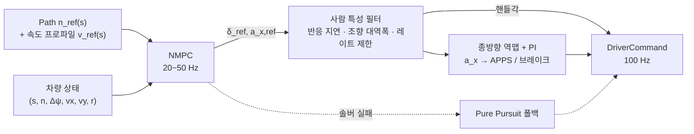

# 전기 포뮬러 차량 시뮬레이터 — 설계 문서

| 항목 | 내용 |
|---|---|
| 상태 | **Draft v0.2** (검토 대기) |
| 최종 수정 | 2026-10-21 |
| 초안 | Claude |
| 검토 | @tkdgusqkr-g |
| 관련 문서 | [차량 파라미터 요청 목록](vehicle_parameters.md) |

---

## 0. 이 문서 사용법 (리뷰 방식)

이 문서는 **사용자 수정 → Claude 검토 → 반영**을 반복하며 발전시킵니다.

- 모든 항목에 ID가 붙어 있습니다: 요구사항 `R-xx`, 비기능 요구사항 `N-xx`, 설계 결정 `D-xx`, 질문 `Q-xx`, 검증 케이스 `V-xx`.
  대화할 때 "D-07은 LTV-MPC로 가자"처럼 ID로 부르면 됩니다.
- 결정 상태: 🟢 확정 / 🟡 제안 (검토 필요) / 🔴 미정 (사용자 답변 필요)
- 수정 방법은 아래 중 편한 것을 쓰면 됩니다.
  1. 본문을 직접 고치기 (삭제, 추가, 수치 변경 모두 가능)
  2. 고치기 애매한 곳에 `> 💬 코멘트 내용` 남기기
  3. 채팅으로 "Q-13 답: ..."처럼 보내기
- 다음 라운드에서 Claude가 변경점(diff)을 검토하고, 반영 결과와 답변을 `> 🤖 ...`로 남긴 뒤 정리합니다.
- 변경 이력은 맨 아래 [§19](#19-변경-이력)에 기록합니다.

---

## 1. 요약 (TL;DR)

v0.2에서 제안하는 핵심 설계는 다음과 같습니다.

1. **최우선 목적은 차량 검증입니다.** 실측 로그와 시뮬레이션 비교(상관성), 테스트 케이스 판정, 파라미터 식별을 하나의 워크플로로 제공합니다 (§9).
2. **C++ 실시간 코어 + Python 도구층**으로 구성합니다. 시뮬레이션 루프 · 모델 · 드라이버 · 제어기 호스트는 C++이고, 검증 · 파라미터 식별 · 배치 · 리포트는 Python 바인딩으로 같은 코어를 씁니다. UI는 Web입니다.
3. **Headless 코어 + 단일 Sim API**: Web UI, CLI, Python 도구는 모두 같은 코어 기능의 클라이언트입니다.
4. **Plant와 이산 블록 분리**: 차량 동역학 · 구동계 · 전기 파워트레인은 강하게 결합되어 있으므로 하나의 연속계(Plant)로 함께 적분합니다. VCU · 드라이버 · 센서는 각자 주기를 갖는 이산 블록입니다.
5. **차량 모델 기본값은 2-track 7-DOF**입니다. 검증 정확도를 높이기 위해 14-DOF로 교체할 수 있게 설계합니다.
6. **구동계는 그래프로 정의**합니다. 모터 · 기어 · 디퍼렌셜 · 축 · 휠을 조합하므로 4WD 인휠(기본)부터 단일 모터 + 디퍼렌셜까지 한 구조로 다룹니다 (§6.1).
7. **전기 모델은 준정적(quasi-static) 수준**에서 시작합니다: 배터리 등가회로(ECM) + 모터/인버터 토크 envelope과 손실맵 + 집중 열모델.
8. **자동 드라이버는 MPC 기반 드라이버 모델**입니다 (acados NMPC). 경로와 속도를 추종하고, 반응 지연 · 조향 대역폭 같은 사람 특성을 설정할 수 있으며, 솔버가 실패하면 Pure Pursuit로 폴백합니다 (§8.5).
9. **드라이버는 공통 인터페이스 하나**(`DriverCommand`)로 통일합니다. DIL, MPC 드라이버, Maneuver(표준 시험용 스크립트 입력), Replay(실측 입력 재생 포함)가 모두 이 인터페이스를 출력합니다.
10. **트랙은 센터라인 + 좌우 폭**, **주행 라인은 센터라인 기준 횡방향 오프셋 n(s)**로 표현합니다. 실측 GPS 로그에서 트랙과 주행 라인을 재구성할 수 있습니다.

---

## 2. 목표와 범위

### 2.1 목적

4WD 인휠 전기 포뮬러 차량(다른 구동 토폴로지도 지원)의 **차량 검증**을 위한 시뮬레이터를 만듭니다.

- 차량 동역학 + 구동계 + 전기 파워트레인 + 제어(VCU)의 결합 시뮬레이션
- 실측 데이터와 비교해 **모델을 검증**하고, 검증된 모델로 **차량의 설계와 제어를 검증**
- 드라이버: 사람(DIL) 또는 MPC 드라이버 모델
- 트랙과 주행 경로 편집

### 2.2 사용 시나리오 (우선순위 순)

| ID | 시나리오 | 예시 |
|---|---|---|
| UC-1 | 모델 상관성 검증 | 실차 로그의 조향·페달 입력을 재생해서 시뮬레이션 응답(가속도, yaw rate, 휠속, 전압·전류)을 실측과 겹쳐 보고 오차 지표 계산 |
| UC-2 | 설계/성능 검증 | 기어비, 배터리 구성, 공력을 바꿨을 때 랩타임·에너지·온도 예측. 모터/배터리의 온도·전류 여유 확인 |
| UC-3 | 제어 검증 | TV/TC/회생 로직을 표준 시험(정상원선회, 스텝 조향 등)과 트랙 주행으로 판정 |
| UC-4 | 회귀 테스트 | 차량 파라미터나 제어 코드가 바뀔 때마다 테스트 스위트를 자동 실행하고 리포트 생성 |
| UC-5 | DIL 주행 | 드라이버가 휠/페달로 주행하며 제어 체감과 피드백 확인 |
| UC-6 | 트랙 설계/재구성 | 편집기나 GPS 로그로 트랙 생성 |
| UC-7 | VCU SIL | 실차 VCU 코드를 그대로 컴파일해 시뮬레이션에 연결 (→ Q-15) |

### 2.3 범위 밖 (v1 Non-goals)

- 대회 규정 준수 판정
- 사실적 그래픽, 사운드, 멀티플레이, 다중 차량
- 멀티바디 서스펜션 (K&C는 룩업 테이블로 근사)
- 인버터 스위칭 수준의 전기 시뮬레이션 (µs 단위)
- 카메라/LiDAR 센서 시뮬레이션 (→ Q-07)
- 모션 플랫폼
- AI 에이전트 연동 (Model Context Protocol). v0.1에서 "MCP"를 잘못 해석해 넣었던 항목이며, Sim API가 있으므로 필요하면 나중에 추가할 수 있음

---

## 3. 요구사항

### 3.1 기능 요구사항

**차량 동역학**

| ID | 요구사항 |
|---|---|
| R-01 | 차량 모델은 fidelity 단계별로 교체할 수 있어야 한다 (kinematic / single-track / 2-track 7-DOF / 14-DOF) |
| R-02 | 타이어는 Pacejka Magic Formula (combined slip)를 지원하고 `.tir` 파라미터 파일을 읽을 수 있어야 한다 |
| R-03 | 공력(Cl, Cd, 압력중심)을 반영하고, 다운포스가 하중 분배에 반영되어야 한다 |
| R-04 | 구동계는 모터 1~4개, 감속기, 디퍼렌셜(open / LSD / locked), 축 컴플라이언스를 조합해 정의할 수 있어야 한다. 기본값은 4WD 인휠 |

**전기 파워트레인**

| ID | 요구사항 |
|---|---|
| R-05 | 배터리: 등가회로 모델(OCV–R0–RC), SoC, 전압 강하, 온도 |
| R-06 | 인버터/모터: DC 전압에 따른 토크–속도 envelope, 효율(손실)맵, 열 디레이팅 |
| R-07 | 회생제동, 배터리 출력단 에너지 계량, 설정 가능한 출력 제한 |

**제어**

| ID | 요구사항 |
|---|---|
| R-08 | VCU 기능: 페달맵, 출력 제한, TC, TV, regen blending, launch control, 센서 plausibility |
| R-09 | 제어기 실행 방식 교체 가능: C++ 내장 / C 공유라이브러리 / FMU / 외부 프로세스 |
| R-10 | 센서 모델(지연, 노이즈, 양자화, 샘플링)을 켜고 끌 수 있어야 한다 |

**드라이버**

| ID | 요구사항 |
|---|---|
| R-11 | 모든 드라이버 소스는 공통 입력 인터페이스를 쓴다 (steer, throttle, brake, buttons) |
| R-12 | DIL: 키보드, 게임패드, 스티어링 휠/페달 입력 및 Force Feedback 출력 |
| R-13 | MPC 드라이버 모델: 경로·속도 추종, 사람 특성(반응 지연, 조향 대역폭, 공격성) 설정 |
| R-14 | 기본 드라이버(Pure Pursuit + PI): 디버깅과 MPC 폴백용 |
| R-15 | Replay: 기록된 입력 재생. 실측 로그의 입력 재생 포함 |
| R-16 | 드라이버 소스 혼합·전환 (예: 조향은 Maneuver, 속도는 PI 속도 유지) |
| R-34 | Maneuver 드라이버: 표준 시험용 스크립트 입력 (스텝, 램프, 사인, 사인 위드 드웰, 속도 유지) |

**트랙/경로**

| ID | 요구사항 |
|---|---|
| R-17 | 트랙 편집: 센터라인 control point, 좌우 폭, 콘, 출발/결승선, 섹터 |
| R-18 | 주행 경로(레이싱 라인) 편집 및 자동 생성 |
| R-19 | Import/Export: 센터라인 CSV, 콘 CSV, GPS 로그(lat/lon), 배경 이미지 트레이싱. GPS 로그에서 트랙과 주행 라인 재구성 |
| R-20 | 트랙 템플릿: 직선 가속, 원선회 패드, 8자, 슬라럼, 레인 체인지 |

**런타임/데이터**

| ID | 요구사항 |
|---|---|
| R-21 | 시간 모드: real-time / fast (최대 속도) / step (lockstep) |
| R-22 | 결정론적 재현: 같은 시나리오 + 같은 입력 → 같은 결과 |
| R-23 | 텔레메트리 로깅, 라이브 플롯, export (CSV / MAT / Parquet) |
| R-24 | 시나리오 파일 = 차량 + 트랙 + 드라이버 + 초기조건 + 종료조건 + 로깅 설정 |
| R-25 | 파라미터 sweep / 배치 실행 |

**검증 (신규)**

| ID | 요구사항 |
|---|---|
| R-26 | 실측 로그 import: 형식 어댑터 + 채널 매핑(이름, 단위, 오프셋, 필터) |
| R-27 | 상관성 비교: 시간/거리 기준 정렬, overlay 플롯, 오차 지표 (RMSE, 피크 오차, 상관계수, 위상 지연, 랩타임·에너지 차이) |
| R-28 | 서브시스템 분리 검증: 측정값을 경계 입력으로 넣고 특정 서브시스템만 검증 (예: 실측 모터 토크·속도 → 배터리 전압·전류·온도) |
| R-29 | 파라미터 식별: 선택한 파라미터를 실측에 맞게 최적화 |
| R-30 | 테스트 케이스: 시나리오 + 판정 기준 → pass/fail. 스위트 실행과 리포트 |
| R-31 | 표준 시험 라이브러리 (정상원선회, 스텝 조향, 주파수 응답, 레인 체인지 등) |
| R-32 | 추적성: 모든 run에 파라미터 해시, 시뮬레이터 버전(git commit), 입력 데이터 해시 기록 |
| R-33 | 불확실성: 파라미터 sweep, 몬테카를로 |

### 3.2 비기능 요구사항

| ID | 요구사항 | 목표치 (제안) |
|---|---|---|
| N-01 | Real-time 성능 | 물리 1 kHz, FFB 500 Hz~1 kHz, 렌더 ≥ 60 Hz, 입력→화면 지연 < 50 ms |
| N-02 | Fast 모드 성능 | L2 모델 + MPC 드라이버 포함 실시간의 ≥ 20배 (26분 주행 → 80초 이내) |
| N-03 | 플랫폼 | DIL은 Windows 10/11, 배치는 Linux도 지원 (→ Q-05) |
| N-04 | 단위/좌표계 | SI 단위, 각도는 내부 rad, ISO 8855 좌표계 |
| N-05 | 테스트 | 모델별 단위 테스트 + 검증 케이스(§5.5) + 결정론 회귀 테스트 |
| N-06 | 결정론 범위 | 같은 플랫폼·같은 빌드에서는 비트 단위 동일. 플랫폼이 다르면 허용 오차 기반 비교 (부동소수점 차이) |

---

## 4. 시스템 아키텍처

### 4.1 설계 원칙

| ID | 원칙 | 이유 |
|---|---|---|
| P-1 | **Headless 코어**: 시뮬레이션은 UI 없이 돈다 | 배치·검증·CI에서 그대로 사용 |
| P-2 | **하나의 코어 API, 여러 frontend** | Web UI, CLI, Python 도구가 같은 기능을 갖는다 |
| P-3 | **Plant는 연속계로 함께 적분, 나머지는 이산 블록** | 휠 회전–구동계–모터–타이어가 강하게 결합되어 있어서 분리 적분하면 불안정하다 |
| P-4 | **이름 기반 Signal Bus** | 모든 신호가 이름으로 노출되므로 로깅, 플롯, 상관성 비교, sweep이 추가 코드 없이 된다 |
| P-5 | **데이터 주도** | 차량/트랙/시나리오/테스트는 파일로 정의하고 코드 수정 없이 교체한다 |
| P-6 | **결정론** | 고정 스텝, 시드 고정, 입력은 sim time 기준으로 기록한다 |
| P-7 | **검증 가능성** | 모든 결과는 재현할 수 있어야 하고, 출처(파라미터·버전·입력)를 추적할 수 있어야 한다 |

### 4.2 구성도



### 4.3 한 스텝 안의 신호 흐름



### 4.4 구성요소와 언어 (D-05)

| 구성요소 | 언어 | 역할 |
|---|---|---|
| `vsim-core` | C++20 | 스케줄러, 모델, 드라이버(MPC 포함), 제어기 호스트, 입력/FFB, Sim API 서버, 로거 |
| `vsim` (Python 패키지) | Python + nanobind | 코어를 in-process로 실행(배치, fast), 검증·식별·리포트, 로그 변환 |
| `ui` | TypeScript | 트랙 편집기, 2D/3D 뷰, 대시보드 |
| MPC 코드 생성 | Python (CasADi) → acados C 코드 | 빌드 시 생성해서 코어에 링크 |
| MATLAB/Simulink (선택) | — | 제어기 FMU export, MAT 로그 분석 |

**실행 방식 두 가지**
- (a) **독립 실행** `vsim-core`: DIL, UI 연동, real-time
- (b) **Python 라이브러리로 로드**: 배치, 검증, 파라미터 식별. 프로세스 간 통신이 없어서 빠름

**스레드 구성 (real-time 모드)**
- 물리 스레드: 높은 우선순위, 1 kHz tick
- 입력/FFB 스레드: 500 Hz~1 kHz
- 네트워크 스레드: Sim API (비동기 I/O)
- 로거 스레드: lock-free 링버퍼 → 디스크

fast / step 모드는 단일 스레드로 돌려 결정론을 보장합니다.

**C++을 택한 이유 (Q-04 답변 반영)**

엄밀히는 Python + Numba로도 실시간은 가능합니다. 그래도 C++을 택한 이유는 다음과 같습니다.
- GC/GIL이 없어 타이밍이 예측 가능함 (FFB 1 kHz, 향후 HIL)
- 실차 VCU C 코드, acados 생성 코드, FMU를 같은 프로세스에서 직접 호출 가능
- 모델 fidelity가 올라가도(14-DOF + 열 + MPC 동시 실행) 성능 여유가 있음

대가는 개발 속도입니다. 그래서 분석·검증·리포트처럼 실시간이 필요 없는 부분은 Python 바인딩으로 Python에서 작성합니다.

---

## 5. 차량 동역학 모델

필요한 파라미터는 [vehicle_parameters.md](vehicle_parameters.md) §2~§8에 정리했습니다.

### 5.1 좌표계 / 명명

- 차량 좌표계 ISO 8855: x 전방, y 좌측, z 상방, yaw는 반시계 방향이 양수
- 지면 좌표계: ENU (트랙 원점 기준 local)
- 바퀴 인덱스: `fl`, `fr`, `rl`, `rr`

### 5.2 Fidelity 단계

| Level | 모델 | 상태 (DOF) | 용도 |
|---|---|---|---|
| L0 | Kinematic bicycle | x, y, ψ, v | 초기 골격(M0), 저속 |
| L1 | Dynamic single-track + 비선형 타이어 | vx, vy, r + 휠 2개 | 빠른 계산, **MPC 드라이버의 예측 모델** |
| **L2** | **Two-track 평면 + 준정적 하중 이동** | **vx, vy, r + 휠 4개 = 7 DOF** | **v1 기본값.** TV/TC 검증 가능 |
| L3 | 14-DOF (차체 6 + 비현가 상하 4 + 휠 회전 4) | 14 DOF | 롤/피치 과도 응답, 댐퍼·차고 채널 상관성 |

(모든 단계에 위치 x, y, ψ의 기구학 적분이 추가됩니다. 구동계 그래프에 따라 회전 자유도가 추가될 수 있습니다, §6.1.)

**D-02 제안: v1 기본 모델은 L2, 이후 L3를 추가합니다.**
- TV/TC 검증에는 바퀴별 슬립과 힘이 필요하므로 최소 two-track이어야 한다
- 포뮬러 차량은 서스펜션이 단단하고 롤이 작아서 준정적 하중 이동으로도 꽤 정확하다
- 다만 차량 검증이 목적이므로 댐퍼 변위, 피치, 차고 의존 공력 채널까지 상관성을 보려면 L3가 필요하다 → M7

### 5.3 L2 모델 상세

**하중 (Fz)**
- `Fz_i = 정적 하중 + 공력 다운포스(압력중심으로 앞뒤 분배) + 종방향 하중 이동 + 횡방향 하중 이동`
- 종방향: `ΔFz = m · ax · h_cg / L`
- 횡방향: 앞/뒤 롤 강성 비율로 분배하고, 롤센터 높이가 있으면 기하학적 하중 이동도 반영
- 가속도 → 하중 → 가속도의 algebraic loop는 **가속도에 1차 지연 필터를 넣어** 끊습니다 (서스펜션 동특성의 근사 역할도 함)

**타이어**
- Pacejka MF 6.1 (또는 5.2) combined slip, `.tir` 파일 로딩
- 단순 대안: 단순화 MF(B, C, D, E) + 마찰 타원 (파라미터가 부족할 때)
- **Relaxation length**(슬립의 1차 지연) 적용: 저속 수치 안정성과 과도 응답 현실성 확보
- 저속(약 1~2 m/s 이하)에서는 슬립 정의가 특이해지므로 저속 감쇠 블렌딩 적용
- 노면 μ 스케일: 구간별(surface zone) + 시나리오 전체

**휠 회전**
- `I_w · ω̇ = T_drive − T_brake − Fx · R_eff − T_roll`
- 구동 측 관성(모터 로터, 감속기)은 구동계 그래프가 반사 관성으로 합산 (§6.1)

**조향**
- 핸들각 → 바퀴 조향각: 좌/우 바퀴별 측정 테이블 (Ackermann 효과 포함) 또는 기어비 + Ackermann 비율
- 토(toe) 고정값, 조향 컴플라이언스는 v1에서 무시

**공력**
- `F_down = ½ ρ Cl A v²`, `F_drag = ½ ρ Cd A v²`, 압력중심 x 위치
- 차고/피치 민감도 맵은 L3 이후

**브레이크**
- 유압 → 바퀴별 토크 (전후 배분, 디스크 유효반경, 패드 μ), 1차 지연
- 휠 락은 타이어 모델이 자연스럽게 표현함
- 브레이크 온도는 후순위

**적분기 (D-12 관련)**

휠 회전 동역학은 저속에서 stiff합니다. 대략 계산해 보면:

```
고유값 λ ≈ C_κ · R² / (I_w · v)
대표값: C_κ ≈ 20,000 N, R ≈ 0.2 m, I_w ≈ 0.35 kg·m² (반사 관성 포함)
v = 1 m/s → λ ≈ 2,300 1/s
explicit Euler 안정 조건 dt < 2/λ ≈ 0.87 ms
RK4 안정 조건      dt < 2.8/λ ≈ 1.2 ms
```

따라서 **dt = 1 ms + RK4 + relaxation length + 저속 블렌딩**을 기본으로 제안하고, M1에서 정지 상태 출발과 정차 시나리오로 안정성을 검증합니다. 문제가 생기면 휠 회전만 sub-stepping하거나 semi-implicit 방식으로 바꿉니다.

### 5.4 L3 (후순위)

- 14-DOF, 서스펜션 K&C는 룩업 테이블 (캠버 게인, 롤센터 높이, 모션비)
- 비선형 댐퍼 커브, 안티롤바, 범프 스톱
- 차고/피치 의존 공력 맵
- 3D 트랙(고도, 뱅크)

### 5.5 모델 구현 검증 케이스

실측 상관성(§9) 이전에, 구현이 수식대로 동작하는지 확인하는 케이스입니다.

| ID | 케이스 | 기준 |
|---|---|---|
| V-01 | 저속 정상상태 선회 | 해석적 bicycle 모델의 understeer gradient와 비교 |
| V-02 | 직선 가속 0–75 m | 손 계산 (트랙션 한계 구간 → 출력 한계 구간)과 비교 |
| V-03 | 에너지 보존 | 배터리 출력 에너지 = 운동에너지 증가 + 손실 합 (오차 < 1%) |
| V-04 | 결정론 | 같은 시나리오 + 입력 → 로그가 비트 단위로 동일 |
| V-05 | 정지 출발/정차 | 저속에서 진동이나 발산 없음 |
| V-06 | 구동계 토폴로지 | 4WD 인휠과 단일 모터 + open diff에서 토크 분배·속도 구속이 해석해와 일치 |

---

## 6. 구동계 & 전기 파워트레인

필요한 파라미터는 [vehicle_parameters.md](vehicle_parameters.md) §9~§12에 정리했습니다.

### 6.1 구동계 그래프 (D-14)

모든 구동 토폴로지를 하나의 구조로 다루기 위해, 구동계를 요소의 연결 그래프로 정의합니다.

| 요소 | 파라미터 | 비고 |
|---|---|---|
| `motor` | 모터 모델 참조, 로터 관성 | §6.3 |
| `gear` | 감속비, 효율, 관성, (백래시) | |
| `diff` | 종류(open / lsd / locked), LSD: preload, 토크 감응 계수(ramp) | |
| `shaft` | 비틀림 강성, 감쇠 (선택) | 생략하면 강체 연결 |
| `wheel` | 코너(fl/fr/rl/rr) | 휠 관성은 차량 쪽 파라미터 |

**설정 예시**

```yaml
# 기본: 4WD 인휠
driveline:
  - {motor: m_fl, gear: {ratio: 14.0, eff: 0.97}, wheel: fl}
  - {motor: m_fr, gear: {ratio: 14.0, eff: 0.97}, wheel: fr}
  - {motor: m_rl, gear: {ratio: 14.0, eff: 0.97}, wheel: rl}
  - {motor: m_rr, gear: {ratio: 14.0, eff: 0.97}, wheel: rr}

# 다른 예: 단일 모터 + 후륜 LSD
driveline:
  - motor: m_rear
    gear: {ratio: 4.2, eff: 0.96}
    diff: {type: lsd, preload_nm: 20, ramp: 0.3}
    outputs:
      - {shaft: {k: 8000, c: 5}, wheel: rl}
      - {shaft: {k: 8000, c: 5}, wheel: rr}
```

**풀이 방법**
- 강체로 연결된 관성(로터 → 감속기 → 휠)은 하나의 자유도로 합칩니다 (반사 관성 `J · i²`).
- 디퍼렌셜은 속도 구속 `ω_carrier = (ω_L + ω_R) / 2`를 추가합니다.
  - open: 양쪽 토크가 같음
  - LSD: 속도차에 반대 방향으로 잠금 토크 `T_lock = preload + ramp · |T_in|`. 정지마찰 불연속은 smoothing(tanh)으로 처리
  - locked: `ω_L = ω_R`
- 축 컴플라이언스를 켜면 비틀림 상태가 추가됩니다 (stiff해지므로 기본은 강체).
- 로드 시 그래프에서 축약 좌표의 관성 행렬을 만들고, 매 스텝 작은 선형계(관성 8개 이하)를 풉니다.

**제어와의 연결**: TV 할당기는 그래프에서 "독립적으로 토크를 줄 수 있는 바퀴 그룹"을 자동으로 뽑아서 제약으로 씁니다. 4WD 인휠은 4개 바퀴 독립, 단일 모터 + open diff는 TV 불가로 판단됩니다.

### 6.2 Accumulator (배터리)

- **셀 등가회로**: `V_cell = OCV(SoC, T) − I·R0(SoC, T) − Σ V_RCi`, `dV_RCi/dt = −V_RCi/(R_i C_i) + I/C_i` (RC 1~2개)
- **팩**: 직렬 N_s × 병렬 N_p, 버스바·커넥터 등 팩 추가 저항 (v1은 셀 균일 가정, 셀 불균형은 후순위)
- **SoC**: 쿨롱 카운팅 `dSoC/dt = −I_pack / (3600 · Q_cell_Ah · N_p)`
- **열**: 집중 모델 `m·c·dT/dt = I²·R + RC 손실 − h·A·(T − T_amb)`
- **한계**: 셀 전압 상·하한, 방전/충전(회생) 전류 한계, 온도 → BMS 디레이팅 커브
  → `bat.lim.p_dis_max`, `bat.lim.p_chg_max` 신호로 내보내고 VCU가 준수
- **전력 algebraic loop 처리**: 요구 전력 P에 대해 `P = (OCV' − I·R0)·I`를 I에 대한 2차식으로 풀어 해를 구합니다 (`OCV'`는 RC 전압을 뺀 값). 판별식이 음수면 그 전력은 낼 수 없는 것이므로 한계로 처리합니다.
- **에너지 계량**: 배터리 출력단 `P = V_pack · I_pack`, 누적 에너지, 회생 에너지 별도 집계
- **보조 부하**: 냉각 펌프, LV 등은 상수 `P_aux`로 근사

### 6.3 인버터 + 모터

**Level A (v1 기본, 준정적) — D-03**
- 토크 명령 추종: 1차 지연(τ ≈ 1~5 ms) + 변화율 제한
- 토크 envelope `T_max(ω, V_dc)`: 정토크 영역 → 약계자(정출력) 영역. base speed는 V_dc에 비례해 스케일링하므로, 배터리 전압이 처지면 고속에서 토크가 줄어드는 현상이 표현됩니다.
- 손실: 모터 + 인버터 손실맵 `P_loss(T, ω, V_dc)` (또는 효율맵 η)
- `P_dc = T·ω + P_loss` (회생 시 T·ω < 0) → `I_dc = P_dc / V_dc` → 배터리로 전달
- 열: 권선 / 인버터 집중 열모델 → 디레이팅 커브
- 모터 개수와 배치는 구동계 그래프가 결정 (§6.1)

**Level B (후순위, 선택)**
- dq축 PMSM 모델 + FOC 전류 제어, multi-rate (10~20 kHz sub-stepping)
- 인버터 제어 검증이 목적일 때만 필요. 계산 비용이 큼

---

## 7. 제어 (VCU)

### 7.1 기능 파이프라인

1. **입력 처리**: APPS 2채널 plausibility, 브레이크 센서, 조향각
2. **드라이버 토크 요구**: 페달맵 `T_req_total = f(pedal, v)`, 브레이크 페달/리프트오프 회생
3. **상태 추정**: 차속 추정(휠속 + IMU), 바퀴별 슬립률. 후순위: 횡슬립각, μ 추정
4. **토크 벡터링**:
   - yaw rate 기준값 `r_ref = vx·δ / (L + K_us·vx²)`, 상한 `|r_ref| ≤ k·μ·g / vx`
   - yaw moment 명령: PI (v1) → LQR/MPC (후순위, §8.5의 acados 인프라 재사용 가능)
   - 토크 분배: 규칙 기반 (v1) → 제약 QP (모터 한계, Fz 가중 마찰 한계, 구동계 토폴로지 제약) (후순위)
5. **트랙션 컨트롤**: 바퀴별 목표 슬립률, PI로 토크 감소 (회생 시 ABS 유사 동작 포함)
6. **출력 제한**: `Σ P_elec ≤ min(설정 출력 한계, BMS 한계)`. 전기 출력은 모터 손실모델로 예측하고, 측정된 팩 전력으로 피드백 보정합니다.
7. **출력**: 모터별 토크 명령. 기계식 브레이크는 페달 직결이고, regen blending은 옵션입니다.
8. **안전 로직**: 센서 plausibility, Ready-to-Drive 상태 머신, 타임아웃 (실차 VCU의 로직을 재현하는 용도)

시뮬레이터 내장 VCU는 **참조 구현**입니다. 차량 검증 시에는 실차 VCU 로직을 SIL/FMU로 연결하는 것을 목표로 합니다 (→ Q-15).

### 7.2 제어기 실행 방식 (플러그인, R-09)

| 방식 | 설명 | 용도 |
|---|---|---|
| C++ 내장 | `Block` 인터페이스 구현 | 참조 구현, 알고리즘 실험 |
| C 공유라이브러리 (SIL) | 정해진 C ABI로 실차 VCU 코드를 컴파일 | 실차 코드 검증 |
| FMU (FMI 2.0/3.0 Co-Simulation) | Simulink / Modelica에서 export | MATLAB 사용 시 |
| External (UDP/CAN) | 별도 프로세스 또는 실제 ECU | HIL (후순위, → Q-17) |

C ABI 초안:

```c
typedef struct {
    double t;
    double apps[2], bse, steer_angle;
    double wheel_speed[4], motor_speed[4];
    double imu_ax, imu_ay, imu_yaw_rate;
    double v_dc, i_dc, p_dis_max, p_chg_max;
    /* 버튼, 모드 등 */
} VcuInputs;

typedef struct {
    double torque_cmd[4];
    int    status;   /* 비트 플래그: RTD, fault 등 */
} VcuOutputs;

int vcu_init(const char *param_json);
int vcu_step(const VcuInputs *in, VcuOutputs *out);
```

실차 코드는 CAN 신호를 입력으로 받으므로 adapter 계층에서 매핑합니다. 장기적으로는 신호 목록 하나에서 구조체를 생성하는 방식(single source of truth)을 고려합니다.

### 7.3 센서 모델 (R-10)

- 센서별 샘플링 주기, 지연, 가우시안 노이즈, 바이어스, 양자화, (dropout)
- 기본값은 꺼짐(이상적인 센서)으로 두고, 강건성 테스트와 실측 상관성 비교에서 켭니다

### 7.4 실행 주기

- VCU 기본 100 Hz (실차 VCU 주기에 맞춰 1 kHz까지 설정 가능), 출력은 zero-order hold

---

## 8. 드라이버 시스템

### 8.1 공통 인터페이스

```cpp
struct DriverCommand {
    double steer;      // 핸들각 [rad]
    double throttle;   // 0..1 (APPS)
    double brake;      // 0..1 → 페달맵으로 브레이크 압력 변환
    Buttons buttons;   // regen_level, tc_mode, tv_mode, launch, ready_to_drive
};
```

모든 소스는 이 형식만 출력하므로, **VCU 입장에서는 누가 운전하는지 구분할 수 없습니다.** 공정한 비교와 검증을 위한 의도적인 설계입니다.

### 8.2 드라이버 소스

| 소스 | 설명 | 주 용도 |
|---|---|---|
| DIL | 키보드, 게임패드, 휠/페달 (§8.4) | 사람 주행 |
| MPC | MPC 드라이버 모델 (§8.5) | 트랙 주행, closed-loop 상관성 |
| Pure Pursuit + PI | 단순 경로·속도 추종 (§8.6) | 디버깅, MPC 폴백 |
| Maneuver | 시간/거리 기반 스크립트 입력 + 속도 유지 (§8.6) | 표준 시험 |
| Replay | 기록된 입력 또는 실측 로그 입력 재생 | 재현, open-loop 상관성 |

### 8.3 Arbiter

- **채널별 소스 선택**: steer / longitudinal(throttle+brake) / buttons를 각각 다른 소스에서 받을 수 있음
  - 예: 스텝 조향 시험에서 조향은 Maneuver, 속도는 PI 속도 유지
- **Takeover**: 자동 주행 중 사람 입력이 임계값을 넘으면 사람에게 전환
- 전환 시 급변을 막기 위한 블렌딩

### 8.4 DIL (Driver-in-the-Loop)

**입력**
- SDL3 기반: 키보드, 게임패드, 휠/페달 축
- 장치별 매핑 프로필: 축 번호, 반전, 데드존, 캘리브레이션, 응답 커브. UI에 캘리브레이션 마법사 제공
- 키보드: 디지털 입력을 변화율 제한 램프로 아날로그화 (조향 속도, 센터 복귀, 속도 감응 조향 제한)

**Force Feedback**
- 핸들 토크 = (앞바퀴 Mz + 기계적 트레일 × Fy) / 조향비 × 게인 + 댐핑 + 마찰, 클리핑 및 저역통과 필터
- 전용 스레드에서 500 Hz~1 kHz로 갱신, SDL haptic의 constant force 효과로 출력
- 장치 호환성(G29/G923/Fanatec 등)은 초기에 실기 테스트 필요 → Q-08

**시각**
- 3D 추적 시점 / 콕핏 시점, HUD (속도, SoC, 출력, TC/TV 상태, 랩타임, 델타)
- 후순위: 이전 랩 또는 MPC 드라이버 고스트카

**성능**
- DIL 세션은 항상 real-time 모드
- 지연 예산: 입력 샘플 → 물리 → 렌더 < 50 ms (목표)

### 8.5 MPC 드라이버 모델 (D-07)

**목적** (→ Q-16)
- (a) **재현형**: 주어진 라인·속도를 사람처럼 따라감. 실측 주행과 closed-loop 비교에 사용
- (b) **한계 주행형**: 차량 한계까지 써서 랩타임 잠재력을 평가

**구조**



**문제 정의**
- 예측 모델: Frenet 좌표 dynamic single-track (L1). 상태 `s, n, Δψ, vx, vy, r, δ`, 입력 `δ̇, a_x`. 단순화 MF 타이어, 저속에서는 kinematic 블렌딩
- 비용: 횡오차 `n − n_ref(s)`, 헤딩 오차, 속도 오차 `v − v_ref(s)`, 입력 크기와 변화율
- 제약: 트랙 경계(여유폭 포함), 조향각·조향 속도, 마찰 타원 (예측 가속도 ≤ g-g 한계 × 공격성)
- 호라이즌 1.5~2 s, N = 30~40 (예측 간격 50 ms)

**솔버**
- **acados** (SQP-RTI + HPIPM): CasADi로 모델을 정의해서 C 코드를 생성하고 코어에 링크
- 대안: 선형화 LTV-MPC + OSQP (구현이 단순하지만 한계 주행 정확도가 낮음)

**설계 포인트**
- **드라이버의 내부 모델 ≠ Plant**: 내부 모델 파라미터는 차량 설정에서 자동 추정하되 따로 덮어쓸 수 있습니다. 실제 드라이버처럼 차량을 완벽히 "모르는" 상황을 재현할 수 있습니다.
- **종방향 출력**: MPC는 목표 가속도를 내고, 드라이버는 VCU 페달맵을 모른다는 가정 아래 공칭 역맵 + PI 보정으로 페달 값을 만듭니다. 그래서 VCU는 사람 입력과 같은 형태를 받습니다.
- **사람 특성**: 반응 지연(0~0.3 s), 신경근 대역폭(2차 필터), 미리보기 시간, 공격성(그립 사용률), 입력 노이즈
- **결정론**: fast/step 모드에서는 솔버를 동기 실행하고 반복 횟수를 고정(RTI)합니다. 결과가 실행 속도와 무관합니다.
- **실패 처리**: 솔버 실패나 불가해 시 해당 tick은 이전 해를 shift해서 쓰거나 Pure Pursuit로 폴백하고, 이벤트로 기록합니다.

**속도 프로파일 생성**
- 준정상상태(QSS) 방식: 경로 곡률 + 차량 g-g-v 한계(다운포스, 출력 한계 반영)로 forward/backward pass
- 실측 주행에서 추출한 속도 프로파일도 사용 가능 (closed-loop 상관성)

**확장 (후순위)**
- MPCC (Model Predictive Contouring Control, 진행도 최대화)로 최소 랩타임 주행

### 8.6 Pure Pursuit / Maneuver

- **Pure Pursuit + PI**: 속도 의존 lookahead, PI 속도 추종. 디버깅, M1의 기본 자동 주행, MPC 폴백
- **Maneuver**: 시간 또는 거리 기반 입력 프로파일 (스텝, 램프, 사인, 사인 스윕, 사인 위드 드웰) + PI 속도 유지. 표준 시험(§9.6)에 사용

---

## 9. 검증 워크플로 (V&V)

이 시뮬레이터의 최우선 목적입니다. 검증을 세 단계로 나눕니다.

| 단계 | 질문 | 방법 |
|---|---|---|
| 1. 구현 검증 | 코드가 수식대로 동작하는가? | 단위 테스트, 해석해 비교 (§5.5) |
| 2. 모델 검증 (상관성) | 모델이 실차를 충분히 재현하는가? | 실측 로그와 비교 (§9.2~§9.4) |
| 3. 차량 검증 | 검증된 모델로 볼 때, 차량의 설계·제어가 목표를 만족하는가? | 테스트 케이스 판정 (§9.5~§9.6) |

순서는 **서브시스템별 상관성 → 차량 전체 상관성 → 테스트 케이스 판정**입니다. 서브시스템부터 맞춰야 오차가 어디서 오는지 구분할 수 있습니다.

### 9.1 데이터 흐름

```text
실측 로그 ──(형식 어댑터 + 채널 매핑)──▶ 정규화 데이터셋 ─┐
                                                          ├─▶ 정렬 · 비교 · 지표 ──▶ 리포트
시나리오 ──(vsim-core, fast)──────────▶ 시뮬레이션 로그 ─┘          │
     ▲                                                              ▼
     └──────────── 파라미터 식별 (최적화 루프) ◀────────────── 오차 함수
```

### 9.2 실측 로그 import (R-26)

- **형식 어댑터**: CSV, MDF4 (asammdf), CAN 원시 로그 + DBC (cantools). 데이터로거 전용 형식은 CSV export를 경유 (→ Q-14)
- **채널 매핑 파일**: 실측 채널을 시뮬레이터 신호 이름으로 연결

```yaml
source: csv
time: {channel: "Time", unit: s}
map:
  drv.cmd.steer:     {channel: "Steering Angle", unit: deg, offset: -1.2}
  veh.imu.ay:        {channel: "G Lat", unit: g, filter: {lowpass_hz: 10}}
  pt.motor.fl.speed: {channel: "Inv FL Speed", unit: rpm}
  bat.v_pack:        {channel: "Pack Voltage", unit: V}
```

- 정규화 결과는 시뮬레이션 로그와 **같은 스키마**로 저장합니다. 그래서 같은 도구로 플롯하고 비교할 수 있습니다.

### 9.3 상관성 모드 (R-27, R-28)

| 모드 | 실측에서 가져오는 입력 | 비교 대상 | 용도 |
|---|---|---|---|
| 서브시스템: 파워트레인 | 모터 속도, 모터 토크 | V_dc, I_dc, SoC, 온도 | 배터리/모터/인버터 모델 검증 |
| 서브시스템: 차체·타이어 | 휠 토크(모터 토크 × 감속비), 조향각, 브레이크 압력 | ax, ay, r, 휠속 | 동역학 모델 검증 |
| 서브시스템: 제어기 | 실측 센서값 | 토크 명령 | 시뮬레이터 VCU(또는 SIL 코드)가 실차와 같은 명령을 내는지 |
| 차량 전체 open-loop | 조향각, APPS, 브레이크 | 전체 | 짧은 구간 (수 초~수십 초) |
| 차량 전체 closed-loop | 실측 주행 라인·속도 → MPC 드라이버가 추종 | 랩타임, 에너지, 온도 | 랩 단위 비교 |

- open-loop 재생은 위치 오차가 누적되어 긴 구간에서는 트랙을 벗어납니다. 그래서 랩 단위 비교는 closed-loop로 합니다.
- **정렬**: 시간 기준 또는 거리(s) 기준. 랩 비교는 거리 기준
- **지표**: RMSE, NRMSE, 피크 오차, 상관계수, 위상 지연(교차상관), 랩타임·에너지 차이
- **출력**: overlay 플롯 + 지표 표가 담긴 리포트

### 9.4 파라미터 식별 (R-29)

- 대상 파라미터와 범위를 지정하면 최적화(SciPy least_squares, CMA-ES 등)로 선택 구간의 오차를 최소화합니다. Python 바인딩으로 fast 모드를 반복 실행합니다.
- 권장 순서: 서브시스템 단위로 진행 (예: 배터리 R0/RC → 모터 손실 → 공력(코스트다운) → 타이어 스케일)
- 결과: 식별값, 민감도, 식별 전후 지표 비교 → 새 파라미터 세트 버전으로 저장
- 과적합 방지: 식별에 쓰지 않은 데이터로 교차 검증

### 9.5 테스트 케이스 (R-30)

```yaml
test: step_steer_60kph_tv_on
scenario:
  vehicle: data/vehicles/car_2026.yaml
  overrides: {control.tv.enabled: true}
  track: templates/flat_pad
  driver:
    steer: {maneuver: step, at_s: 2.0, amplitude_deg: 45, rate_dps: 400}
    longitudinal: {speed_hold_kph: 60}
  time: {mode: fast, t_end: 8}
checks:
  - name: 횡슬립각 제한
    expr: "max(abs(veh.chassis.beta)) < deg(6)"
  - name: yaw rate 응답 시간
    expr: "rise_time(veh.chassis.r, 0.1, 0.9) < 0.25"
  - name: 모터 온도 여유
    expr: "max(pt.motor.*.temp) < 120"
```

- 판정 함수: `max`, `min`, `mean`, `abs`, `rise_time`, `settle_time`, `overshoot`, `at(t)`, `window(t0, t1)` 등
- 스위트 실행 → Markdown/HTML 리포트 (pass/fail, 플롯, 지표, 추적 정보)
- CI 연동 가능: 파라미터나 제어 코드가 바뀌면 회귀 확인
- 테스트 러너와 판정은 Python, 시뮬레이션 실행은 C++ 코어 (D-16)

### 9.6 표준 시험 라이브러리 (R-31)

| 시험 | 참고 표준 | 확인 항목 |
|---|---|---|
| 정상 원선회 | ISO 4138 | understeer gradient, 한계 횡가속 |
| 스텝 조향 | ISO 7401 | yaw rate 응답 시간, 오버슈트 |
| 주파수 응답 (사인 스윕/랜덤) | ISO 7401 | yaw rate / ay 게인·위상 |
| 레인 체인지 | ISO 3888-1 / -2 | 안정성, 통과 속도 |
| 선회 중 제동 | ISO 7975 | 안정성 |
| 사인 위드 드웰 | FMVSS 126 계열 | 안정성 (TV/TC 검증) |
| 직진 가속 / 제동 | — | 0–75 m 시간, 정지거리, TC 슬립 |
| 코스트다운 | SAE J2263 계열 | 공력·구름저항 식별 |

표준은 절차를 참고하는 용도이며, 포뮬러 차량에 맞게 속도와 진폭을 조정합니다.

### 9.7 추적성과 불확실성 (R-32, R-33)

- run 메타데이터: 파라미터 세트 해시, 코어 버전(git commit), 시나리오, 입력 로그 해시, 생성 시각
- sweep / 몬테카를로 (파라미터 분포 지정, 예: μ ±5%, 질량 ±2%) → 결과 분포와 판정 통과 확률

---

## 10. 트랙 & 경로 편집

### 10.1 데이터 모델

```text
Track
  id, name, closed: bool
  centerline: [ControlPoint{x, y, z?, w_left, w_right, bank?}]
  interpolation: periodic_cubic_spline | catmull_rom | clothoid
  surface_zones: [{s_start, s_end, mu_scale, name}]
  cones: [{x, y, color: blue | yellow | orange | big_orange}]
  start_finish: s,  sectors: [s, ...]
  geo_ref: {lat0, lon0}                       # GPS import 시
  background: {image, m_per_px, offset, rot}  # 편집기 전용

Path (주행 라인)
  id, track_id, name
  offset: [n(s) control points]   # 센터라인 기준 횡방향 오프셋
  speed_profile?: v(s)            # 선택, 없으면 드라이버가 생성
```

**D-10 제안: 주행 라인을 Frenet 오프셋 n(s)로 저장**
- 트랙 센터라인을 고쳐도 라인이 따라 움직임
- `−w_right ≤ n ≤ w_left` 제약으로 트랙 경계 안에 자연스럽게 묶임
- MPC 드라이버의 Frenet 예측 모델, 최소 곡률 최적화(QP)와 형태가 같음

**런타임 표현**: Δs = 0.25~0.5 m로 재샘플링한 배열 `(s, x, y, ψ, κ, w_l, w_r)` + 차량 위치의 Frenet 투영 `(s, n)`
→ 랩 카운트, 코스 이탈 판정, 드라이버에 사용

**콘 처리**: v1은 **센터라인 우선**(센터라인과 폭을 편집하면 콘이 일정 간격으로 자동 생성)으로 제안합니다. 콘 배치에서 센터라인을 역산하는 방식은 후순위입니다 (→ Q-09).

### 10.2 GPS 로그에서 재구성 (검증용)

- 실측 GPS(lat/lon) → `geo_ref` 기준 ENU 변환 → 스무딩 → **주행 라인(Path)**으로 저장
- 트랙 경계를 얻는 방법:
  - (a) 콘이나 경계를 GPS로 측량
  - (b) 주행 라인 ± 기본 폭 가정
  - (c) 위성사진 배경 트레이싱
- 이렇게 만든 트랙과 주행 라인을 closed-loop 상관성(§9.3)에 사용합니다.

### 10.3 편집기 기능 (v1)

- 2D 탑뷰 캔버스: pan/zoom, 그리드, 축척
- Control point 추가 / 사이에 삽입 / 드래그 / 삭제 / 루프 닫기
- 점별 폭 핸들 (드래그 또는 숫자 입력)
- 곡률 색상 표시, 검증: 자기 교차, 경계 겹침, 최소 폭, 최소 회전반경
- 템플릿 (R-20): 직선 가속, 원선회 패드, 8자, 슬라럼, 레인 체인지
- 주행 라인: 오프셋 핸들 편집, 자동 생성(센터라인 / 최소 곡률, 후자는 후순위)
- Undo/Redo, 저장/불러오기
- 편집 연산은 command 패턴으로 구현 (UI, 스크립트, 향후 확장이 같은 연산과 undo 이력을 공유)
- 편집은 sim 일시정지 상태에서만 허용 (v1)

### 10.4 파일 형식

| 형식 | 용도 |
|---|---|
| `*.track.json` | 네이티브 포맷 (스키마 버전 포함) |
| CSV `x_m, y_m, w_tr_right_m, w_tr_left_m` | 센터라인 (TUMFTM racetrack-database 호환) |
| CSV `x, y, color` | 콘 맵 |
| CSV / GPX (lat, lon) | GPS 로그 → ENU 변환 |
| PNG / JPG + 축척 | 위성사진 배경 트레이싱 |

---

## 11. 시뮬레이션 코어 (런타임)

### 11.1 스케줄러와 시간

**주기 (기본값 제안, 모두 설정 가능)**

| 태스크 | 주기 | 비고 |
|---|---|---|
| Plant 적분 | 1 ms (RK4) | |
| 센서 | 센서별 | 지연 버퍼 포함 |
| VCU | 10 ms (100 Hz) | 1 ms까지 가능 |
| Driver | 10 ms | DIL은 최신 입력 샘플 |
| MPC 솔브 | 20~50 ms | Driver 태스크 안에서 실행, 사이 tick은 보간 |
| 로깅 | 10 ms (고속 신호는 1 ms 옵션) | |
| 상태 publish (UI) | 16.7 ms (60 Hz) | |
| FFB 출력 | 1~2 ms | 전용 스레드 |

**한 tick 안의 실행 순서 (결정론 보장용, 고정)**
1. 입력 소스 샘플링
2. 센서가 Plant 출력을 샘플링 (지연 버퍼 반영)
3. Driver 태스크 → `DriverCommand`
4. Arbiter
5. VCU 태스크 → 액추에이터 명령 (ZOH)
6. Plant를 tick 길이만큼 진행 (내부 1 ms 스텝)
7. 이벤트 처리 (랩 통과, 코스 이탈, 콘 충돌, 한계 초과, 솔버 실패)
8. 로깅, publish (주기가 된 경우)

**시간 모드 (R-21)**
- `realtime`: 벽시계에 맞춤 (고정 스텝 누적기 방식). 처리 시간이 넘치면 overrun을 기록하고, 옵션으로 슬로모션
- `fast`: 대기 없이 최대 속도
- `step`: API의 `step(n)` 호출 때만 진행 (디버깅, 외부 도구 연동)
- 런타임 중 모드 전환 가능

**결정론**: 입력은 벽시계가 아니라 sim time 기준으로 기록합니다. DIL 입력도 driver tick마다 샘플한 값을 저장하므로 replay가 정확히 재현됩니다.

### 11.2 블록 인터페이스

```cpp
// 연속계: 상태 → 미분. 적분기, MPC 모델 생성, FMU export에 재사용
class PlantModel {
public:
    virtual ~PlantModel() = default;
    virtual std::size_t state_size() const = 0;
    virtual void derivatives(double t, std::span<const double> x,
                             const PlantInputs& u, std::span<double> dx) const = 0;
    virtual void outputs(double t, std::span<const double> x,
                         const PlantInputs& u, SignalBus& bus) const = 0;
};

// 이산 블록: VCU, 드라이버, 센서 등
class Block {
public:
    virtual ~Block() = default;
    virtual std::string_view name() const = 0;
    virtual double period() const = 0;                 // [s]
    virtual void init(const ParamTree& p, Context& ctx) = 0;
    virtual void step(double t, SignalBus& bus) = 0;   // bus에서 읽고 bus에 씀
};
```

### 11.3 Signal Bus와 명명 규칙

- 형식: `<domain>.<component>.<signal>[.<corner>]`
  - 예: `veh.chassis.vx`, `veh.tire.fl.fz`, `pt.motor.rl.torque`, `bat.soc`, `ctrl.tv.yaw_ref`, `drv.cmd.steer`
- 신호 메타데이터: 단위, 설명, 주기
- 초기화 때 이름을 인덱스로 한 번 변환하고, 런타임에는 인덱스로 접근합니다 (문자열 검색 비용 없음)
- 로깅/조회 대상은 glob 패턴으로 선택 (예: `veh.tire.*.fz`)

### 11.4 파라미터 & 설정

- YAML + JSON Schema 검증 (UI와 Python 도구에서도 같은 스키마 사용)
- 레이어링: 기본 차량 → 차량 variant → 시나리오 override → 런타임 변경
- 파라미터 경로로 접근: `vehicle.aero.cl`, `control.tv.kp` (sweep, 식별에서 사용)
- 파라미터별 **런타임 변경 가능 여부** 플래그 (예: 질량은 reset 필요, 제어 게인은 즉시 반영)
- 파라미터 세트는 버전 관리하고 해시로 식별 (R-32)

### 11.5 시나리오 예시

```yaml
scenario: endurance_mpc_baseline
vehicle: data/vehicles/car_2026.yaml
overrides:
  control.tv.enabled: true
  control.power_limit_kw: 60
track: data/tracks/home_track.track.json
driver:
  steer: mpc
  longitudinal: mpc
  mpc: {path: measured_line_0412, aggressiveness: 0.9, reaction_delay_s: 0.15}
initial: {s: 0.0, v: 0.0, soc: 0.95}
environment: {ambient_temp_c: 25, mu_scale: 1.0}
time: {mode: fast, dt: 0.001}
stop: ["laps >= 20", "bat.soc < 0.05"]
logging: {signals: ["veh.*", "pt.*", "bat.*", "ctrl.*"], rate_hz: 100}
```

---

## 12. 시각화, UI, 데이터

### 12.1 Web UI (D-08)

- 트랙 편집기 (Canvas2D / SVG)
- 라이브 2D 맵: 차량 자세, 궤적, 경로
- 3D 뷰 (three.js): DIL용 추적/콕핏 시점 + HUD
- 대시보드: 주요 게이지, 실행 제어 버튼
- 3D 품질이나 지연이 부족하면 같은 상태 스트림을 구독하는 Godot / Unity 클라이언트로 교체 (API가 같으므로 코어 변경 없음)

### 12.2 텔레메트리 플롯

- 플로팅 도구를 직접 만들지 않고 기존 도구를 활용: **PlotJuggler**(오픈소스) 또는 **Foxglove** (둘 다 MCAP과 라이브 스트림 지원)
- 상관성 리포트의 overlay 플롯은 Python 도구가 생성 (§9.3)
- 오프라인 분석: Python 노트북, MATLAB (MAT export)

### 12.3 Run 산출물 (D-11)

```text
runs/2026-10-21T14-03-12_endurance_mpc_baseline/
  meta.json                # 파라미터 해시, git commit, 입력 해시, 시각
  scenario.resolved.yaml   # 모든 override가 적용된 최종 파라미터
  log.mcap                 # 시계열 (C++ 코어가 기록)
  events.jsonl             # 랩, 섹터, 한계 초과, fault, 모드 전환, 콘 충돌, 솔버 실패
  inputs.jsonl             # replay용 DriverCommand
  summary.json             # 랩타임, 에너지, 최대 출력, 최고 온도, 최저 SoC
```

Export (Python 도구): Parquet, CSV, MAT

---

## 13. 기술 스택 (제안)

| 영역 | 선택 | 비고 |
|---|---|---|
| 코어 | C++20, CMake | |
| 의존성 관리 | vcpkg | 대안 Conan |
| 수치 | Eigen | |
| MPC | acados + CasADi (모델 정의·코드 생성) | 대안 OSQP (LTV-MPC) |
| Python 바인딩 | nanobind | 대안 pybind11 |
| Sim API 서버 | WebSocket + JSON-RPC 2.0 | 라이브러리(IXWebSocket / uWebSockets / Boost.Beast)는 M0에서 결정 |
| 입력 / FFB | SDL3 | |
| FMU | FMI Library (fmilib) | |
| 설정 | YAML (rapidyaml 또는 yaml-cpp) + JSON Schema | |
| 로그 | MCAP (C++ header-only) | Python에서 Parquet/CSV/MAT 변환 |
| 테스트 | GoogleTest (C++), pytest (Python) | |
| Python 도구 | NumPy, pandas, SciPy, asammdf, cantools, matplotlib | |
| Web UI | TypeScript + Vite + three.js | |
| MATLAB/Simulink | 선택 | 제어기 FMU export, MAT 분석 |

---

## 14. 저장소 구조 (제안)

```text
vehicle_simulation/
├─ docs/
│  ├─ design.md
│  └─ vehicle_parameters.md
├─ core/                      # C++ 코어
│  ├─ include/vsim/
│  ├─ src/
│  │  ├─ sim/                 # scheduler, clock, bus, params, scenario
│  │  ├─ models/
│  │  │  ├─ vehicle/          # chassis, tire, aero, steering, brakes
│  │  │  ├─ driveline/        # 그래프, gear, diff, shaft
│  │  │  ├─ powertrain/       # battery, inverter, motor
│  │  │  └─ sensors/
│  │  ├─ control/             # VCU 참조 구현 + adapter (c_abi, fmu, external)
│  │  ├─ driver/              # mpc, pure_pursuit, maneuver, replay, dil, arbiter
│  │  ├─ track/               # 트랙 모델, spline, frenet, io, templates
│  │  ├─ api/                 # WebSocket JSON-RPC 서버
│  │  ├─ io/                  # 입력, FFB
│  │  └─ log/                 # MCAP 로거
│  ├─ apps/vsim-core/         # 독립 실행 파일
│  └─ tests/
├─ codegen/mpc/               # CasADi 모델 → acados C 코드 생성
├─ python/vsim/               # 바인딩 + 검증·식별·리포트 도구
├─ ui/                        # Web UI
├─ data/
│  ├─ vehicles/
│  ├─ tires/
│  ├─ tracks/
│  ├─ scenarios/
│  ├─ tests/                  # 테스트 케이스 (§9.5)
│  └─ mappings/               # 실측 채널 매핑 (§9.2)
└─ tools/
```

---

## 15. 마일스톤 (제안, 순서 조정 가능)

차량 검증이 최우선이므로 v0.1보다 검증 워크플로를 앞으로 당겼습니다.

| 단계 | 내용 | 완료 기준 |
|---|---|---|
| **M0** Walking skeleton | CMake 빌드, 스케줄러, bus, L0 kinematic, 키보드 입력, 2D 웹 뷰, MCAP 로깅, Python 바인딩 기본 | 키보드로 오벌을 돌고, 같은 시나리오를 Python에서 fast로 실행 |
| **M1** 차량 + 구동계 + 전기 v1 | L2 7-DOF, MF 타이어, 구동계 그래프, 파워트레인 Level A, 배터리 ECM, 기본 VCU, Pure Pursuit, Maneuver | V-01~V-06 통과 |
| **M2** 검증 워크플로 v1 | 로그 import + 채널 매핑, 서브시스템·open-loop 상관성, 지표·리포트, 테스트 케이스 러너, 표준 시험 일부 | 실측 로그 1개로 상관성 리포트 생성, 테스트 스위트 실행 |
| **M3** 트랙 v1 | 트랙 편집기, 템플릿, GPS 재구성, Frenet, 랩 타이밍 | 실측 GPS로 트랙과 주행 라인 재구성 |
| **M4** MPC 드라이버 + 식별 | acados NMPC 드라이버, 속도 프로파일, closed-loop 상관성, 파라미터 식별 v1 | 실측 랩과 closed-loop 비교 리포트, fast ≥ 20배 |
| **M5** DIL | 휠/페달(SDL3), FFB, 3D 뷰, HUD, real-time 튜닝 | 휠로 주행, 지연 < 50 ms |
| **M6** 제어 스위트 + SIL | TC, TV, regen blending, launch, C ABI / FMU 플러그인, 센서 모델 | 실차 VCU 코드로 테스트 스위트 실행 |
| **M7** 고충실도 | L3 14-DOF, 열 디레이팅 고도화, 불확실성 분석, 최소 곡률 라인 | 댐퍼·피치 채널 상관성 |

---

## 16. 리스크

| 리스크 | 영향 | 대응 |
|---|---|---|
| C++ 개발 속도 | 일정 | 실시간이 필요 없는 부분은 Python으로, 코어는 인터페이스를 먼저 고정 |
| acados의 Windows 빌드 | DIL에서 MPC 사용 | M0 직후 spike 테스트. 안 되면 LTV-MPC(OSQP) 또는 MPC는 Linux 배치 전용 |
| 실측 데이터 품질 (동기화, 센서 오프셋, 누락) | 상관성 신뢰도 | 채널 매핑에 오프셋·필터·시간 정렬 기능, 데이터 품질 검사 리포트 |
| 파라미터 식별 과적합 | 잘못된 모델 신뢰 | 교차 검증, 서브시스템 단위 식별 |
| 저속 타이어 수치 불안정 | 정지·출발 시 발산 | relaxation length, 저속 블렌딩, sub-step (§5.3) |
| 타이어 데이터 부재 | 정확도 | 대표값으로 시작, 실측으로 μ·강성 스케일 식별 |
| FFB 장치 호환성 | DIL 체감 | M5 초반 실기 spike 테스트 |
| 브라우저 3D 지연 | DIL 체감 | 측정 후 Godot 전환 옵션 |
| 범위 확장 | 일정 | fidelity 단계화, 마일스톤 완료 기준 엄수 |

---

## 17. 설계 결정 목록

| ID | 주제 | 제안 | 상태 |
|---|---|---|---|
| D-01 | 대상 차량 | 4WD 인휠 기본, 구동계 그래프로 모든 토폴로지 지원. 대회 규정은 범위 밖 | 🟢 |
| D-02 | 기본 차량 모델 | L2 (two-track 7-DOF + 준정적 하중 이동), L3는 M7 | 🟡 |
| D-03 | 모터/인버터 모델 | Level A: 준정적 envelope + 손실맵 + 집중 열모델 | 🟡 |
| D-04 | 배터리 모델 | ECM (R0 + RC 1~2개) + 집중 열모델 | 🟡 |
| D-05 | 언어 구성 | C++20 코어 + Python 도구(nanobind) + TypeScript UI. MATLAB은 선택 | 🟢 |
| D-06 | Sim API | WebSocket + JSON-RPC 2.0 (C++ 서버) | 🟡 |
| D-07 | 자동 드라이버 | MPC 드라이버 (acados NMPC, Frenet single-track), 폴백 Pure Pursuit | 🟡 Q-16 |
| D-08 | UI | Web (TypeScript + three.js), 3D 엔진은 M5에서 재평가 | 🟡 Q-10 |
| D-09 | 입력/FFB | SDL3, FFB 전용 스레드 | 🟡 Q-08 |
| D-10 | 트랙/경로 표현 | 센터라인 control point + periodic cubic spline + 폭, 주행 라인 = Frenet 오프셋 n(s) | 🟡 Q-09 |
| D-11 | 로그 형식 | MCAP (코어 기록) → Python에서 Parquet/CSV/MAT 변환 | 🟡 |
| D-12 | 적분/주기 | dt 1 ms, RK4, VCU 100 Hz 기본 | 🟡 |
| D-13 | 좌표계/단위 | ISO 8855, SI | 🟡 |
| D-14 | 구동계 | 요소 그래프 + 축약 좌표 풀이 | 🟡 |
| D-15 | 검증 워크플로 | 3단계 V&V, 서브시스템 우선 상관성, 테스트 케이스 YAML + 판정식 | 🟡 Q-13 |
| D-16 | 검증 도구 위치 | 테스트 러너·상관성·식별은 Python, 시뮬레이션 실행은 C++ 코어 | 🟡 |

---

## 18. 질문

### 18.1 답변 완료 (v0.2)

| ID | 질문 | 답변 | 반영 |
|---|---|---|---|
| Q-01 | 대상 대회/규정, 파라미터 확보 | 규정은 신경 쓰지 않음. 파라미터는 구할 수 있음 | 규정 항목 삭제, [파라미터 요청 목록](vehicle_parameters.md) 작성 |
| Q-02 | 구동 토폴로지 | 4WD 인휠. 모든 토폴로지를 커버하면 좋겠음 | D-01, D-14 (구동계 그래프) |
| Q-03 | 최우선 용도 | 차량 검증 | §9 검증 워크플로 신설, 마일스톤 재배치. 범위 구체화는 Q-13 |
| Q-04 | 언어 | 실시간을 위해 C++. 필요하면 전부 써도 됨 | D-05 (C++ 코어 + Python 도구) |
| Q-06 | "MCP"의 의미 | model based control | MPC(Model Predictive Control) 드라이버로 해석해서 §8.5 신설, Model Context Protocol 관련 내용 삭제 |

### 18.2 열린 질문

**우선순위 높음**

- **Q-13 "차량 검증"의 범위**: 아래 중 어디까지인가요? (복수 선택 가능)
  - (a) 시뮬레이션 모델이 실차와 맞는지 (상관성)
  - (b) 설계 성능 예측 (랩타임, 에너지, 온도)
  - (c) 제어/VCU 로직 검증 (SIL, 나아가 HIL)
  - (d) 부품 사양 여유 검증 (모터·배터리 전류, 온도 한계)
- **Q-14 실측 로그**: 어떤 로거를 쓰나요? (MoTeC, AiM, 자체 CAN 로거 등) 파일 형식, 채널 목록, 샘플링 주기는? 샘플 로그를 하나 공유할 수 있나요?
- **Q-15 VCU 코드 형태**: 직접 작성한 C인가요, Simulink 코드 생성인가요? 시뮬레이션에 실차 VCU 코드를 그대로 넣고 싶은가요?
- **Q-16 MPC 드라이버의 목적**: 실제 드라이버 재현, 한계 주행(최소 랩타임), 둘 다 중 어느 것인가요?
- **Q-17 HIL 계획**: 실제 VCU를 CAN으로 연결할 계획이 있나요? (있으면 Linux 실시간 커널 고려)

**그 외**

- **Q-05 OS**: DIL은 Windows인가요? 배치는 Linux에서도 돌리나요? (acados의 Windows 지원과 관련 있음)
- **Q-07 Driverless**: 자율주행까지 고려하나요? (콘 인식, 인지 센서 모델, steer-by-wire 필요)
- **Q-08 DIL 하드웨어**: 갖고 있는 휠/페달 기종은? FFB가 필수인가요? 모니터는 1대인가요, 3대인가요?
- **Q-09 "경로 편집"의 의미**: 트랙 레이아웃(콘/경계) 편집, 주행 라인 편집, 둘 다 중 어느 것인가요? 콘을 먼저 찍는 방식이 필요한가요?
- **Q-10 3D 그래픽 수준**: 단순한 박스 차량 + 콘 정도면 충분한가요?
- **Q-12 일정과 인원**: 언제까지 어디까지 필요한가요? 몇 명이 개발하나요?

(Q-11 타이어/검증 데이터 보유 여부는 [파라미터 요청 목록](vehicle_parameters.md)으로 통합)

---

## 19. 변경 이력

| 버전 | 날짜 | 내용 |
|---|---|---|
| v0.1 | 2026-10-21 | 초안 작성 (Claude) |
| v0.2 | 2026-10-21 | Q-01~Q-04, Q-06 답변 반영. 대회 규정 제거, 구동계 그래프(§6.1) 추가, C++ 코어 + Python 도구로 변경, MCP(Model Context Protocol) 해석을 MPC 드라이버(§8.5)로 정정, 검증 워크플로(§9) 신설, 요구사항 R-26~R-34 추가, 마일스톤 재배치, 파라미터 요청 목록 분리 |
