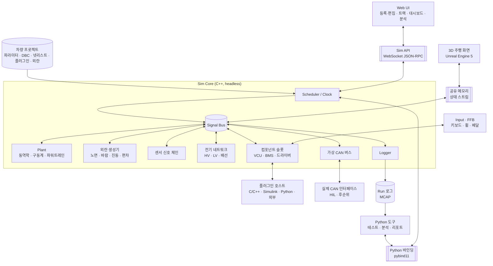
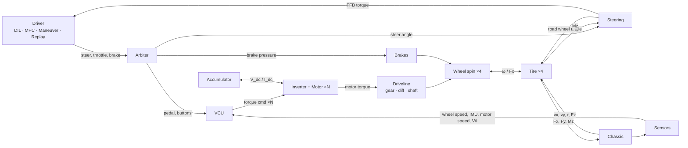
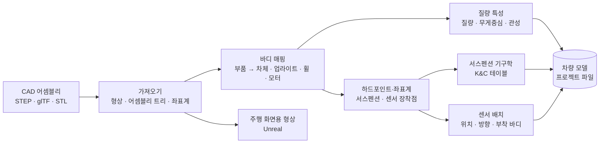
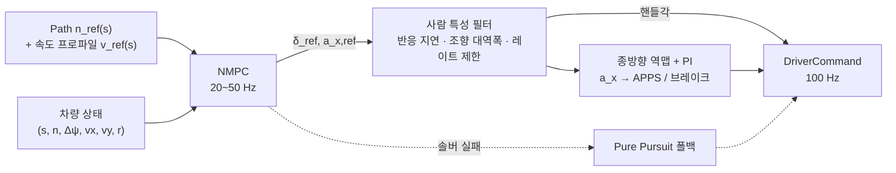
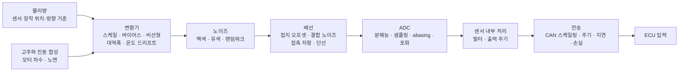

# 전기 포뮬러 차량 시뮬레이터 — 설계 문서

| 항목 | 내용 |
|---|---|
| 상태 | **Draft v1.3** (M6 구현 완료, Unreal 빌드·휠 느낌 확인 대기) |
| 최종 수정 | 2026-10-23 |
| 초안 | Claude |
| 검토 | @tkdgusqkr-g |
| 관련 문서 | [차량 파라미터 요청 목록](vehicle_parameters.md) |

**목차**: [0 사용법](#0-이-문서-사용법-리뷰-방식) · [1 요약](#1-요약-tldr) · [2 목표](#2-목표와-범위) · [3 요구사항](#3-요구사항) · [4 아키텍처](#4-시스템-아키텍처) · [5 차량 빌더](#5-차량-빌더-cad-기반-모델링) · [6 동역학](#6-차량-동역학-모델) · [7 구동계·파워트레인](#7-구동계--전기-파워트레인) · [8 제어](#8-제어-vcu) · [9 드라이버](#9-드라이버-시스템) · [10 실제 환경](#10-실제-환경-모델링-외란과-비이상성) · [11 플러그인](#11-플러그인--사용자-코드-통합) · [12 CAN·배선·기판](#12-전기-시스템-can-배선-기판) · [13 검증](#13-검증-워크플로-vv) · [14 트랙](#14-트랙--경로) · [15 런타임](#15-시뮬레이션-코어-런타임) · [16 UI](#16-ui-시각화-데이터) · [17 스택](#17-기술-스택-제안) · [18 저장소](#18-저장소와-차량-프로젝트-구조) · [19 로드맵](#19-로드맵-혼자-개발하는-기준) · [20 리스크](#20-리스크) · [21 결정](#21-설계-결정-목록) · [22 질문](#22-질문) · [23 이력](#23-변경-이력)

---

## 0. 이 문서 사용법 (리뷰 방식)

이 문서는 **사용자 수정 → Claude 검토 → 반영**을 반복하며 발전시킵니다.

- 모든 항목에 ID가 붙어 있습니다: 요구사항 `R-xx`, 비기능 요구사항 `N-xx`, 설계 결정 `D-xx`, 질문 `Q-xx`, 검증 케이스 `V-xx`, 현상 `PH-xx`.
  대화할 때 "PH-07을 제일 먼저 보고 싶다"처럼 ID로 부르면 됩니다.
- 결정 상태: 🟢 확정 / 🟡 제안 (검토 필요) / 🔴 미정 (사용자 답변 필요)
- 수정 방법은 아래 중 편한 것을 쓰면 됩니다.
  1. 본문을 직접 고치기 (삭제, 추가, 수치 변경 모두 가능)
  2. 고치기 애매한 곳에 `> 💬 코멘트 내용` 남기기
  3. 채팅으로 "Q-23 답: ..."처럼 보내기
- 다음 라운드에서 Claude가 변경점(diff)을 검토하고, 반영 결과와 답변을 `> 🤖 ...`로 남긴 뒤 정리합니다.
- 변경 이력은 맨 아래 [§23](#23-변경-이력)에 기록합니다.

---

## 1. 요약 (TL;DR)

**최종 목표: 실제와 동일한 가상 환경에서 풀카를 모델링해서, 실제 차량에서 생길 현상을 미리 확인한다.**

일반적인 차량 시뮬레이션은 이상적인 세계를 가정합니다. 노면은 평평하고, 센서는 참값을 바로 주고, 통신은 지연이 없습니다. 이 시뮬레이터는 반대로 **실제 환경의 외란과 센싱 외란, 전기·통신의 비이상성을 함께 모델링**합니다.

v0.6에서 제안하는 핵심 설계는 다음과 같습니다.

0. **차량은 CAD로 입력합니다** (§5). STEP 파일을 넣고 가져오기 마법사를 따라가면, 질량 특성, 서스펜션(형식까지 사용자가 설정), 센서 위치, 주행 화면의 차량 형상이 모두 같은 CAD에서 나옵니다. 시뮬레이터는 특정 실차에 묶이지 않고, 설계 단계의 차도 굴려볼 수 있습니다.
1. **외란은 물리적으로 발생하는 위치에서 주입합니다** (§10). 출력에 노이즈를 덧붙이는 대신, 노면 요철은 타이어 접지점에, 진동은 차체에, 장착 오차는 센서 위치에 넣습니다. 그래서 하나의 요철이 IMU 스파이크, 휠속 변동, 서스펜션 변위로 **동시에, 서로 연관되어** 나타납니다.
2. **센서 값은 신호 체인을 거쳐 만들어집니다**: 장착 위치의 물리량 → 변환기 오차 → 노이즈 → 배선 → ADC → 센서 내부 처리 → CAN 전송 → ECU (§10.5).
3. **모든 비이상성은 분류별로 켜고 끌 수 있고, 시드로 재현됩니다.** 그래서 어떤 현상이 어떤 외란 때문에 생겼는지 하나씩 분리해서 확인할 수 있습니다.
4. **차가 구르는 것부터, 디테일은 천천히** (§19). 가장 먼저 키보드로 몰 수 있는 차를 만들고, 마일스톤마다 차가 굴러가는 상태를 유지하면서 디테일 층을 하나씩 더합니다. 현상 카탈로그(§2.3)는 각 디테일 층이 제대로 들어갔는지 확인하는 기준입니다.
5. **C++ 실시간 코어 + Python 도구층**: 물리·외란·센서·CAN·전기는 C++, 테스트·분석·리포트는 Python입니다.
6. **차량 모델의 목표는 14-DOF**입니다. 노면 외란은 상하 운동이 있어야 의미가 있으므로, single-track(M0) → 2-track 7-DOF(M1) → 14-DOF(M5)로 단계적으로 올립니다.
7. **주행 화면은 Unreal Engine 5**로 만들어 아세토 코르사 수준의 그래픽을 목표로 합니다. 물리는 항상 C++ 코어가 계산합니다.
8. **사용자 코드는 슬롯에 끼웁니다**: C/C++, Simulink, Python, 외부 프로세스. Simulink는 명령 하나로 내보내기(`vsim_export`)가 되게 합니다 (§11.3).
9. **CAN 버스, DBC, 배선, 센서, 외란 프로파일은 모두 사용자가 UI에서 등록·편집**하고, 차량 프로젝트 폴더에 텍스트 파일로 저장합니다 (§18.2).
10. **혼자 개발하는 것을 전제로**, 있는 라이브러리는 최대한 가져다 쓰고 차별점(외란, 신호 체인, 전기·통신 통합, CAD 기반 모델링)에 집중합니다 (§19).

---

## 2. 목표와 범위

### 2.1 목적

4WD 인휠 전기 포뮬러 차량(다른 구동 토폴로지도 지원)의 **풀카 모델**을 만들고, **실제와 동일한 환경**에 놓아서 실제 차량에서 생길 현상을 미리 확인합니다.

- **차량 입력**: CAD 어셈블리로 차량·센서를 모델링 (§5). 시뮬레이터는 특정 실차와 무관
- **주행**: 사람(DIL, 아세토 코르사 수준 그래픽) 또는 MPC 드라이버
- **동역학**: 차체, 타이어, 서스펜션, 구동계
- **전기**: 배터리, 인버터, 모터, HV/LV 전기 네트워크, 배선, CAN 통신
- **제어**: 실차 제어 코드(Simulink, C/C++, Python)를 그대로 연결
- **실제 환경**: 노면·바람·기온 외란, 센싱 외란, 액추에이터·전기·통신 비이상성, 제작 편차
- **트랙**: 고도·뱅크·연석·노면 상태까지 포함한 3D 트랙 편집

### 2.2 사용 시나리오

| ID | 시나리오 | 예시 |
|---|---|---|
| UC-1 | 현상 사전 확인 | 실제 차량을 만들기 전에, 노면 요철에서 TC가 오작동하는지, 고출력 순간 LV 전압이 처지는지 확인 |
| UC-2 | 가상 주행 | 드라이버가 휠/페달로 주행하며 차량 거동과 제어 체감 확인 |
| UC-3 | 설계/성능 검증 | 기어비, 배터리 구성, 공력을 바꿨을 때 랩타임·에너지·온도 예측, 부품 여유 확인 |
| UC-4 | 제어 검증 | 실차 VCU 코드를 연결해서, 외란과 센서 오차가 있는 상태에서도 TV/TC/회생 로직이 동작하는지 판정 |
| UC-5 | 전기 시스템 검증 | CAN 부하·지연, 프리차지·셧다운, 배선 전압 강하, LV 전력 예산, 단선·단락 시 반응 |
| UC-6 | 원인 분리 | 외란을 하나씩 껐다 켜서 현상의 원인을 찾음 |
| UC-7 | 회귀 테스트 | 파라미터나 코드가 바뀔 때마다 테스트 스위트 자동 실행 |
| UC-8 | 실측 상관성 (선택) | 실측 데이터가 생기면 모델과 외란 크기를 실측에 맞춰 보정 |
| UC-9 | 설계 단계 비교 | 아직 만들지 않은 차를 CAD로 입력해서, 서스펜션 기하나 센서 위치를 바꿔 가며 비교 |

### 2.3 현상 카탈로그 (미리 확인하고 싶은 현상)

"풀카 모델링"이 구체적으로 무엇을 재현해야 하는지 정의하는 목록입니다. 로드맵(§19)은 "차가 구르는 것부터"(Q-23) 순서로 디테일 층을 쌓고, 각 층이 들어갔는지를 이 현상들로 확인합니다. 빠진 현상이 있으면 언제든 추가해 주세요.

| ID | 현상 | 필요한 모델 | 관련 외란·비이상성 |
|---|---|---|---|
| PH-01 | IMU 장착 위치·각도 오차와 중력 성분 때문에 TV의 yaw rate·횡가속 입력이 틀어짐 | L2+, 센서 체인 | 장착 오차, 차체 롤·피치, 노면 경사 |
| PH-02 | 노면 요철·연석에서 바퀴 하중이 출렁여 TC가 오작동 | L3, 노면 프로파일 | 노면 거칠기, 연석 |
| PH-03 | 저속에서 휠속 센서 펄스가 부족해 차속 추정이 틀어지고 launch control이 불안정 | 센서 체인 | 톱니 양자화, 저속 검출 한계 |
| PH-04 | 모터 토크 리플과 감속기 백래시로 구동계 진동(wheel hop) 발생 | 구동계 컴플라이언스, 모터 Level B | 토크 리플, 백래시 |
| PH-05 | 엔듀런스 중 배터리·모터 온도가 올라 디레이팅 → 랩타임 저하 | 열 모델 | 기온, 냉각 성능 |
| PH-06 | 셀 편차 때문에 최저 셀 전압이 먼저 한계에 닿아 출력 제한 | 셀 편차 모델 | 셀 용량·저항 편차 |
| PH-07 | 고출력 순간 LV 전압이 처져 ECU가 리셋 (brownout) | 전기 네트워크, ECU 전원 모델 | 배선 저항, DC-DC 응답, 부하 기동 |
| PH-08 | CAN 부하가 늘어 토크 명령이 늦거나 빠져 제어 성능 저하 | 가상 CAN | 버스 부하, 지터, 프레임 손실 |
| PH-09 | ECU 간 클록 차이로 메시지 위상이 흘러 간헐적 타임아웃 | 가상 CAN, ECU 타이밍 | 클록 드리프트, 태스크 지터 |
| PH-10 | 페달 센서 노이즈·접촉 불량 → APPS 불일치 판정 → 출력 차단 | 센서 체인, 전기 네트워크 | 노이즈, 접촉 저항, 단선 |
| PH-11 | 진동이 anti-aliasing 필터 없이 샘플링되어 저주파 오차로 나타남 | 센서 체인, 진동 합성 | 모터·노면 진동 스펙트럼 |
| PH-12 | 노면 μ가 고르지 않은 구간(먼지, 젖은 곳)에서 TC/TV 반응 | 노면 μ 맵 | μ 공간 분포 |
| PH-13 | 타이어 온도·공기압 변화로 첫 랩과 이후 랩의 그립이 다름 | 타이어 열 모델 | 기온, 노면 온도 |
| PH-14 | 회생 중 배터리 충전 한계(높은 SoC, 저온) → 회생 감소 → 제동감 변화 | 배터리 한계 | SoC, 온도 |
| PH-15 | 측풍·돌풍에서 고속 안정성 저하 | 공력 yaw 민감도 | 바람 |
| PH-16 | 프리차지 실패, 컨택터 채터링 | 전기 네트워크 | 저전압, 코일 전압 |
| PH-17 | 브레이크 온도에 따라 패드 μ와 제동 밸런스가 변함 | 브레이크 열 모델 | 온도 |
| PH-18 | GNSS 끊김·지연으로 위치 기반 로직 오류 | 센서 체인 | GNSS outage, 지연 |

### 2.4 범위 밖 (Non-goals)

- 대회 규정 준수 판정
- 멀티플레이, 다중 차량
- 멀티바디 서스펜션 해석 (K&C 룩업 테이블 기반 14-DOF로 근사. 부족하면 Project Chrono 같은 멀티바디 엔진 연동을 검토)
- 인버터 스위칭 수준의 전기 시뮬레이션 (µs 단위). 회로도 수준 연동은 §12.4 참고
- **기판 물리 해석** (레이아웃, 신호 무결성, EMI, 기판 발열): 전용 EDA 도구의 영역
- 카메라/LiDAR 센서 시뮬레이션 (→ Q-07)
- 모션 플랫폼
- AI 에이전트 연동 (Model Context Protocol). Sim API가 있으므로 필요하면 나중에 추가 가능

사운드(모터음, 타이어 스퀼)는 범위 밖에서 **후순위**로 옮겼습니다. 아세토 코르사 수준의 주행에서는 타이어 소리가 드라이버에게 그립 한계를 알려주는 중요한 피드백이기 때문입니다.

---

## 3. 요구사항

### 3.1 기능 요구사항

**차량 빌더 (신규, §5)**

| ID | 요구사항 |
|---|---|
| R-61 | CAD 어셈블리(STEP 권장, glTF/OBJ/STL)를 가져와서 형상, 어셈블리 트리, 이름 있는 좌표계·점을 읽는다. 좌표계 정렬을 지정할 수 있다 |
| R-62 | CAD 부품을 시뮬레이터 바디(차체, 업라이트, 휠, 모터 로터, 조향계)에 매핑하고, 바디별 질량·무게중심·관성을 계산한다. 실측값으로 덮어쓰고 차이를 보여준다 |
| R-63 | 서스펜션 형식은 사용자가 템플릿 또는 사용자 정의 링크로 설정하고, 일반 구속식 기반 기구학 해석기가 K&C 테이블을 만든다 |
| R-64 | 센서를 CAD 좌표계 / 3D 편집기 클릭 / 숫자 입력으로 배치한다. 부착 바디는 자동 지정, 센서 모델은 라이브러리에서 선택 |
| R-65 | CAD를 다시 가져와도 바디 매핑과 센서 배치가 부품 이름·ID 기준으로 유지된다 |
| R-66 | 같은 CAD 형상을 주행 화면(Unreal)에 쓰고, 바디 운동(휠 회전, 조향, 서스펜션)이 코어 상태로 구동된다 |
| R-67 | STEP을 넣으면 가져오기 마법사가 좌표계 정렬 → 바디 매핑 → 서스펜션 → 조향 → 구동계 → 센서 → 확인 순서로 안내한다 |

**차량 동역학**

| ID | 요구사항 |
|---|---|
| R-01 | 차량 모델은 fidelity 단계별로 교체할 수 있어야 한다 (kinematic / single-track / 2-track 7-DOF / 14-DOF) |
| R-02 | 타이어는 Pacejka Magic Formula (combined slip)를 지원하고 `.tir` 파라미터 파일을 읽을 수 있어야 한다. 타이어 열·공기압·마모 효과 |
| R-03 | 공력(Cl, Cd, 압력중심)을 반영하고, 다운포스가 하중 분배에 반영되어야 한다. 차고·피치·yaw 민감도 |
| R-04 | 구동계는 모터 1~4개, 감속기, 디퍼렌셜(open / LSD / locked), 축 컴플라이언스, 백래시를 조합해 정의할 수 있어야 한다. 기본값은 4WD 인휠 |

**전기 파워트레인**

| ID | 요구사항 |
|---|---|
| R-05 | 배터리: 등가회로 모델(OCV–R0–RC), SoC, 전압 강하, 온도, 셀 편차 |
| R-06 | 인버터/모터: DC 전압에 따른 토크–속도 envelope, 효율(손실)맵, 열 디레이팅, 토크 리플 |
| R-07 | 회생제동, 배터리 출력단 에너지 계량, 설정 가능한 출력 제한 |

**제어**

| ID | 요구사항 |
|---|---|
| R-08 | 참조 VCU: 페달맵, 출력 제한, TC, TV, regen blending, launch control, 센서 plausibility |
| R-09 | 제어기는 슬롯이며 사용자 코드로 교체할 수 있어야 한다 (§11) |

**드라이버**

| ID | 요구사항 |
|---|---|
| R-11 | 모든 드라이버 소스는 공통 입력 인터페이스를 쓴다 (steer, throttle, brake, buttons) |
| R-12 | DIL: 키보드, 게임패드, 스티어링 휠/페달 입력 및 Force Feedback 출력 |
| R-13 | MPC 드라이버: **추종 모드**(경로·속도 추종, 사람 특성 설정)와 **한계 주행 모드**(MPCC) |
| R-14 | 기본 드라이버(Pure Pursuit + PI): 디버깅과 MPC 폴백용 |
| R-15 | Replay: 기록된 입력 재생. 실측 로그의 입력 재생 포함 |
| R-16 | 드라이버 소스 혼합·전환 (예: 조향은 Maneuver, 속도는 PI 속도 유지) |
| R-34 | Maneuver 드라이버: 표준 시험용 스크립트 입력 (스텝, 램프, 사인, 사인 위드 드웰, 속도 유지) |

**실제 환경: 외란과 비이상성 (신규, §10)**

| ID | 요구사항 |
|---|---|
| R-46 | 환경 외란: 노면 거칠기(ISO 8608), 요철·연석, 노면 μ 공간 분포, 노면 온도, 바람(정상풍 + 돌풍), 기온·기압·습도 |
| R-47 | 외란은 물리적 발생 위치(타이어 접지점, 차체, 센서 장착점 등)에서 주입한다 |
| R-48 | 센서 신호 체인: 장착 위치·방향(차량 빌더에서 배치, §5.6), 변환기 오차, 노이즈, 배선, ADC, 센서 내부 처리, 전송 단계를 거쳐 ECU 입력을 만든다 |
| R-49 | 고주파 진동 합성: 물리 스텝보다 빠른 진동(모터 차수, 노면)을 스펙트럼으로 합성해서 센서에 전달 (aliasing 재현) |
| R-50 | 액추에이터 비이상성: 모터 토크 리플·응답 지연·정확도, 백래시, 브레이크 μ 변화, 조향 마찰·유격 |
| R-51 | ECU 비이상성: 클록 드리프트, 태스크 지터, 전원 전압 저하 시 리셋 |
| R-52 | 제작 편차: 질량 분포, 얼라인먼트, 셀 용량·저항 편차를 분포로 지정 |
| R-53 | 모든 비이상성은 분류별(환경 / 센서 / 액추에이터 / 전기 / 통신 / 편차)로 켜고 끌 수 있어야 하고, 시드로 재현되어야 한다 |
| R-54 | 외란 파라미터의 출처를 기록한다 (데이터시트 / 표준 스펙트럼 / 실측 식별) |

**플러그인 (§11)**

| ID | 요구사항 |
|---|---|
| R-35 | 모든 기능 블록(드라이버, VCU, BMS 로직, 센서, 배터리·모터 모델 등)은 슬롯이며, 기본 구현 또는 사용자 코드로 채울 수 있어야 한다 |
| R-36 | 지원 형식: C/C++ 공유라이브러리, FMU (FMI 2.0/3.0, Simulink·Modelica 등), Python, 외부 프로세스 |
| R-37 | 플러그인 포트는 Signal Bus 신호 또는 CAN 메시지에 연결할 수 있어야 한다. 단위를 선언하면 자동 변환 |
| R-38 | 플러그인 실행 시간을 측정하고, 실시간 모드에서 초과하면 경고한다 |
| R-55 | Simulink 모델은 명령 하나로 플러그인으로 내보내고 프로젝트에 등록할 수 있어야 한다 |

**전기 시스템 (§12)**

| ID | 요구사항 |
|---|---|
| R-39 | 가상 CAN: 여러 버스, DBC 기반 인코딩/디코딩, 노드(내장 모델 / 플러그인 / 실제 장치) |
| R-40 | CAN 충실도 단계: 이상적 전달 / 타이밍(전송 시간, 중재, 버스 부하) / 고장(프레임 손실, 지연, bus-off) |
| R-41 | 실제 CAN 인터페이스 연결 (Windows: PCAN-Basic, Kvaser, Vector XL / Linux: SocketCAN) (후순위) |
| R-56 | **CAN 버스, DBC, 노드, 신호 매핑을 사용자가 UI에서 등록·편집**할 수 있어야 한다. DBC는 import, 편집, export |
| R-42 | 전기 네트워크: HV/LV 회로를 넷리스트로 정의하고 해석 (전압 강하, 퓨즈, 릴레이·컨택터, 프리차지, 셧다운 회로) |
| R-57 | 전기 분석: 전선 굵기 검토(허용 전류, 전압 강하율), LV 전력 예산(부하별 소비), 프리차지·셧다운 시퀀스 검증 |
| R-43 | 고장 주입: 단선, 단락, 커넥터 저항 증가, 퓨즈 단선, 릴레이 고착, CAN 메시지 손실을 시나리오에서 지정 |
| R-44 | 회로도 수준 연동: SPICE 넷리스트(기판 회로)를 ngspice로 연동 (후순위, 실시간 아님) |
| R-45 | 가상 ECU: 실제 펌웨어 바이너리를 MCU 에뮬레이터로 실행하고 가상 CAN에 연결 (후순위) |

**트랙/경로**

| ID | 요구사항 |
|---|---|
| R-17 | 트랙 편집: 센터라인, 좌우 폭, **고도·뱅크**, 연석, 콘, 출발/결승선, 섹터 |
| R-18 | 주행 경로(레이싱 라인) 편집 및 자동 생성 |
| R-19 | Import/Export: 센터라인 CSV, 콘 CSV, GPS 데이터(lat/lon/alt), 배경 이미지 트레이싱 |
| R-20 | 트랙 템플릿: 직선 가속, 원선회 패드, 8자, 슬라럼, 레인 체인지 |
| R-58 | 노면 속성 편집: 구간별 거칠기 등급, μ, 국부 요철(범프, 포트홀) |

**런타임/데이터/UI**

| ID | 요구사항 |
|---|---|
| R-21 | 시간 모드: real-time / fast (최대 속도) / step (lockstep) |
| R-22 | 결정론적 재현: 같은 시나리오 + 같은 입력 + 같은 시드 → 같은 결과 |
| R-23 | 텔레메트리 로깅, 라이브 플롯, export (CSV / MAT / Parquet) |
| R-24 | 시나리오 파일 = 차량 프로젝트 + 트랙 + 드라이버 + 환경·외란 프로파일 + 초기조건 + 종료조건 + 고장 + 로깅 설정 |
| R-25 | 파라미터 sweep / 배치 실행 / 몬테카를로 |
| R-59 | 차량 프로젝트: 사용자가 등록한 모든 데이터를 한 폴더에 텍스트 파일로 저장 (git으로 이력 관리 가능) |

**검증**

| ID | 요구사항 |
|---|---|
| R-30 | 테스트 케이스: 시나리오 + 판정 기준 → pass/fail. 스위트 실행과 리포트 |
| R-31 | 표준 시험 라이브러리 (정상원선회, 스텝 조향, 주파수 응답, 레인 체인지 등) |
| R-32 | 추적성: 모든 run에 파라미터 해시, 시뮬레이터 버전, 플러그인 버전, 시드, 입력 데이터 해시 기록 |
| R-60 | 현상 탐지: run에서 진동(스펙트럼 피크), 리셋, 타임아웃, 한계 초과 같은 현상을 자동으로 찾아 리포트 |
| R-26~R-29 | (선택) 실측 로그 import, 상관성 비교, 서브시스템 분리 상관성, 파라미터·외란 식별 |

### 3.2 비기능 요구사항

| ID | 요구사항 | 목표치 (제안) |
|---|---|---|
| N-01 | Real-time 성능 | 물리 1 kHz, FFB 500 Hz~1 kHz, 렌더 ≥ 60 Hz, 입력→화면 지연 < 50 ms |
| N-02 | Fast 모드 성능 | L3 + 외란 + MPC 드라이버 포함 실시간의 ≥ 10배. 전기 네트워크·CAN 타이밍 포함 시 별도 측정 |
| N-03 | 플랫폼 | **Windows 10/11이 기본** (개발, 주행, 배치 모두). 코어는 크로스플랫폼 코드로 유지해서 Linux 빌드(CI, 서버 배치)도 가능하게 함 |
| N-04 | 단위/좌표계 | SI 단위, 각도는 내부 rad, ISO 8855 좌표계 |
| N-05 | 테스트 | 모델별 단위 테스트 + 검증 케이스(§6.5) + 결정론 회귀 테스트 |
| N-06 | 결정론 범위 | 같은 플랫폼·같은 빌드·같은 플러그인·같은 시드에서는 비트 단위 동일. 플랫폼이 다르면 허용 오차 기반 비교 |

---

## 4. 시스템 아키텍처

### 4.1 설계 원칙

| ID | 원칙 | 이유 |
|---|---|---|
| P-1 | **Headless 코어**: 시뮬레이션은 UI 없이 돈다 | 배치·테스트·CI에서 그대로 사용 |
| P-2 | **하나의 코어 API, 여러 frontend** | Web UI, 3D 주행 화면, CLI, Python 도구가 같은 기능을 쓴다 |
| P-3 | **Plant는 연속계로 함께 적분, 나머지는 이산 블록** | 휠 회전–구동계–모터–타이어가 강하게 결합되어 있어서 분리 적분하면 불안정하다 |
| P-4 | **이름 기반 Signal Bus** | 모든 신호가 이름으로 노출되므로 로깅, 플롯, 플러그인 연결, sweep이 추가 코드 없이 된다 |
| P-5 | **데이터 주도** | 차량·센서·CAN·배선·외란·플러그인 연결은 파일로 정의하고 코드 수정 없이 교체한다 |
| P-6 | **결정론** | 고정 스텝, 외란 소스별 시드, 입력은 sim time 기준으로 기록한다 |
| P-7 | **검증 가능성** | 모든 결과는 재현할 수 있어야 하고, 출처(파라미터·버전·시드·입력)를 추적할 수 있어야 한다 |
| P-8 | **슬롯 기반 확장** | 기본 구현과 사용자 코드가 같은 인터페이스를 쓴다 |
| P-9 | **외란은 물리적 발생 위치에서 주입** | 하나의 원인이 여러 센서·신호에 서로 연관된 형태로 나타나야 실제와 같다. 출력에 독립 노이즈를 덧붙이면 이 상관관계가 사라진다 |
| P-10 | **측정값은 신호 체인을 거친다** | ECU는 참값이 아니라 센서·배선·ADC·통신을 거친 값을 받는다 |
| P-11 | **이상 ↔ 실제를 분류별로 전환** | 외란을 하나씩 켜고 끄며 현상의 원인을 분리할 수 있어야 한다 |
| P-12 | **사용자가 등록, 코드는 그대로** | CAN·DBC·센서·배선·외란은 UI에서 등록하고, 시뮬레이터 코드는 차량별로 바꾸지 않는다 |

### 4.2 구성도



### 4.3 한 스텝 안의 신호 흐름 (물리 계층)



이 그림은 이상적인 경우의 흐름입니다. 실제 환경 모드에서는 다음이 더해집니다.
- 노면 외란이 타이어 접지점으로, 바람이 공력으로 들어갑니다 (§10.2).
- `Sensors → VCU` 경로는 신호 체인(§10.5)을 거칩니다.
- `VCU ↔ 인버터 / BMS`는 가상 CAN(§12.2)을, `배터리 ↔ 인버터`는 전기 네트워크(§12.3)를 거칩니다.

### 4.4 구성요소와 언어 (D-05)

| 구성요소 | 언어 | 역할 |
|---|---|---|
| `vsim-core` | C++20 | 스케줄러, 모델, 외란 생성기, 센서 신호 체인, 드라이버(MPC 포함), 플러그인 호스트, 가상 CAN, 전기 네트워크, 입력/FFB, Sim API 서버, 로거 |
| `vsim` (Python 패키지) | Python + pybind11 | 코어를 in-process로 실행(배치, fast), 테스트·분석·리포트, 로그 변환, Python 플러그인 SDK |
| `ui` | TypeScript (React) | 등록·편집 화면, 트랙 편집기, 대시보드, 분석 화면 |
| `viewer` | Unreal Engine 5 (C++) | 3D 주행 화면 (렌더링·HUD·사운드, 물리 없음) |
| MPC 코드 생성 | Python (CasADi) → acados C 코드 | 빌드 시 생성해서 코어에 링크 |
| `sdk/simulink` | MATLAB | `vsim_export` 내보내기 도구, 신호 라이브러리 |
| 사용자 플러그인 | C/C++, Simulink, Python 등 | §11 |

**실행 방식 두 가지**
- (a) **독립 실행** `vsim-core`: DIL, UI 연동, real-time. Python 플러그인이 있으면 인터프리터를 내장해서 실행
- (b) **Python 라이브러리로 로드**: 배치, 테스트, 분석. 프로세스 간 통신이 없어서 빠름

**스레드 구성 (real-time 모드)**
- 물리 스레드: 높은 우선순위, 1 kHz tick (외란·센서·플러그인 호출 포함)
- 입력/FFB 스레드: 500 Hz~1 kHz
- 네트워크 스레드: Sim API (비동기 I/O)
- 로거 스레드: lock-free 링버퍼 → 디스크

fast / step 모드는 단일 스레드로 돌려 결정론을 보장합니다.

**C++을 택한 이유**
- GC/GIL이 없어 타이밍이 예측 가능함 (FFB 1 kHz, 향후 HIL)
- C/C++ 코드, Simulink 생성 코드, FMU, acados 생성 코드를 같은 프로세스에서 직접 호출 가능
- 14-DOF + 외란 + 센서 체인 + 전기 네트워크 + MPC를 동시에 돌려도 성능 여유가 있음
- 대가는 개발 속도이므로, 실시간이 필요 없는 테스트·분석·리포트는 Python으로 작성

---

## 5. 차량 빌더: CAD 기반 모델링

Q-24 답변에 따라, 차량과 센서는 사용자가 **CAD로 입력해서** 시뮬레이터에 모델링합니다. 시뮬레이터는 특정 실차에 묶이지 않고(Q-25), 실차를 만들기 전 설계 단계에서도 CAD만 있으면 그 차를 굴려볼 수 있습니다.

### 5.1 흐름 (D-25)



**CAD 하나가 단일 출처**입니다. 질량 특성, 서스펜션 기하, 센서 위치, 주행 화면의 차량 형상이 모두 같은 CAD에서 나오므로, CAD를 고치면 시뮬레이션 전체가 함께 바뀝니다. 준비할 CAD 데이터는 [vehicle_parameters.md](vehicle_parameters.md) §0에 정리했습니다.

### 5.2 CAD 가져오기

- **형식**: STEP(AP203 / AP214 / AP242) 권장. 대부분의 CAD(SolidWorks, CATIA, NX, Fusion 360, Inventor 등)에서 내보낼 수 있습니다. glTF / OBJ / STL(형상만)도 지원합니다.
- **처리**: OpenCASCADE 기반 Python 도구가 오프라인으로 처리합니다 (실시간이 필요 없는 전처리).
  - 어셈블리 트리, 부품별 형상, 재질·밀도(있으면), 이름 있는 좌표계·점
  - 웹 3D 편집기와 Unreal용 메시(glTF) 생성
- **좌표계 정렬**: CAD마다 원점과 축 방향이 다릅니다 (예: Y가 위). UI에서 기준점과 축을 지정하면 시뮬레이터 좌표계(ISO 8855)로 변환합니다.
- **다시 가져오기**: CAD가 바뀌면 다시 가져옵니다. 바디 매핑과 센서 배치는 부품 이름·ID 기준으로 유지되고, 사라진 부품은 경고합니다.

### 5.3 바디 매핑

시뮬레이터의 강체(바디)에 CAD 부품을 할당합니다.

| 바디 | 예 |
|---|---|
| `chassis` (현가 질량) | 프레임, 바디워크, 배터리 팩, 드라이버 |
| `upright_fl` ~ `upright_rr` (비현가 질량) | 업라이트, 허브, 브레이크 캘리퍼, 인휠 모터 고정자 |
| `wheel_fl` ~ `wheel_rr` (회전) | 림, 타이어, 디스크 |
| `motor_rotor_*` (회전) | 모터 로터 (관성은 감속비로 반사) |
| `steering` | 핸들, 칼럼, 랙 |

- 이름 규칙으로 자동 할당(예: `FL_UPRIGHT*` → `upright_fl`)하고, 나머지는 UI에서 드래그로 할당
- 서스펜션 링크(위시본, 푸시로드)처럼 양쪽에 걸친 부품은 질량을 현가/비현가로 나누는 규칙 적용 (기본 절반씩)
- 드라이버: CAD에 마네킹이 있으면 그것을 쓰고, 없으면 질량과 무게중심을 직접 입력

### 5.4 질량 특성

- 바디별 질량, 무게중심, 관성 텐서를 부품 합으로 계산합니다 (평행축 정리).
- **출처 우선순위**: 실측값 > CAD 프로그램이 계산한 질량 특성 > 형상 × 밀도 계산
- CAD에는 보통 배선, 볼트, 냉각수, 접착제 같은 질량이 빠져 있습니다. 실측값(코너 웨이트 등)이 있으면 차이를 보여 주고, 차이를 "미분류 질량"으로 추가해서 맞출 수 있습니다.
- 결과는 차량 동역학 파라미터(§6)로 자동 전달됩니다.

### 5.5 서스펜션 정의와 기구학 (D-27)

Q-27 답변에 따라, 서스펜션 형식은 시뮬레이터에 고정하지 않고 **STEP을 넣은 뒤 사용자가 설정**합니다.

**정의 방식 두 가지**

| 방식 | 내용 | 용도 |
|---|---|---|
| **템플릿** | 형식을 고르면 필요한 하드포인트 목록이 나오고, CAD에서 각 점을 지정 | 흔한 형식을 빠르게 |
| **사용자 정의 링크** | 링크(강체), 조인트(구면·회전·유니버설·슬라이더), 스프링·댐퍼, 로커, 안티롤바를 직접 연결 | 템플릿에 없는 형식, 특이한 로커·ARB 배치 |

템플릿 목록(초안): 더블 위시본 + 푸시로드 / 풀로드 / 아웃보드 댐퍼, 맥퍼슨 스트럿, 멀티링크(5링크). 템플릿도 내부적으로는 사용자 정의 링크로 저장되므로, 템플릿으로 시작해서 일부만 고칠 수도 있습니다.

```yaml
# projects/my_car_2026/builder/suspension_front.yaml (빌더가 생성)
template: double_wishbone_pushrod      # 사용자 정의면 template 없이 links/joints만
side: left                             # 오른쪽은 대칭 생성 (비대칭이면 따로 정의)
points:                                # CAD에서 지정한 점 (차량 좌표계, m)
  uca_front:  {cad_point: FL_UCA_F}    # CAD 이름 있는 점
  uca_rear:   {pick: [0.120, 0.265, 0.310]}   # 3D 편집기에서 찍은 점
  uca_outer:  {pick_sphere_center: part/FL_UPRIGHT/face_42}   # 볼조인트 구면 중심 자동 계산
  # ... lca_*, tie_rod_*, pushrod_*, rocker_*, damper_*, arb_*
links:
  rocker: {pivot_axis: [rocker_pivot_a, rocker_pivot_b], parts: [FL_ROCKER]}   # 질량은 CAD 부품에서
```

**하드포인트 지정**
- 3D 편집기에서 CAD 형상 클릭. 볼조인트의 구면이나 베어링 구멍(원통)을 클릭하면 중심점이나 축을 자동으로 계산
- CAD의 이름 있는 점·좌표계 자동 매칭
- 숫자 입력
- 링크에 CAD 부품을 연결하면 링크 질량도 CAD에서 가져옴 (현가/비현가 질량 분배에 사용, §5.3)

**기구학 해석기** (오프라인, Python)
- **일반 구속식 기반**: 각 링크의 위치·자세를 미지수로, 조인트를 구속식으로 두고 Newton–Raphson으로 풉니다. 형식과 무관하게 같은 해석기가 동작합니다.
- 입력: 휠 스트로크(범프/리바운드), 랙 이동(조향), 롤
- 출력 K&C 테이블: 캠버 게인, 토 변화(범프 스티어), 롤센터 높이, 모션비(스프링·댐퍼·ARB), anti-dive / anti-squat, 캐스터·킹핀·스크럽·트레일, 조향 Ackermann
- 결과는 L3 모델(§6.4)과 FFB(§9.4)의 입력이 됩니다.
- **확인 도구**: 스트로크·조향을 움직이는 3D 애니메이션, K&C 그래프, 구속 잔차, 특이 자세(링크가 일직선) 경고, 링크 간 간섭 검사(선택)
- 부싱 컴플라이언스는 범위 밖이며, 필요하면 테이블로 직접 입력합니다.
- 후순위: 기구학을 테이블 대신 주행 중에 직접 푸는 방식(멀티바디화). 지금은 범위 밖이지만, 같은 링크 정의를 그대로 쓸 수 있게 저장 형식을 설계합니다.

### 5.6 센서 배치 (Q-24)

센서는 차량을 모델링할 때 사용자가 직접 넣습니다. 세 가지 방법을 지원합니다.

| 방법 | 내용 | 장점 |
|---|---|---|
| **1. CAD 좌표계** | CAD에서 센서 장착 위치에 이름 있는 좌표계를 만들면(예: `SENSOR_IMU_MAIN`) 가져올 때 자동으로 센서 후보가 됨 | 위치·방향이 정확하고, CAD가 바뀌면 같이 바뀜 |
| **2. 3D 편집기에서 찍기** | 웹 3D 편집기에서 차량 형상의 표면을 클릭 → 위치와 표면 방향을 잡고, 회전·오프셋을 미세 조정 | 빠름, CAD를 고치지 않아도 됨 |
| **3. 숫자 입력** | 좌표와 각도를 직접 입력 | CAD가 없을 때 |

- **부착 바디 자동 지정**: 센서는 찍은 부품이 속한 바디에 붙습니다. 그 바디의 운동을 측정하므로, 업라이트의 가속도계는 비현가 운동을, 차체 IMU는 차체 운동을 측정합니다.
- **센서 모델 라이브러리**: 센서 제품(데이터시트 값)을 한 번 정의하고 여러 위치에 배치합니다. 라이브러리는 프로젝트 간에 공유할 수 있습니다.
- **장착 각도 vs 장착 오차**: 의도한 장착 각도는 CAD에서, 실제 조립 시 생기는 오차는 제작 편차 분포(§10.3)로 지정합니다.
- 배치 결과는 센서 신호 체인(§10.5)의 첫 단계("장착 위치 기준 물리량")로 바로 쓰입니다.

### 5.7 그 밖의 배치 항목 (후순위)

- 배터리 팩·모터·인버터 위치 → 질량, 열 모델 경계
- **하네스 경로**: 3D에서 배선 경로를 그리면 전선 길이가 전기 네트워크(§12.3)에 자동 반영
- 정면 투영 면적: 차량 형상에서 자동 계산 (공력 초기값)

### 5.8 주행 화면 연결

- 같은 CAD 형상을 Unreal 주행 화면에도 씁니다 (glTF로 가져오거나, Unreal의 Datasmith CAD 가져오기 기능 활용).
- 바디 매핑 덕분에 휠 회전, 조향, 서스펜션 움직임이 코어 상태로 그대로 구동됩니다.

### 5.9 가져오기 마법사

STEP을 넣으면 아래 순서로 안내합니다. 각 단계는 나중에 다시 열어 고칠 수 있고, CAD를 다시 가져오면 바뀐 부분만 다시 확인합니다.

| 단계 | 하는 일 | 관련 절 |
|---|---|---|
| 1. 가져오기 | STEP 읽기, 형상·어셈블리 트리 표시 | §5.2 |
| 2. 좌표계 정렬 | 기준점과 축 방향 지정 (예: 앞차축 중심 지면, X 전방) | §5.2 |
| 3. 바디 매핑 | 부품 → 차체 / 업라이트 / 휠 / 모터 로터 / 조향계 (이름 규칙 자동 + 드래그) | §5.3 |
| 4. 서스펜션 | 앞·뒤 각각 템플릿 선택 또는 사용자 정의, 하드포인트 지정, 기구학 애니메이션으로 확인 | §5.5 |
| 5. 조향 | 랙 위치, C-factor(랙 이동량 / 핸들 1회전), 최대 핸들각 | §5.5 |
| 6. 구동계 | 모터·감속기를 바퀴에 연결 (구동계 그래프) | §7.1 |
| 7. 센서 | 센서 배치 (좌표계 / 클릭 / 숫자), 제품 선택 | §5.6 |
| 8. 확인 | 질량 특성 요약, 실측값과 비교, K&C 그래프, 누락 항목 목록 | §5.4 |

---

## 6. 차량 동역학 모델

필요한 파라미터는 [vehicle_parameters.md](vehicle_parameters.md) §2~§8에 정리했습니다.

### 6.1 좌표계 / 명명

- 차량 좌표계 ISO 8855: x 전방, y 좌측, z 상방, yaw는 반시계 방향이 양수
- 지면 좌표계: ENU (트랙 원점 기준 local)
- 바퀴 인덱스: `fl`, `fr`, `rl`, `rr`

### 6.2 Fidelity 단계

| Level | 모델 | 상태 (DOF) | 용도 |
|---|---|---|---|
| L0 | Kinematic bicycle | x, y, ψ, v | 저속, 디버깅용 |
| L1 | Dynamic single-track + 비선형 타이어 | vx, vy, r (종방향은 힘 기반, 바퀴 회전 상태는 L2부터) | **M0에서 처음 굴리는 모델**, MPC 드라이버의 예측 모델 |
| L2 | Two-track 평면 + 준정적 하중 이동 | vx, vy, r + 휠 4개 = 7 DOF | 첫 번째 완성 모델(M1), 빠른 배치 |
| **L3** | **14-DOF (차체 6 + 비현가 상하 4 + 휠 회전 4)** | **14 DOF** | **목표 기본 모델.** 노면 외란, 롤/피치, 댐퍼, 연석, 주행 체감 |

(모든 단계에 위치의 기구학 적분이 추가됩니다. 구동계 그래프에 따라 회전 자유도가 추가될 수 있습니다, §7.1.)

**D-02: L1로 굴리기 시작해서, L2를 거쳐 L3를 기본 모델로 전환합니다.**
- 노면 거칠기, 요철, 연석 같은 외란은 상하 운동이 있어야 바퀴 하중 변동으로 이어집니다 (PH-02). 그래서 "실제와 동일한 환경"이라는 목표에는 L3가 필수입니다.
- L2는 M1에서 전체 흐름을 빨리 완성하는 용도와, 빠른 배치 계산용으로 유지합니다.

### 6.3 L2 모델 상세

**하중 (Fz)**
- `Fz_i = 정적 하중 + 공력 다운포스(압력중심으로 앞뒤 분배) + 종방향 하중 이동 + 횡방향 하중 이동`
- 종방향: `ΔFz = m · ax · h_cg / L`
- 횡방향: 앞/뒤 롤 강성 비율로 분배하고, 롤센터 높이가 있으면 기하학적 하중 이동도 반영
- 가속도 → 하중 → 가속도의 algebraic loop는 **가속도에 1차 지연 필터를 넣어** 끊습니다

**타이어**
- Pacejka MF 6.1 (또는 5.2) combined slip, `.tir` 파일 로딩
- 단순 대안: 단순화 MF(B, C, D, E) + 마찰 타원 (파라미터가 부족할 때)
- **Relaxation length**(슬립의 1차 지연) 적용: 저속 수치 안정성과 과도 응답 현실성 확보
- 저속(약 1~2 m/s 이하)에서는 슬립 정의가 특이해지므로 저속 감쇠 블렌딩 적용
- 노면 μ: 노면 μ 맵(§14.1) × 시나리오 스케일

**휠 회전**
- `I_w · ω̇ = T_drive − T_brake − Fx · R_eff − T_roll`
- 구동 측 관성(모터 로터, 감속기)은 구동계 그래프가 반사 관성으로 합산 (§7.1)

**조향**
- 핸들각 → 바퀴 조향각: 좌/우 바퀴별 측정 테이블 (Ackermann 효과 포함) 또는 기어비 + Ackermann 비율
- 조향계 마찰·유격·컴플라이언스는 비이상성으로 추가 (§10.4)

**공력**
- `F_down = ½ ρ Cl A v²`, `F_drag = ½ ρ Cd A v²`, 압력중심 x 위치
- 공기 밀도 ρ는 기온·기압·습도로 계산 (§10.2)
- 상대풍(차속 + 바람)으로 계산하고, yaw 각 민감도를 반영 (L3)

**브레이크**
- 유압 → 바퀴별 토크 (전후 배분, 디스크 유효반경, 패드 μ), 1차 지연
- 패드 μ의 온도 의존성은 비이상성으로 추가 (§10.4)

**적분기 (D-12 관련)**

휠 회전 동역학은 저속에서 stiff합니다. 대략 계산해 보면:

```
고유값 λ ≈ C_κ · R² / (I_w · v)
대표값: C_κ ≈ 20,000 N, R ≈ 0.2 m, I_w ≈ 0.35 kg·m² (반사 관성 포함)
v = 1 m/s → λ ≈ 2,300 1/s
explicit Euler 안정 조건 dt < 2/λ ≈ 0.87 ms
RK4 안정 조건      dt < 2.8/λ ≈ 1.2 ms
```

따라서 **dt = 1 ms + RK4 + relaxation length + 저속 블렌딩**을 기본으로 제안하고, M1에서 정지 상태 출발과 정차 시나리오로 안정성을 검증합니다. 문제가 생기면 휠 회전만 sub-stepping하거나 semi-implicit 방식으로 바꿉니다.

### 6.4 L3 모델

- 차체 6 자유도 + 비현가 질량 상하 4 + 휠 회전 4
- 서스펜션: K&C 룩업 테이블 (캠버 게인, 범프 스티어, 롤센터 높이, 모션비), 스프링, 비선형 댐퍼 커브, 안티롤바, 범프 스톱
- 타이어 수직: 스프링–댐퍼 + 접지면 길이만큼의 노면 평활화(enveloping) 필터. 짧은 요철과 연석에서 점 접촉 모델보다 현실적
- 타이어가 지면에서 뜨는 상황(Fz = 0) 처리
- 노면 입력: 3D 트랙 표면 + 바퀴 궤적별 거칠기 프로파일 (§10.2)
- 차고·피치 의존 공력 맵
- 휠 홉 고유진동수는 대략 `√(k_tire / m_unsprung) ≈ √(100,000 / 12) ≈ 91 rad/s ≈ 15 Hz`이므로 1 ms 스텝으로 충분합니다.

**M5 구현** (`vehicle.model: full`, `TwoTrackModel`의 L3 경로)
- 좌표: 수평면에서 움직이는 차량 좌표계(x, y, ψ와 속도)에 차체 상하 Z(현가 질량 무게중심 높이), 롤 φ(왼쪽 위 +), 피치 θ(코 숙임 +), 바퀴별 비현가 상하 z_u를 더했습니다. 바퀴 이동 s(범프 +) = z_u − (Z − θ·x_i + φ·y_i) − 정적 오프셋.
- 운동방정식: Kane 방법. 차체 무게중심이 지면 위 h에서 롤·피치로 움직이는 속도 `(vx + h q, vy − h p + r x_s, vz)`를 정의하고 일반화 속도 `[vx, vy, r, p, q]`의 5×5 질량 행렬(상수, 미리 역행렬)과 속도 곱 항을 유도했습니다. 속도 곱 항의 일률 합이 0이고 모든 힘이 같은 부분 속도로 들어가서, 에너지 수지(V-03)가 수치 적분 오차 수준(약 1e-7)으로 맞습니다.
- 서스펜션 힘: 스프링 `k (예압 + 스프링 압축(s)) · d(스프링)/ds`(로커가 있으면 기구학 표), 디그레시브 댐퍼(범프/리바운드, 꺾임 속도), 점진 범프 스톱, 처짐 한계, 안티롤바(롤 강성 → 좌우 이동 차이). 정적 평형에서 예압이 하중을 받도록 정합니다.
- 잭킹과 접지점 이동: 타이어 수평력 F가 접지점의 바퀴 이동에 따른 이동 `dcp/ds`를 통해 이동 좌표에 `J = F · dcp/ds`를 줍니다(롤센터·anti 효과가 여기서 나옴). 접지점 속도에도 같은 항이 들어가 슬립에 반영됩니다. 인휠 구동·아웃보드 브레이크라 종방향 힘도 접지점에 작용합니다.
- 타이어 수직: 스프링(100 N/mm)–댐퍼, 접지면 길이(0.1 m) 위 세 점의 노면 평균, Fz ≥ 0(뜨면 0). 노면 기울기만큼 수직력이 기울어(`−Fz ∇z`) 오르막 저항·요철 감속이 생기고, 노면이 하는 일이 정확히 상쇄됩니다.
- 캠버 추력은 구르는 동안 생기므로 정지 근처에서 저속 감쇠와 같은 비율로 줄입니다(토·캠버로 주차 중인 차가 미끄러지지 않도록).
- FFB: 앞바퀴의 타이어 힘(Fx, Fy, Fz)과 Mz의 조향축(로어→어퍼 볼조인트) 모멘트를 K&C 표의 팔 길이로 계산하고, 바퀴 조향각/핸들각 비로 핸들 토크로 바꿉니다. 캐스터 트레일, 킹핀 경사의 복원력, 노면 요철·연석의 하중 변화가 모두 여기서 나옵니다.

**하드포인트 → K&C** (`vsim/models/vehicle/suspension.hpp`)
- 로어 위시본 회전각 → 어퍼 위시본 각(킹핀 길이 구속) → 업라이트의 킹핀축 회전(타이로드 길이 구속) → 로커 각(푸시로드 길이 구속)을 차례로 뉴턴법으로 풉니다. 바퀴 이동은 로어 각에 대한 바깥 뉴턴 반복으로 맞춥니다.
- 표: 바퀴 이동 ±6 cm(49점) × 랙 이동(앞, 25점). 값과 이동 미분을 같은 구간 기울기로 써서 스프링 에너지와 힘이 정확히 일치합니다. 오른쪽은 왼쪽의 거울상입니다.
- 정적 요약: 킹핀각, 캐스터, 스크럽, 메커니컬 트레일, 롤센터(접지점 횡이동 기울기 × 반윤거), 캠버 게인, 범프 스티어, 모션비, 애커만 비율.

**타이어 확장 (아세토 코르사도 모델링하는 효과)**
- 열 모델: 표면·카커스 온도 → 그립 (PH-13)
- 공기압: 온도에 따른 압력 변화 → 강성·접지면
- 마모 (후순위)

### 6.5 모델 구현 검증 케이스

실측 상관성(§13.4) 이전에, 구현이 수식대로 동작하는지 확인하는 케이스입니다.

| ID | 케이스 | 기준 |
|---|---|---|
| V-01 | 저속 정상상태 선회 | 해석적 bicycle 모델의 understeer gradient와 비교 |
| V-02 | 직선 가속 0–75 m | 손 계산 (트랙션 한계 구간 → 출력 한계 구간)과 비교 |
| V-03 | 에너지 보존 | 배터리 출력 에너지 = 운동에너지 증가 + 손실 합 (오차 < 1%) |
| V-04 | 결정론 | 같은 시나리오 + 입력 + 시드 → 로그가 비트 단위로 동일 |
| V-05 | 정지 출발/정차 | 저속에서 진동이나 발산 없음 |
| V-06 | 구동계 토폴로지 | 4WD 인휠과 단일 모터 + open diff에서 토크 분배·속도 구속이 해석해와 일치 |
| V-07 | 전기 네트워크 | 프리차지 RC 응답, 직렬 저항 전압 강하가 해석해와 일치 |
| V-08 | CAN 타이밍 | 프레임 전송 시간과 버스 부하가 손 계산과 일치 |
| V-09 | L3 수직 응답 | 1/4 차량 모델의 주파수 응답(차체·휠 홉 공진)과 일치 |
| V-10 | 노면 생성 | 생성한 노면 프로파일의 PSD가 ISO 8608 등급과 일치 |
| V-11 | 센서 체인 | 정지 상태 IMU 출력의 Allan variance가 설정한 노이즈 밀도·바이어스 불안정성과 일치 |

---

## 7. 구동계 & 전기 파워트레인

필요한 파라미터는 [vehicle_parameters.md](vehicle_parameters.md) §9~§12에 정리했습니다.

### 7.1 구동계 그래프 (D-14)

모든 구동 토폴로지를 하나의 구조로 다루기 위해, 구동계를 요소의 연결 그래프로 정의합니다.

| 요소 | 파라미터 | 비고 |
|---|---|---|
| `motor` | 모터 모델 참조, 로터 관성 | §7.3 |
| `gear` | 감속비, 효율, 관성, 백래시 | 백래시는 비이상성(§10.4) |
| `diff` | 종류(open / lsd / locked), LSD: preload, 토크 감응 계수(ramp) | |
| `shaft` | 비틀림 강성, 감쇠 (선택) | 생략하면 강체 연결 |
| `wheel` | 코너(fl/fr/rl/rr) | 휠 관성은 차량 쪽 파라미터 |

**설정 예시**

```yaml
# 기본: 4WD 인휠
driveline:
  - {motor: m_fl, gear: {ratio: 14.0, eff: 0.97}, wheel: fl}
  - {motor: m_fr, gear: {ratio: 14.0, eff: 0.97}, wheel: fr}
  - {motor: m_rl, gear: {ratio: 14.0, eff: 0.97}, wheel: rl}
  - {motor: m_rr, gear: {ratio: 14.0, eff: 0.97}, wheel: rr}

# 다른 예: 단일 모터 + 후륜 LSD
driveline:
  - motor: m_rear
    gear: {ratio: 4.2, eff: 0.96}
    diff: {type: lsd, preload_nm: 20, ramp: 0.3}
    outputs:
      - {shaft: {k: 8000, c: 5}, wheel: rl}
      - {shaft: {k: 8000, c: 5}, wheel: rr}
```

**풀이 방법**
- 강체로 연결된 관성(로터 → 감속기 → 휠)은 하나의 자유도로 합칩니다 (반사 관성 `J · i²`).
- 디퍼렌셜은 속도 구속 `ω_carrier = (ω_L + ω_R) / 2`를 추가합니다.
  - open: 양쪽 토크가 같음
  - LSD: 속도차에 반대 방향으로 잠금 토크 `T_lock = preload + ramp · |T_in|`. 정지마찰 불연속은 smoothing(tanh)으로 처리
  - locked: `ω_L = ω_R`
- 축 컴플라이언스나 백래시를 켜면 비틀림 상태가 추가됩니다 (PH-04).
- 로드 시 그래프에서 축약 좌표의 관성 행렬을 만들고, 매 스텝 작은 선형계(관성 8개 이하)를 풉니다.

**제어와의 연결**: TV 할당기는 그래프에서 "독립적으로 토크를 줄 수 있는 바퀴 그룹"을 자동으로 뽑아서 제약으로 씁니다.

### 7.2 Accumulator (배터리)

- **셀 등가회로**: `V_cell = OCV(SoC, T) − I·R0(SoC, T) − Σ V_RCi`, `dV_RCi/dt = −V_RCi/(R_i C_i) + I/C_i` (RC 1~2개)
- **팩**: 직렬 N_s × 병렬 N_p. 셀 편차를 켜면 셀(또는 병렬 그룹)마다 용량·저항이 달라지고, 최저/최고 셀 전압을 추적합니다 (PH-06).
- **SoC**: 쿨롱 카운팅 `dSoC/dt = −I_pack / (3600 · Q_cell_Ah · N_p)`. BMS가 추정한 SoC(오차 포함)와 참 SoC를 구분합니다.
- **열**: 집중 모델 `m·c·dT/dt = I²·R + RC 손실 − h·A·(T − T_amb)`. 후순위로 셀 위치별 온도 분포
- **한계**: 셀 전압 상·하한, 방전/충전(회생) 전류 한계, 온도 → BMS 디레이팅 커브
  → `bat.lim.p_dis_max`, `bat.lim.p_chg_max` 신호로 내보내고 VCU가 준수
- **전력 algebraic loop 처리**: 요구 전력 P에 대해 `P = (OCV' − I·R0)·I`를 I에 대한 2차식으로 풀어 해를 구합니다. 판별식이 음수면 그 전력은 낼 수 없는 것이므로 한계로 처리합니다. 전기 네트워크(§12.3)를 켜면 이 계산은 네트워크 해석기로 넘어갑니다.
- **에너지 계량**: 배터리 출력단 `P = V_pack · I_pack`, 누적 에너지, 회생 에너지 별도 집계

### 7.3 인버터 + 모터

**Level A (기본, 준정적) — D-03**
- 토크 명령 추종: 1차 지연(τ ≈ 1~5 ms) + 변화율 제한
- 토크 envelope `T_max(ω, V_dc)`: 정토크 영역 → 약계자(정출력) 영역. base speed는 V_dc에 비례해 스케일링
- 손실: 모터 + 인버터 손실맵 `P_loss(T, ω, V_dc)` (또는 효율맵 η)
- `P_dc = T·ω + P_loss` (회생 시 T·ω < 0) → `I_dc = P_dc / V_dc` → 배터리(또는 전기 네트워크)로 전달
- 열: 권선 / 인버터 집중 열모델 → 디레이팅 커브
- 비이상성(§10.4): 토크 정확도 오차, 토크 리플(로터 각도의 고조파), 응답 지연 편차

**Level B (후순위, 선택)**
- dq축 PMSM 모델 + FOC 전류 제어, multi-rate (10~20 kHz sub-stepping)
- 인버터 제어 코드 검증, 데드타임·리졸버 오차 같은 전기적 비이상성이 필요할 때

---

## 8. 제어 (VCU)

### 8.1 참조 VCU 기능 파이프라인

시뮬레이터에 내장하는 VCU는 **참조 구현**입니다. 실차 VCU 코드는 같은 슬롯에 플러그인으로 연결합니다 (§11).

1. **입력 처리**: APPS 2채널 plausibility, 브레이크 센서, 조향각
2. **드라이버 토크 요구**: 페달맵 `T_req_total = f(pedal, v)`, 브레이크 페달/리프트오프 회생
3. **상태 추정**: 차속 추정(휠속 + IMU), 바퀴별 슬립률. 후순위: 횡슬립각, μ 추정
4. **토크 벡터링**:
   - yaw rate 기준값 `r_ref = vx·δ / (L + K_us·vx²)`, 상한 `|r_ref| ≤ k·μ·g / vx`
   - yaw moment 명령: PI → LQR/MPC (§9.5의 acados 인프라 재사용 가능)
   - 토크 분배: 규칙 기반 → 제약 QP (모터 한계, Fz 가중 마찰 한계, 구동계 토폴로지 제약)
5. **트랙션 컨트롤**: 바퀴별 목표 슬립률, PI로 토크 감소 (회생 시 ABS 유사 동작 포함)
6. **출력 제한**: `Σ P_elec ≤ min(설정 출력 한계, BMS 한계)`
7. **출력**: 모터별 토크 명령. 기계식 브레이크는 페달 직결이고, regen blending은 옵션입니다.
8. **안전 로직**: 센서 plausibility, Ready-to-Drive 상태 머신, 타임아웃

참조 VCU는 **센서 신호 체인을 거친 값**(§10.5)을 입력으로 받습니다. 그래서 외란과 센서 오차가 제어에 주는 영향이 그대로 드러납니다.

**M6 구현** (`ReferenceVcu`, 차량에 센서가 있고 `control.use_sensors: true`(기본)일 때)
- 가속 페달: `pedal` 센서의 두 채널 전압 → 각 채널의 0 %/100 % 전압으로 페달 위치. 두 채널이 10 %p 넘게 다르거나 범위(0.2~4.8 V, 단선·단락)를 벗어난 상태가 100 ms 이어지면 구동 토크 차단, 정상으로 돌아오면 해제(FSAE T.4.2). 페달 위치는 양 끝 2 % 데드밴드.
- 브레이크: 압력 센서 / 최대 압력이 브레이크 요구. 회생과 구동 차단은 `brake_cut`(5 %)를 넘을 때만(센서 바이어스로 회생이 켜지지 않도록). 압력 10 bar 초과와 APPS 25 % 초과가 겹치면 구동 차단, APPS 5 % 미만이 될 때까지 유지(EV.4.7 BSPC).
- 차속 추정: 휠속 센서 속도에 요레이트(자이로) × 반윤거를 빼 차체 중심선 속도로 바꾸고, 구동 중에는 가장 느린 바퀴, 제동 중에는 가장 빠른 바퀴, 그 밖에는 평균을 기준으로 씁니다. IMU 종가속도를 적분하면서 기준 쪽으로 당기는 상보 필터: 바퀴끼리 5 % 넘게 다르거나 |가속도| > 2 m/s²이면(4WD는 네 바퀴가 함께 미끄러짐) 시정수 3 s, 아니면 0.1 s. 결과 `vcu.vx_est`를 슬립 제어와 회생 페이드에 씁니다.
- 센서가 없거나 그 모델 단계에 신호가 없으면 드라이버 페달과 참 속도를 씁니다.

### 8.2 실행 주기

- VCU 기본 100 Hz (실차 VCU 주기에 맞춰 1 kHz까지 설정 가능), 출력은 zero-order hold
- 실제 환경 모드에서는 ECU 클록 드리프트와 태스크 지터가 적용됩니다 (§10.6)

---

## 9. 드라이버 시스템

### 9.1 공통 인터페이스

```cpp
struct DriverCommand {
    double steer;      // 핸들각 [rad]
    double throttle;   // 0..1 (APPS)
    double brake;      // 0..1 → 페달맵으로 브레이크 압력 변환
    Buttons buttons;   // regen_level, tc_mode, tv_mode, launch, ready_to_drive
};
```

모든 소스는 이 형식만 출력하므로, **VCU 입장에서는 누가 운전하는지 구분할 수 없습니다.** 페달과 핸들의 물리량은 다시 센서 신호 체인(APPS, 조향각 센서)을 거쳐 VCU에 들어갑니다.

### 9.2 드라이버 소스

| 소스 | 설명 | 주 용도 |
|---|---|---|
| DIL | 키보드, 게임패드, 휠/페달 (§9.4) | 사람 주행 |
| MPC | MPC 드라이버 모델, 추종 / 한계 주행 (§9.5) | 트랙 주행, 성능 평가 |
| Pure Pursuit + PI | 단순 경로·속도 추종 (§9.6) | 디버깅, MPC 폴백 |
| Maneuver | 시간/거리 기반 스크립트 입력 + 속도 유지 (§9.6) | 표준 시험 |
| Replay | 기록된 입력 재생 (실측 로그 포함) | 재현 |
| 사용자 플러그인 | 팀이 만든 드라이버 모델 (§11) | 자유 |

### 9.3 Arbiter

- **채널별 소스 선택**: steer / longitudinal(throttle+brake) / buttons를 각각 다른 소스에서 받을 수 있음
- **Takeover**: 자동 주행 중 사람 입력이 임계값을 넘으면 사람에게 전환
- 전환 시 급변을 막기 위한 블렌딩

### 9.4 DIL (Driver-in-the-Loop)

**대상 하드웨어** (Q-08): 로지텍 G29(휠 + 페달)와 키보드, FFB 필수.

**입력**
- SDL3 기반 입력 서비스: 전용 스레드(약 1 kHz)에서 휠·페달을 읽고, 장치 연결·해제(핫플러그)를 처리합니다. 휠이 없으면 키보드로 자동 전환 (`driver.input: auto | wheel | keyboard`)
- 장치별 매핑 프로필(`config/input/*.yaml`): 축 번호, 반전, 회전 범위, 페달 원시값(놓음/끝까지), 데드존, 응답 커브, 버튼(리셋·일시정지), FFB 설정. 여러 프로필이 맞으면 `priority`가 높은 것
- 보정 도구 `vsim-input calibrate`: 조향·페달 축과 방향, FFB 방향을 측정해서 프로필 작성. UI 마법사는 M3 주행 화면과 함께
- 키보드: 디지털 입력을 변화율 제한 램프로 아날로그화 (M1에서는 브라우저 라이브 뷰가 키 상태를 Sim API로 전송)

**Force Feedback**
- 차량 쪽: 핸들 토크 `T_sw = Σ_앞바퀴 (Mz − t_mech·Fy) / 조향비` (`veh.ffb.torque_sw`, 반시계 +). 셀프 얼라이닝 토크가 그립 한계 근처에서 줄어들어 핸들이 가벼워짐
- 장치 쪽: `T_wheel = 게인·T_sw − 댐핑·ω − 마찰·tanh(ω/ω0) − 스토퍼(조향 한계 초과분)`, 최대 토크로 정규화·클리핑. 댐핑·마찰·스토퍼는 입력 스레드에서 휠 각도로 바로 계산해서, 시뮬레이션이 느려지거나 멈춰도 안정적
- 시뮬레이션이 멈추면(일시정지, 지연) 노면 반력은 timeout 뒤 페이드아웃
- 입력 스레드에서 500 Hz로 SDL haptic의 constant force 효과(조향 축)를 갱신. DirectInput 백그라운드 모드라 다른 창에 포커스가 있어도 동작
- L3에서는 노면 요철과 연석의 충격이 앞바퀴 힘을 통해 핸들로 전달됩니다 (실제 차량의 "노면 정보")

**시각** (§16.3)
- Unreal Engine 5 주행 화면: 콕핏 / 추적 시점, HUD (속도, SoC, 출력, TC/TV 상태, 랩타임, 델타)
- 후순위: 고스트카, 트리플 모니터, 사운드

**성능**
- DIL 세션은 항상 real-time 모드
- 지연 예산: 입력 샘플 → 물리 → 렌더 < 50 ms (목표)

### 9.5 MPC 드라이버 모델 (D-07)

| 모드 | 목적 | 방식 |
|---|---|---|
| **추종 모드** | 주어진 라인·속도를 사람처럼 따라감 | NMPC 경로·속도 추종 + 사람 특성 필터 |
| **한계 주행 모드** | 차량 한계까지 써서 랩타임 잠재력 평가 | MPCC (Model Predictive Contouring Control, 진행도 최대화) |

**구조 (추종 모드)**



**문제 정의 (추종 모드)**
- 예측 모델: Frenet 좌표 dynamic single-track (L1). 상태 `s, n, Δψ, vx, vy, r, δ`, 입력 `δ̇, a_x`. 단순화 MF 타이어, 저속에서는 kinematic 블렌딩
- 비용: 횡오차 `n − n_ref(s)`, 헤딩 오차, 속도 오차 `v − v_ref(s)`, 입력 크기와 변화율
- 제약: 트랙 경계(여유폭 포함), 조향각·조향 속도, 마찰 타원 (예측 가속도 ≤ g-g 한계 × 공격성)
- 호라이즌 1.5~2 s, N = 30~40 (예측 간격 50 ms)

**한계 주행 모드 (MPCC)**
- 기준 경로 대신 진행도를 최대화하고, 트랙 경계와 마찰 한계를 제약으로 둡니다.
- 사람 특성 필터는 끄고, 공격성은 1.0 근처로 둡니다.
- 보조 도구: 랩 전체를 한 번에 푸는 오프라인 최소 랩타임 최적화 (후순위)

**솔버**
- **acados** (SQP-RTI + HPIPM): CasADi로 모델을 정의해서 C 코드를 생성하고 코어에 링크
- 대안: 선형화 LTV-MPC + OSQP

**설계 포인트**
- **드라이버의 내부 모델 ≠ Plant**: 실제 드라이버처럼 차량을 완벽히 "모르는" 상황을 재현합니다.
- **드라이버가 보는 상태**: 기본은 참값입니다(사람은 눈과 몸으로 차를 느끼므로). 원하면 드라이버 인지 노이즈를 추가할 수 있습니다.
- **종방향 출력**: 공칭 역맵 + PI 보정으로 페달 값을 만듭니다.
- **사람 특성 (추종 모드)**: 반응 지연(0~0.3 s), 신경근 대역폭(2차 필터), 미리보기 시간, 공격성, 입력 노이즈
- **결정론**: fast/step 모드에서는 솔버를 동기 실행하고 반복 횟수를 고정(RTI)
- **실패 처리**: 이전 해 shift 또는 Pure Pursuit로 폴백하고 이벤트로 기록

**속도 프로파일 생성**: 준정상상태(QSS) forward/backward pass, 또는 한계 주행 결과나 사람 주행 기록에서 추출

### 9.6 Pure Pursuit / Maneuver

- **Pure Pursuit + PI**: 속도 의존 lookahead, PI 속도 추종. 디버깅, 초기 자동 주행, MPC 폴백
- **Maneuver**: 시간 또는 거리 기반 입력 프로파일 (스텝, 램프, 사인, 사인 스윕, 사인 위드 드웰) + PI 속도 유지. 표준 시험(§13.3)에 사용

---

## 10. 실제 환경 모델링: 외란과 비이상성

이 시뮬레이터의 핵심입니다. 일반적인 시뮬레이션이 생략하는 실제 환경의 불완전함을 모델링합니다.

### 10.1 분류와 전환 (D-21)

| 분류 | 내용 | 주입 위치 |
|---|---|---|
| `environment` | 노면 거칠기·요철·연석, 노면 μ·온도, 바람, 기온·기압·습도 | 타이어 접지점, 공력, 열 모델 |
| `sensors` | 장착 오차, 변환기 오차, 노이즈, 진동, ADC, 센서 내부 처리 | 센서 신호 체인 |
| `actuators` | 모터 토크 리플·정확도·지연, 백래시, 브레이크 μ 변화, 조향 마찰·유격 | 파워트레인, 구동계, 브레이크, 조향 |
| `electrical` | 배선 저항, 접지 오프셋, 결합 노이즈, LV 리플, 전압 저하 | 전기 네트워크, 신호 체인의 배선 단계 |
| `comms` | CAN 지연·지터·손실, ECU 클록 드리프트, 태스크 지터, 리셋 | 가상 CAN, ECU 노드 |
| `variation` | 제작 편차 (질량 분포, 얼라인먼트, 셀 편차, 센서 개체 편차) | 파라미터 로드 시 |

```yaml
realism:                     # 분류별로 ideal / real
  environment: real
  sensors: real
  actuators: ideal           # 예: 액추에이터만 이상적으로 두고 원인 분리
  electrical: real
  comms: real
  variation: real
seed: 42                     # 모든 외란 소스의 시드는 여기서 파생
```

- 외란 소스마다 독립 시드를 주 시드에서 파생시킵니다. 그래서 한 분류를 꺼도 나머지 분류의 난수열은 바뀌지 않습니다. 원인을 분리할 때 비교가 공정해집니다.
- 몬테카를로: 시드와 편차를 바꿔 여러 번 돌리고, 현상 발생 확률을 구합니다.

### 10.2 환경 외란

**노면**
- **거칠기**: ISO 8608 등급(A~H)의 공간 PSD로 노면 프로파일을 생성합니다. 좌우 바퀴 궤적은 상관(coherence)을 갖게 만듭니다. 트랙 구간별로 등급을 지정할 수 있습니다.
- **국부 요철**: 범프, 포트홀, 이음매, 맨홀 등 위치와 형상을 지정 (§14)
- **연석**: 위치, 높이, 단면 형상, 표면 μ
- **노면 μ 공간 분포**: μ 맵(이미지 또는 구간 표). 먼지, 모래, 젖은 구간, 고무가 쌓인 레코드 라인 (PH-12)
- **노면 온도**: 타이어 열 모델 입력 (PH-13)

**대기**
- 기온·기압·습도 → 공기 밀도 (공력), 냉각 성능 (배터리·모터·인버터 열 모델)
- **바람**: 정상풍(속도, 방향) + 돌풍(Dryden 난류 스펙트럼 또는 1-cos 돌풍). 상대풍으로 공력을 계산하므로 측풍에서 yaw 모멘트가 생깁니다 (PH-15).
- 비: 노면 μ 감소로 근사 (수막 현상은 범위 밖)

### 10.3 제작 편차

- 차량: 질량·무게중심 위치, 얼라인먼트(토·캠버), 스프링·댐퍼 개체 편차
- 배터리: 셀 용량·내부저항 편차 (PH-06)
- 센서: 개체별 바이어스·스케일 편차 (같은 모델이어도 개체마다 다름)
- 정규분포 또는 균일분포로 지정하고, 시드로 고정하면 "특정 한 대의 차"가 됩니다.

### 10.4 액추에이터 비이상성

| 대상 | 비이상성 | 관련 현상 |
|---|---|---|
| 모터 | 토크 정확도 오차(±%), 토크 리플(전기각의 6차 등 고조파), 응답 지연 편차, 온도 디레이팅 | PH-04 |
| 감속기·구동축 | 백래시, 비틀림 컴플라이언스 | PH-04 |
| 브레이크 | 유압 지연, 패드 μ의 온도 의존성, 밸런스 변화 | PH-17 |
| 조향 | 마찰, 유격, 컴플라이언스 | 조향각 센서와 실제 바퀴각의 차이 |
| 배터리 | 셀 편차, BMS SoC 추정 오차 | PH-06, PH-14 |

### 10.5 센서 신호 체인 (D-22)

ECU는 참값이 아니라 아래 체인을 거친 값을 받습니다.



- 아날로그 센서는 모든 단계를 거치고, 디지털 센서(CAN IMU 등)는 배선·ADC 단계를 건너뜁니다.
- 각 단계는 센서 설정에서 켜고 끌 수 있습니다.

**단계별 내용**

| 단계 | 모델링 내용 |
|---|---|
| 물리량 | 센서 **장착 위치와 방향**에서의 값. IMU는 무게중심이 아닌 장착점의 가속도(구심·접선 성분 포함)와 **중력 성분**(차체 롤·피치, 노면 경사)을 측정 (PH-01) |
| 변환기 | 스케일 오차, 바이어스(고정 + 온도 드리프트 + 랜덤워크), 비선형성, 축간 간섭·정렬 오차, 대역폭(1차/2차 응답), 히스테리시스 |
| 고주파 진동 | 물리 스텝(1 ms)보다 빠른 진동을 스펙트럼으로 합성. 모터 차수 진동은 모터 속도에 비례하는 주파수, 노면 진동은 차속 × 공간 PSD. 센서 내부 샘플링 주기(수 kHz)로 생성 |
| 노이즈 | 백색(노이즈 밀도), 유색(1/f, 성형 필터), 랜덤워크. Allan variance 파라미터로 지정 가능 |
| 배선 | 전기 네트워크(§12.3)와 연결. 센서 전원 전압 변동(레이시오메트릭 센서), 접지 오프셋, 결합 노이즈, 접촉 저항, 단선·단락 (PH-10) |
| ADC | 분해능, 기준 전압 노이즈, 샘플링 주기, 포화. **anti-aliasing 필터가 없으면 고주파 진동이 저주파 오차로 접힘** (PH-11) |
| 센서 내부 처리 | 내부 디지털 필터, 출력 데이터 주기, 처리 지연 |
| 전송 | DBC 스케일링에 의한 양자화, 메시지 주기, 버스 지연·손실 (§12.2) |

**센서별 특화 모델**

| 센서 | 특화 모델 | 관련 현상 |
|---|---|---|
| IMU | 장착 위치(레버암), 장착 각도 오차, 중력 성분, 진동 픽업, 자이로 바이어스 드리프트, 온도 | PH-01, PH-11 |
| 휠속 센서 | 톱니 수에 따른 펄스 양자화, 톱니 간격 오차, 저속 검출 한계(펄스 없음), 유효 반경 변화 | PH-03 |
| 조향각 센서 | 오프셋, 조향계 유격·컴플라이언스로 인한 실제 바퀴각과의 차이 | |
| APPS / 브레이크 압력 | 포텐셔미터 노이즈, 2채널 간 오프셋, 전원 전압 의존성, 배선 고장 | PH-10 |
| 전류·전압 센서 | 오프셋, 게인 오차, 대역폭, 홀 센서 온도 드리프트 | |
| 온도 센서 | 열 시간상수(지연), 장착 위치(실제 최고 온도점이 아님) | PH-05 |
| GNSS | 낮은 갱신율, 지연, 멀티패스 노이즈, 끊김, 위치 랜덤워크 | PH-18 |
| 모터 리졸버 | 각도 오차 (Level B) | |

**센서 설정 예시**

센서 배치는 차량 빌더(§5.6)에서 하고, 결과는 아래처럼 저장됩니다. 센서 제품의 사양은 라이브러리에 한 번만 정의합니다.

```yaml
# projects/my_car_2026/sensors/library/imu_generic_mems.yaml (센서 모델 라이브러리)
type: imu
accel:
  range_g: 16
  noise_density_g_rthz: 150e-6
  bias_instability_g: 40e-6
  bias_temp_coeff_g_per_c: 0.1e-3
gyro:
  range_dps: 500
  noise_density_dps_rthz: 0.005
  bias_instability_dph: 3.0
sample_rate_hz: 1000
```

```yaml
# projects/my_car_2026/sensors/instances.yaml (차량 빌더가 생성)
imu_main:
  model: library/imu_generic_mems
  mount: {cad_frame: SENSOR_IMU_MAIN}     # CAD 좌표계 → 위치·방향·부착 바디(chassis) 자동
  output_rate_hz: 200
  internal_filter: {type: lowpass, cutoff_hz: 50}
  transport: {can: can_main, message: IMU_Accel}   # §12.2
ws_fl:
  model: library/ws_hall_36t
  mount: {body: upright_fl, pos_m: [1.55, 0.62, 0.20], rpy_deg: [0, 0, 0]}  # 3D 편집기에서 찍은 결과
  transport: {analog_to: vcu}
```

**M6 구현** (`vsim/sensors/`, 블록 `sensors`가 매 물리 스텝 드라이버 다음, VCU 앞에서 실행)
- 정의: `vehicle.sensors` 목록(차량 빌더가 위치·방향을 찍음) `{name, type, position, orientation_deg, rate_hz, ...}`. 위치는 무게중심 아래 지면 기준 차량 좌표. 출력은 `sens.<이름>.<채널>`. 센서 라이브러리 파일과 CAN 전송은 아직 없고, 제품 사양은 센서 항목 안에 채널별로 적습니다(`accel: {noise_density: …}`).
- 채널 오차 체인(`ChannelModel`): 개체 편차(스케일·바이어스, `realism.variation`) → 1차 대역폭 → 백색 잡음(σ = 밀도 × √샘플링률) + Gauss-Markov 바이어스(불안정성 B를 Allan 최저점 0.664 B가 되게, 상관시간 `bias_tau_s`) + 랜덤워크 → 양자화 → 지연(샘플 수) → 범위 포화 → 고장. `realism.sensors: ideal`이면 샘플 시점의 참값 그대로(고장만 적용).
- 샘플링: 센서마다 `rate_hz`로 물리 스텝 위에서 샘플링하고 다음 샘플까지 값을 유지합니다. 난수는 센서·채널별 이름 붙은 스트림이라 하나를 바꿔도 다른 센서 값이 그대로입니다.
- IMU: 장착점 가속도 = 차량 좌표계 원점 가속도 + 차체 상하 가속도 + 각가속도 × 레버암 + 구심 항(롤·피치·요 각속도), 여기에 중력을 더해 차체(롤·피치) → 장착 방향(+ 개체별 장착 오차 0.5°)으로 돌립니다. 자이로는 오일러 각속도를 차체 축 각속도로 바꿉니다. 모터 차수 진동 `vibration: [{motor, order, amplitude, axis}]`은 모터 속도로 위상을 매 스텝 적분하고 샘플 시점에 값을 읽으므로, 샘플링보다 빠른 진동이 그대로 접힙니다(PH-11). `anti_alias_hz`는 샘플링 전 아날로그 2차 필터(이득 1/(1+(f/fc)²), 위상 지연)입니다.
- 휠속: 바퀴 각도를 적분해 톱니 경계 통과 시점을 스텝 안에서 보간하고 1 µs 타이머로 양자화, 지난 샘플 이후 펄스들(최소 2개)의 간격으로 속도를 계산(주기법). 마지막 펄스가 `timeout_s`(0.1 s)보다 오래면 0(PH-03). 톱니 간격 오차는 개체 편차.
- 페달(APPS): 두 채널 전압 맵(`ch1_v`, `ch2_v`), 12비트 ADC, 0~5 V 포화. 고장 `open`은 0 V, `short`는 5 V.
- GNSS: 안테나 위치(레버암), 속도·진행 방향, 10 Hz, 지연 50 ms, 끊김(분당 횟수, 지속시간 지수분포) 동안 값 유지·`valid` 0.
- 그 밖: 조향각, 브레이크 압력, 전류·전압, 온도(프로브 열 시정수), 서스펜션 변위, 임의 신호(`type: signal`).
- 고장: `faults: [{channel, type: offset|stuck|open|short|value|noise|scale, at_s, until_s, value}]`. 배선·전기 네트워크 연결(§12.3)은 M9에서.
- 모델 단계와의 관계: L1·L2에 없는 물리량(배터리, 바퀴 이동 등)을 재는 센서는 그 단계에서 빠지고, L3에서는 없는 신호 이름이 오류입니다.

### 10.6 ECU·통신 비이상성

- **클록 드리프트**: ECU마다 수십 ppm의 클록 오차를 줍니다. 같은 10 ms 주기 메시지라도 ECU끼리 위상이 서서히 흘러, 특정 순간에 겹치거나 빠지는 현상이 생깁니다 (PH-09).
- **태스크 지터**: 제어 주기의 실행 시점이 흔들림
- **전원 의존 동작**: ECU 노드마다 최소 동작 전압과 리셋 후 재시작 시간을 둡니다. LV 전압이 떨어지면 리셋되고 CAN 송신이 멈춥니다 (PH-07).
- **CAN**: 버스 부하에 따른 지연, 지터, 프레임 손실, error frame, bus-off (§12.2)

### 10.7 외란 파라미터의 출처

"실제와 동일한 환경"이 되려면 외란의 **크기와 스펙트럼**이 실제와 맞아야 합니다. 파라미터마다 출처를 기록합니다 (R-54).

| 출처 | 예 | 신뢰도 |
|---|---|---|
| 데이터시트 | IMU 노이즈 밀도, 바이어스 불안정성, ADC 분해능 | 중간 (실제 장착 상태의 진동·온도는 반영 안 됨) |
| 표준 스펙트럼 | ISO 8608 노면 등급, Dryden 난류 | 중간 (트랙마다 다름) |
| 실측 식별 | 정지 상태 센서 기록 → 노이즈·바이어스, 주행 기록 → 진동 PSD, 노면 프로파일 | 높음 |

- **시뮬레이터는 특정 실차와 무관합니다 (Q-25).** 차량은 CAD와 데이터시트로 입력하고, 외란은 데이터시트와 표준 스펙트럼으로 시작합니다. 실측 없이도 모든 기능이 동작합니다.
- 실측은 **선택 사항**입니다. 다만 외란 크기가 실제와 얼마나 맞는지는 실제와 비교해야만 알 수 있습니다. 센서, 모터, 트랙은 다음 차에서도 그대로 쓰는 경우가 많아서, 지금 있는 차에서 잰 센서 노이즈·진동 스펙트럼은 설계 중인 차의 시뮬레이션에도 그대로 쓸 수 있습니다 (§13.4). 측정 방법은 [vehicle_parameters.md](vehicle_parameters.md) §19에 정리했습니다.

---

## 11. 플러그인 / 사용자 코드 통합

### 11.1 슬롯

시뮬레이터의 기능 블록은 모두 **슬롯**입니다. 각 슬롯은 기본 구현(builtin) 또는 사용자 코드로 채웁니다.

| 슬롯 | 기본 구현 | 교체 예 |
|---|---|---|
| `driver` | DIL / MPC / Pure Pursuit / Maneuver / Replay | 팀이 만든 드라이버 모델 |
| `vcu` | 참조 VCU (§8.1) | Simulink VCU, 실차 C 코드 |
| `bms_logic` | 참조 BMS 로직 (전류·출력 제한, SoC 추정) | 실차 BMS 코드 |
| `inverter_ctrl` | Level A 내장 | 인버터 제어 Simulink 모델 |
| `sensors.*` | 센서 신호 체인 (§10.5) | 사용자 센서 모델 |
| `plant.battery` | ECM (§7.2) | Simulink/Modelica 배터리 모델 |
| `plant.motor` | Level A (§7.3) | 사용자 모터 모델 |
| `plant.tire` | Pacejka MF | 사용자 타이어 모델 (C/C++ 권장) |
| `disturbance.*` | 외란 생성기 (§10) | 사용자 외란 모델 (예: 실측 노면 프로파일 재생) |
| `can_node.*` | 내장 노드 (§12.2) | CAN 메시지를 직접 주고받는 사용자 코드 |
| `analysis` | — | 사용자 후처리 (Python) |

### 11.2 플러그인 종류

| 종류 | 대상 | 방식 | 실시간 | 비고 |
|---|---|---|---|---|
| **Native** | C, C++ (C ABI를 내보내면 Rust 등도 가능) | 공유 라이브러리 (.dll / .so) | ✅ | 가장 빠름 |
| **FMU** | Simulink, Modelica(OpenModelica, Dymola), AMESim, GT-Suite 등 | FMI 2.0 / 3.0 (Co-Simulation, Model Exchange) | ✅ (FMU 성능에 따름) | 도구 간 표준 |
| **Python** | Python | 코어에 내장한 인터프리터 (pybind11) | ⚠️ 100~200 Hz 이하 권장 | GIL 때문에 고주기는 비권장 |
| **External** | MATLAB 라이브 실행, ROS 2, LabVIEW 등 | 공유 메모리 / UDP, lockstep 프로토콜 | ⚠️ 통신 지연에 따름 | 범용 탈출구 |
| **CAN 노드** | 위 어떤 종류든 | 신호 대신 CAN 프레임으로 통신 (§12.2) | ✅ | 실차 코드에 가장 가까움 |
| **가상 ECU** | 펌웨어 바이너리 (.elf) | MCU 에뮬레이터 (§12.5) | ❌ 대체로 실시간보다 느림 | 후순위 |

### 11.3 Simulink 내보내기: `vsim_export` (D-23)

Q-18 답변("쓰기 편하고 퀄리티 높은 것")에 따라, 경로 선택을 사용자에게 맡기지 않고 **명령 하나**로 처리합니다.

```matlab
% MATLAB에서
vsim_export('vcu_2026.slx', 'Project', 'D:/projects/my_car_2026')
```

**동작**
1. **모델 검사**: 고정 스텝 이산 솔버인지, 샘플 시간이 맞는지, 최상위 Inport/Outport의 이름·단위·자료형
2. **경로 자동 선택** (보유 라이선스 감지)
   - Embedded Coder 또는 Simulink Coder가 있으면 → **C 코드 생성 + vsim 래퍼 → Native 플러그인**. 실차에 들어가는 코드와 같아서 품질이 가장 높고, 가장 빠름
   - 없고 FMU export가 가능하면 → **FMU**
   - 둘 다 안 되면 → 필요한 라이선스를 안내
3. **연결 설정 초안 자동 생성**: 포트 이름이 Signal Bus 신호나 DBC 신호 이름과 같으면 자동 연결, 다르면 UI에서 매핑 (이름 유사도로 후보 제안)
4. **프로젝트에 등록**: 플러그인 파일, 연결 설정, 모델 버전·해시

**함께 제공하는 것**
- Simulink용 **vsim 신호 라이브러리**: Signal Bus 신호 이름과 단위가 정의된 버스 객체. 이걸로 포트를 만들면 연결이 자동으로 됨
- 예제 모델: 같은 TV 로직을 C++, Python, Simulink로 구현한 예

### 11.4 연결 설정 (manifest)

플러그인의 포트를 Signal Bus 신호나 CAN 메시지에 연결합니다. 보통은 `vsim_export`나 UI가 만들어 주고, 직접 고칠 수도 있습니다.

```yaml
components:
  vcu:
    type: native                       # vsim_export가 코드 생성 경로로 만든 결과
    path: plugins/vcu_2026/vcu_2026.dll
    period: 0.01
    ports:
      in:
        APPS1:        sens.apps1.ecu   # 신호 체인을 거친 값 (§10.5)
        WheelSpeedFL: {signal: sens.ws_fl.ecu, unit: rpm}   # 단위 자동 변환
      out:
        TorqueCmdFL:  pt.motor.fl.torque_cmd
  bms_logic:
    type: python
    module: team_bms.logic:BmsLogic
    period: 0.01
  battery:
    type: builtin
    model: ecm_2rc
```

### 11.5 결합 방식과 주의점

- **이산 블록 플러그인**(제어기, 로직): 주기마다 호출하고 출력은 ZOH. 문제 없음
- **Plant 쪽 플러그인**:
  - Native `PlantModel` 구현 또는 FMU Model Exchange: 코어 적분기가 함께 적분하므로 강결합도 안정적
  - FMU Co-Simulation / Python / External: 한 스텝 지연으로 결합됨. 강하게 결합된 루프(휠–타이어 등)는 불안정할 수 있어서 로드 시 경고
- **Python**: 실행 시간이 플러그인마다 측정되고, 실시간 모드에서 예산을 넘으면 overrun 경고
- **결정론**: SDK가 sim time과 시드를 제공합니다. 플러그인이 벽시계나 자체 난수를 쓰면 결정론이 깨집니다.
- **추적성**: 플러그인 파일 해시와 버전을 run 메타데이터에 기록합니다.

### 11.6 Plugin SDK

- **C 헤더** `vsim_plugin.h` (모든 Native 플러그인의 공통 ABI)
- **C++ 기반 클래스** (헤더 온리)
- **Python 패키지** `vsim.plugin`
- **Simulink**: `vsim_export`, vsim 신호 라이브러리, 예제

```c
/* vsim_plugin.h — Native 플러그인 공통 ABI (초안) */
typedef struct {
    const char *name;
    const char *unit;
    int         direction;   /* 0 = in, 1 = out */
} VsimPort;

typedef struct {
    int    abi_version;
    int    (*describe)(const VsimPort **ports, int *n_ports);
    void * (*create)(const char *params_json, double period);
    int    (*step)(void *self, double t, const double *in, double *out);
    void   (*destroy)(void *self);
} VsimPluginApi;

VSIM_EXPORT const VsimPluginApi *vsim_plugin_entry(void);
```

```python
# Python 플러그인 예시
from vsim.plugin import Block

class MyTorqueVectoring(Block):
    period = 0.01
    inputs = {"steer": "rad", "vx": "m/s", "yaw_rate": "rad/s"}
    outputs = {"mz_cmd": "N*m"}

    def init(self, params):
        self.kp = params.get("kp", 1.0)
        self.wheelbase = params["wheelbase"]
        self.steer_ratio = params["steer_ratio"]

    def step(self, t, u):
        delta = u["steer"] / self.steer_ratio          # 핸들각 → 바퀴 조향각
        r_ref = u["vx"] * delta / self.wheelbase       # 중립 조향 기준 yaw rate
        return {"mz_cmd": self.kp * (r_ref - u["yaw_rate"])}
```

---

## 12. 전기 시스템: CAN, 배선, 기판

### 12.1 가능 범위 (D-20)

| 대상 | 가능 여부 | 방법 | 비고 |
|---|---|---|---|
| CAN 통신 | ✅ | 가상 CAN 버스 + DBC (§12.2) | 사용자가 버스·DBC를 등록, 타이밍, 고장 주입, 실제 CAN 연결 |
| 배선도 (HV/LV 전기 네트워크) | ✅ | 넷리스트 + 회로 해석기 (§12.3) | 전압 강하, 전선 굵기, LV 전력 예산, 프리차지, 셧다운, 고장 주입 |
| 기판 회로 (회로도 수준) | ⚠️ 일부 | ngspice 연동 (§12.4) | µs 단위 해석이라 실시간보다 느림. 특정 회로만 대상 |
| 기판 펌웨어 (MCU) | ⚠️ 일부 | MCU 에뮬레이터 (§12.5) | 지원 MCU·주변장치 확인 필요 |
| 기판 물리 (레이아웃, 신호 무결성, EMI, 발열) | ❌ 범위 밖 | 전용 EDA 도구 | KiCad 내장 도구, HyperLynx 등 |

**ECU를 얼마나 실제에 가깝게 넣을 것인가 (단계)**

| 단계 | 무엇을 실행하나 | 인터페이스 | 예 |
|---|---|---|---|
| E1 알고리즘 | 제어 알고리즘 | Signal Bus (물리 단위) | Python, FMU, C++ 플러그인 (§11) |
| E2 애플리케이션 코드 (SIL) | 실차 소스코드를 PC용으로 컴파일 | CAN 프레임 + I/O 추상화 | `vsim_export` 코드 생성 결과, 직접 작성한 C |
| E3 펌웨어 바이너리 (가상 ECU) | 실제 MCU용 바이너리 | 에뮬레이터 + 가상 CAN / ADC / GPIO | §12.5 |
| E4 실제 하드웨어 (HIL) | 실제 ECU 보드 | 실제 CAN 인터페이스 + I/O 보드 | 후순위 (→ Q-22) |

### 12.2 가상 CAN (D-18)

**사용자 등록 (Q-19 답변 반영, R-56)**

CAN 구성은 시뮬레이터에 고정되어 있지 않고, 사용자가 **UI의 CAN 네트워크 편집기**에서 등록합니다.

| 등록 대상 | 내용 |
|---|---|
| 버스 | 추가·삭제, 이름, 규격(CAN 2.0 / CAN FD), 비트레이트(FD는 데이터 비트레이트 별도) |
| DBC | 버스별로 import (여러 개 가능), 메시지·신호 편집(ID, 주기, 시작 비트, 길이, 엔디안, 스케일, 오프셋, 단위, 송신 노드), DBC export. 바꾼 뒤에는 깨진 매핑을 알려줌 |
| 노드 | 이름, 연결 버스, 구현(내장 모델 / 플러그인 / 실제 장치), 클록 드리프트, 태스크 지터, 최소 동작 전압 |
| 신호 매핑 | DBC 신호 ↔ Signal Bus 신호. 이름 유사도로 자동 제안 |

등록 내용은 차량 프로젝트 폴더(§18.2)의 텍스트 파일과 DBC 파일로 저장됩니다.

```yaml
# projects/my_car_2026/can/network.yaml (UI가 생성·편집)
fidelity: timing            # ideal | timing | faults
buses:
  - {name: can_main, standard: classic, bitrate: 1000000, dbc: [main.dbc]}
  - {name: can_inv,  standard: classic, bitrate: 1000000, dbc: [inverter.dbc]}
nodes:
  - {name: VCU,    buses: [can_main, can_inv], impl: {component: vcu}, clock_ppm: 30, jitter_us: 50, v_min: 7.0}
  - {name: INV_FL, buses: [can_inv],  impl: builtin.inverter, clock_ppm: -45}
  - {name: BMS,    buses: [can_main], impl: builtin.bms}
  - {name: IMU,    buses: [can_main], impl: builtin.sensor_gateway}
```

**충실도 단계 (R-40)**

| 단계 | 내용 |
|---|---|
| `ideal` | 송신한 tick에 바로 전달 |
| `timing` | 프레임 길이(비트 스터핑 추정 포함)로 전송 시간 계산, ID 우선순위 중재, 큐 대기 → 메시지 지연, 버스 부하 |
| `faults` | 프레임 손실, 지연·지터 주입, error frame, 노드 bus-off |

**분석 출력**
- 버스별 부하율, 메시지별 지연 (최소/평균/최대)
- 타임아웃 감지 (메시지가 N 주기 이상 안 옴)
- 버스 로그 (candump / ASC / BLF) → SavvyCAN, CANalyzer 같은 기존 도구에서 열 수 있음

**실제 CAN 연결 (후순위, R-41)**
- 어댑터: PCAN-Basic / Kvaser / Vector XL (Windows, 기본), SocketCAN (Linux)
- 용도: 실제 ECU를 책상 위에서 시뮬레이터에 연결 (rest-bus 시뮬레이션) → HIL의 첫 단계

### 12.3 전기 네트워크 / 배선 (D-19)

Q-20 답변에 따라 아래 네 가지를 모두 지원합니다.

| 목적 | 분석 내용 |
|---|---|
| (a) 전압 강하·전선 굵기 | 지로 전류 vs 전선 허용 전류, 전압 강하율, 배선 손실과 온도 상승 |
| (b) 프리차지·셧다운 동작 | 시퀀스(셧다운 회로 → 프리차지 → 컨택터) 검증, 프리차지 시간, 조건 위반 감지 (PH-16) |
| (c) 고장 주입 | 단선, 단락, 접촉 저항 증가, 퓨즈 단선, 릴레이 고착 → 센서·ECU·제어기 반응 (PH-10) |
| (d) LV 전력 예산 | 부하별 소비 전력, DC-DC 여유, 부하 기동 시 전압 저하와 ECU 리셋 (PH-07) |

**범위**
- HV: 배터리, 컨택터(AIR), 프리차지 저항·릴레이, 방전 회로, 퓨즈, HV 케이블, 인버터 DC-link 커패시터
- LV: LV 배터리, DC-DC 컨버터(평균 모델), 퓨즈, 릴레이, 전원 분배, 부하(펌프, 팬, ECU)
- 셧다운 회로: 직렬로 연결된 스위치와 인터록
- 센서 배선: 센서 전원, 신호선, 접지 (센서 신호 체인의 배선 단계, §10.5)

**충실도 단계**

| 단계 | 내용 |
|---|---|
| E0 (기본) | 네트워크 없음. 배터리 ↔ 인버터 직결 (§7.2 방식) |
| E1 | DC 저항 네트워크: 전압 강하, 퓨즈, 컨택터·릴레이 상태 |
| E2 | 과도 해석: 커패시터·인덕턴스, 프리차지 곡선, 부하 기동 전류 + 고장 주입 |

**사용자 등록**: UI의 회로 편집기(그래프 편집)에서 부품과 연결을 등록하고, 배선도·회로도 파일에서 가져올 수도 있습니다 (KiCad 넷리스트, WireViz 하네스 YAML은 후순위 검토).

```yaml
# projects/my_car_2026/electrical/netlist.yaml
level: E2
components:
  - {id: ACC,    type: battery_model, pos: HV+, neg: HV-}     # §7.2 배터리 모델
  - {id: AIR_P,  type: contactor, a: HV+, b: DC+, coil: SDC}  # 셧다운 회로가 닫혀야 붙음
  - {id: PRE_K,  type: relay, a: HV+, b: n_pre, coil: PRE_CMD}
  - {id: PRE_R,  type: resistor, a: n_pre, b: DC+, r_ohm: 1000}
  - {id: HV_CAB, type: wire, a: DC+, b: INV_DC+, length_m: 1.2, area_mm2: 16}
  - {id: C_LINK, type: capacitor, a: INV_DC+, b: HV-, c_f: 400e-6}
  - {id: INV,    type: inverter_model, pos: INV_DC+, neg: HV-}  # §7.3 모델이 전류원으로 연결
  - {id: F_VCU,  type: fuse, a: LV12, b: LV_VCU, rating_a: 5}
  - {id: VCU,    type: ecu_load, a: LV_VCU, b: GND, i_a: 0.4, v_min: 7.0}  # 7 V 미만이면 리셋
```

**해석기**
- Modified Nodal Analysis (MNA): 스위치는 컨덕턴스, 커패시터·인덕터는 사다리꼴 companion 모델, 비선형 소자(다이오드, 퓨즈 열모델)는 Newton 반복
- 희소 LU 분해 (Eigen). 스위치 상태가 바뀔 때만 재분해
- 시간 간격은 Plant 스텝(1 ms)이 기본, 빠른 과도 구간은 sub-step
- 배터리 모델은 전압원 + 내부 임피던스로, 인버터 모델은 전류원으로, ECU는 전원 의존 부하로 연결

**고장 주입 (R-43)**

```yaml
faults:
  - {at_s: 12.0, type: open,  target: wire.APPS1_SIG}      # APPS 신호선 단선
  - {at_s: 30.0, type: short, target: wire.LV_PUMP, to: GND}
  - {at_s: 38.0, type: contact_resistance, target: conn.X12.pin3, r_ohm: 5.0}
  - {at_s: 45.0, type: can_drop, target: can_main.BMS_Status, duration_s: 0.5}
```

### 12.4 기판 회로 연동 (후순위)

- 회로도에서 export한 SPICE 넷리스트(KiCad, Altium)를 **ngspice 공유 라이브러리**로 연동합니다.
- 회로의 입출력 단자를 시뮬레이터 신호에 연결합니다. 예: APPS 신호 조절 회로, BMS 셀 전압 측정 회로
- µs 단위로 풀기 때문에 실시간보다 느립니다. fast/step 모드에서 특정 시나리오만 돌리는 용도입니다.
- 스위칭 회로(DC-DC 등)는 평균 모델로 대체하는 것을 권장합니다.

### 12.5 가상 ECU (후순위)

- 실제 펌웨어 바이너리(.elf)를 MCU 에뮬레이터(예: Renode)에서 실행하고, 가상 CAN과 가상 ADC/GPIO에 연결합니다.
- 소스코드가 아닌 **실제 빌드 결과물**로 테스트하므로, 컴파일러·드라이버·RTOS 문제까지 잡을 수 있습니다.
- 에뮬레이터가 지원하는 MCU와 주변장치에 따라 가능 여부가 달라집니다 (→ Q-21).

---

## 13. 검증 워크플로 (V&V)

### 13.1 검증 단계와 실측 데이터의 역할

| 단계 | 질문 | 방법 | 실측 데이터 |
|---|---|---|---|
| 1. 구현 검증 | 코드가 수식대로 동작하는가? | 단위 테스트, 해석해 비교 (§6.5) | 불필요 |
| 2. 현상 확인·차량 검증 | 실제 환경에서 차량의 설계·제어·전기 시스템이 목표를 만족하는가? 어떤 현상이 생기는가? | 테스트 케이스 + 현상 탐지 (§13.2~§13.3) | 불필요 |
| 3. 모델·외란 상관성 (선택) | 시뮬레이션의 차량과 외란이 실제와 같은가? | 실측 로그와 비교·식별 (§13.4) | 필요 |

- 시뮬레이터를 만들고 돌리는 데는 실측이 필요 없습니다.
- 실측이 없으면 상대 비교(설계 A vs B)와 현상의 **존재 여부**는 확인할 수 있지만, 절대 수치(랩타임, 최고 온도, 노이즈 크기)가 실제와 얼마나 맞는지는 알 수 없습니다.
- 외란 크기를 실제에 맞추는 방법은 §10.7을 참고하세요.

### 13.2 테스트 케이스 (R-30)

```yaml
test: tc_on_rough_road
scenario:
  project: projects/my_car_2026
  track: templates/straight_200m
  environment: {road: {roughness: {standard: iso8608, class: C}}}
  realism: {environment: real, sensors: real, actuators: real, electrical: ideal, comms: real}
  driver:
    steer: {maneuver: hold, value_deg: 0}
    longitudinal: {maneuver: full_throttle}
  seeds: [1, 2, 3, 4, 5]          # 몬테카를로
checks:
  - name: TC 오개입 없음
    expr: "count(events.tc_intervention where slip_true < 0.05) == 0"
  - name: 휠 홉 없음
    expr: "max(spectral_peak(veh.wheel.*.fz, 10, 30)) < 300"
  - name: 0-75 m
    expr: "time_to(veh.s, 75) < 4.2"
```

- 판정 함수: `max`, `min`, `mean`, `abs`, `rise_time`, `settle_time`, `overshoot`, `at(t)`, `window(t0, t1)`, `spectral_peak`, `count(events...)`, CAN 관련(`bus_load`, `msg_latency`, `timeouts`), 전기 관련(`min_voltage`, `fuse_margin`)
- 전기·CAN 테스트 예: "APPS 신호선 단선 후 100 ms 이내 토크 0", "프리차지 완료 전 컨택터 닫힘 금지", "can_main 버스 부하 < 60%", "펌프 기동 시 VCU 전원 > 7 V"
- 스위트 실행 → Markdown/HTML 리포트 (pass/fail, 플롯, 지표, 시드별 결과, 추적 정보)
- CI 연동 가능

### 13.3 현상 탐지와 표준 시험

**현상 탐지 (R-60)**: 테스트로 미리 정하지 않은 현상도 run에서 자동으로 찾아 리포트합니다.
- 진동: 주요 신호의 스펙트럼 피크 (휠 홉, 구동계 진동)
- 이벤트: ECU 리셋, CAN 타임아웃, 퓨즈 단선, 출력 차단, 한계 초과, plausibility 오류
- 참값과 측정값의 차이가 큰 구간 (센서 오차가 제어에 영향을 준 곳)
- 원인 분리 보조: 같은 시나리오를 분류별로 ideal로 바꿔 다시 돌리고, 현상이 사라지는 분류를 표시

**M6 구현** (`python -m vsim.phenomena`, [python/vsim/phenomena.py](../python/vsim/phenomena.py)): 모든 분류를 real로 돌린 run에서 이벤트(APPS·BSPC 토크 차단, 트랙션 컨트롤 개입, 휠속 끊김, GNSS 끊김, 배터리 한계)와 센서 채널의 스펙트럼 피크(중앙값의 10배 넘는 것)를 찾습니다. `--isolate`는 all-ideal run을 기준으로 분류마다 그것만 real(`only`) 또는 그것만 ideal(`without`)로 다시 돌려 고른 신호의 RMS 차이를 표로 보여 줍니다. 테스트 식에는 `peak_freq(x, f0, f1)`, `peak_amp(x, f0, f1)`를 더했습니다. ECU 리셋·CAN 타임아웃·퓨즈는 해당 모델이 생기는 M8·M9에서 더합니다.

**표준 시험 라이브러리 (R-31)**

| 시험 | 참고 표준 | 확인 항목 |
|---|---|---|
| 정상 원선회 | ISO 4138 | understeer gradient, 한계 횡가속 |
| 스텝 조향 | ISO 7401 | yaw rate 응답 시간, 오버슈트 |
| 주파수 응답 (사인 스윕/랜덤) | ISO 7401 | yaw rate / ay 게인·위상 |
| 레인 체인지 | ISO 3888-1 / -2 | 안정성, 통과 속도 |
| 선회 중 제동 | ISO 7975 | 안정성 |
| 사인 위드 드웰 | FMVSS 126 계열 | 안정성 (TV/TC 검증) |
| 직진 가속 / 제동 | — | 0–75 m 시간, 정지거리, TC 슬립 |
| 코스트다운 | SAE J2263 계열 | 공력·구름저항 |

표준은 절차를 참고하는 용도이며, 포뮬러 차량에 맞게 속도와 진폭을 조정합니다.

### 13.4 실측 상관성과 식별 (선택, R-26~R-29)

- **Import**: CSV, MDF4 (asammdf), CAN 로그 + DBC (cantools). 채널 매핑 파일로 실측 채널을 시뮬레이터 신호 이름에 연결
- **상관성 모드**

| 모드 | 실측에서 가져오는 입력 | 비교 대상 |
|---|---|---|
| 서브시스템: 파워트레인 | 모터 속도, 모터 토크 | V_dc, I_dc, SoC, 온도 |
| 서브시스템: 차체·타이어 | 휠 토크, 조향각, 브레이크 압력 | ax, ay, r, 휠속 |
| 서브시스템: 제어기 | 실측 센서값 | 토크 명령 |
| 차량 전체 open-loop | 조향각, APPS, 브레이크 | 전체 (짧은 구간) |
| 차량 전체 closed-loop | 실측 주행 라인·속도 → MPC 추종 모드 | 랩타임, 에너지, 온도 |

- **외란 식별**: 정지 상태 기록 → Allan variance로 센서 노이즈·바이어스, 주행 기록 → 진동 PSD, 서스펜션·IMU 기록 → 노면 등급 추정
- **파라미터 식별**: 최적화(SciPy least_squares, CMA-ES 등)로 오차 최소화. 서브시스템 단위로 진행하고, 식별에 쓰지 않은 데이터로 교차 검증
- **지표**: RMSE, NRMSE, 피크 오차, 상관계수, 위상 지연, PSD 비교, 랩타임·에너지 차이

### 13.5 추적성 (R-32)

- run 메타데이터: 차량 프로젝트 버전(git commit), 파라미터 해시, 코어 버전, 플러그인 해시·버전, realism 설정, 시드, 입력 데이터 해시, 생성 시각

---

## 14. 트랙 & 경로

### 14.1 데이터 모델

```text
Track
  id, name, closed: bool
  centerline: [ControlPoint{x, y, z, w_left, w_right, bank}]   # 고도·뱅크 포함
  interpolation: periodic_cubic_spline | catmull_rom | clothoid
  surface:
    zones: [{s_start, s_end, mu, roughness_class, temp_offset_c, name}]
    mu_map?: {image, m_per_px, origin}     # 세밀한 μ 분포 (선택)
    features: [{type: bump | pothole | joint, s, n, height_m, length_m}]
  curbs: [{side, s_start, s_end, height_m, profile, mu}]
  cones: [{x, y, color}]
  start_finish: s,  sectors: [s, ...]
  geo_ref: {lat0, lon0, alt0}
  background: {image, m_per_px, offset, rot}  # 편집기 전용

Path (주행 라인)
  id, track_id, name
  offset: [n(s) control points]   # 센터라인 기준 횡방향 오프셋
  speed_profile?: v(s)
```

**D-10: 주행 라인을 Frenet 오프셋 n(s)로 저장**
- 트랙 센터라인을 고쳐도 라인이 따라 움직이고, 트랙 경계 안에 자연스럽게 묶임
- MPC 드라이버의 Frenet 예측 모델, 최소 곡률 최적화와 형태가 같음

**M2 구현 (파일 스키마 1)**: 센터라인 점 `{x, y, z, w_left, w_right, bank_deg}`, `closed`, 출발·결승·구간은 **점 번호**(`start_point`, `finish_point`, `sector_points`; 점을 옮기면 함께 움직임), 주행 라인은 `lines: [{name, offsets: [[u, n], ...]}]`로 u = s / 길이 ∈ [0, 1]. 보간은 chord-length 3차 스플라인(닫힌 트랙은 주기 스플라인) 하나만 구현했고, 노면 구간·연석·콘·`geo_ref`·배경 이미지는 아직 없습니다 (M5).

**M5 구현 (스키마 1 확장)**: `surface {mu, roughness, grass_mu, grass_roughness}`, `kerbs [{from_point, to_point, side, width, height}]`, `patches [{from_point, to_point, n_min, n_max, mu}]`. 고도는 점을 지나는 3차 스플라인, 뱅크는 점 사이 선형. 노면 높이 = 센터라인 고도 + n·tan(뱅크) + 거칠기(ISO 8608, 트랙 이름으로 고정한 64개 코사인, 0.01~5 cycle/m, 닫힌 트랙은 한 바퀴에 정수 주기) + 연석(사인 단면, 0.5 m 럼블, 끝 1.5 m 램프). 경계 밖은 1.5 m에 걸쳐 노면 거칠기에서 잔디 거칠기로 넘어가 높이에 계단이 없습니다. 투영은 샘플 구간을 원호로 보는 Frenet 좌표라서 곡선에서도 높이의 기울기가 정확합니다(`ds/dp = t / (1 − κ n)`). 구간 `zones`·`mu_map`·국부 요철·콘 맵·`geo_ref`는 아직 없습니다.

**런타임 표현**
- Δs = 0.25~0.5 m로 재샘플링한 배열 `(s, x, y, z, ψ, κ, bank, w_l, w_r)` + 차량 위치의 Frenet 투영 `(s, n)`
- 투영은 이전 s 근처(±25 m)만 찾아서, 스키드패드처럼 코스가 교차해도 지금 달리는 쪽 가지에 붙습니다
- 노면 높이 `z(x, y)` = 트랙 표면(고도·뱅크) + 거칠기 프로파일(§10.2) + 국부 요철 + 연석
- 노면 μ `μ(x, y)` = 구간 μ × μ 맵

### 14.2 GPS 데이터에서 만들기

- GPS(lat/lon/alt) → `geo_ref` 기준 ENU 변환 → 스무딩 → 센터라인(고도 포함) 또는 주행 라인
- 트랙 경계: 콘이나 경계를 GPS로 측량 / 주행 라인 ± 기본 폭 / 위성사진 트레이싱

### 14.3 편집기 기능

- 2D 탑뷰 캔버스 + 고도·뱅크 프로파일 편집 (s축 그래프)
- Control point 추가 / 삽입 / 드래그 / 삭제 / 루프 닫기, 점별 폭·고도·뱅크
- 노면 구간 편집: μ, 거칠기 등급, 온도 오프셋, 국부 요철, 연석
- 곡률 색상 표시, 검증: 자기 교차, 경계 겹침, 최소 폭, 최소 회전반경, 급경사
- 템플릿 (R-20): 직선 가속, 원선회 패드, 8자, 슬라럼, 레인 체인지
- 주행 라인: 오프셋 핸들 편집, 자동 생성(센터라인 / 최소 곡률 / MPCC 결과)
- Undo/Redo, command 패턴 (UI와 스크립트가 같은 연산 공유)
- 3D 미리보기: 주행 화면용 메시를 바로 생성해서 확인 (§16.3)

### 14.4 파일 형식

| 형식 | 용도 |
|---|---|
| `*.track.json` | 네이티브 포맷 (스키마 버전 포함) |
| CSV `x_m, y_m, w_tr_right_m, w_tr_left_m` | 센터라인 (TUMFTM racetrack-database 호환) |
| CSV `x, y, color` | 콘 맵 |
| CSV / GPX (lat, lon, alt) | GPS 데이터 → ENU 변환 |
| PNG / JPG + 축척 | 위성사진 배경, μ 맵 |
| CSV (s, z) | 실측 노면 프로파일 (있으면 거칠기 생성 대신 사용) |

---

## 15. 시뮬레이션 코어 (런타임)

### 15.1 스케줄러와 시간

**주기 (기본값 제안, 모두 설정 가능)**

| 태스크 | 주기 | 비고 |
|---|---|---|
| Plant 적분 | 1 ms (RK4) | |
| 외란 생성 | 1 ms (노면·바람), 센서 내부 주기 (고주파 진동) | |
| 센서 신호 체인 | 센서별 내부 샘플링 → 출력 주기 | 지연 버퍼 포함 |
| 전기 네트워크 | 1 ms (빠른 과도는 sub-step) | E1/E2일 때 |
| 가상 CAN | 이벤트 기반 (sub-tick 타임스탬프) | 수신 노드는 다음 실행 때 처리 |
| VCU / 플러그인 | 각자 선언한 주기 (+ ECU 클록 드리프트·지터) | 기본 10 ms |
| Driver | 10 ms | DIL은 최신 입력 샘플 |
| MPC 솔브 | 20~50 ms | Driver 태스크 안에서 실행 |
| 로깅 | 10 ms (고속 신호는 1 ms 옵션) | |
| 상태 publish | 주행 화면 공유 메모리: 매 물리 tick / Web UI: 60 Hz | |
| FFB 출력 | 1~2 ms | 전용 스레드 |

**한 tick 안의 실행 순서 (결정론 보장용, 고정)**
1. 입력 소스 샘플링, 예약된 고장 적용
2. 외란 생성 (노면 입력, 바람)
3. 센서 신호 체인이 Plant 출력을 샘플링 (장착 위치 변환, 오차, 지연 버퍼)
4. 도착한 CAN 프레임을 수신 노드에 전달
5. Driver 태스크 → `DriverCommand`
6. Arbiter
7. VCU와 그 밖의 이산 슬롯 실행 (주기·드리프트에 따라) → 명령 (ZOH), 송신할 CAN 프레임은 버스 큐로
8. 전기 네트워크 해석 + Plant를 tick 길이만큼 진행
9. 이벤트 처리 (랩 통과, 코스 이탈, 한계 초과, 퓨즈 단선, ECU 리셋, 버스 타임아웃, 솔버 실패)
10. 로깅, publish (주기가 된 경우)

**시간 모드 (R-21)**
- `realtime`: 벽시계에 맞춤 (고정 스텝 누적기 방식). 처리 시간이 넘치면 overrun을 기록하고, 옵션으로 슬로모션
- `fast`: 대기 없이 최대 속도
- `step`: API의 `step(n)` 호출 때만 진행 (디버깅, 외부 도구 연동, 가상 ECU)

**결정론**: 입력은 sim time 기준으로 기록하고, 외란 소스마다 파생 시드를 씁니다.

### 15.2 블록 인터페이스

```cpp
// 연속계: 상태 → 미분. 적분기, MPC 모델 생성, FMU export에 재사용
class PlantModel {
public:
    virtual ~PlantModel() = default;
    virtual std::size_t state_size() const = 0;
    virtual void derivatives(double t, std::span<const double> x,
                             const PlantInputs& u, std::span<double> dx) const = 0;
    virtual void outputs(double t, std::span<const double> x,
                         const PlantInputs& u, SignalBus& bus) const = 0;
};

// 이산 블록: VCU, 드라이버, 센서 체인, 외란 생성기, 플러그인 어댑터 등
class Block {
public:
    virtual ~Block() = default;
    virtual std::string_view name() const = 0;
    virtual double period() const = 0;                 // [s]
    virtual void init(const ParamTree& p, Context& ctx) = 0;   // ctx가 시드·sim time 제공
    virtual void step(double t, SignalBus& bus) = 0;   // bus에서 읽고 bus에 씀
};
```

플러그인 호스트(Native, FMU, Python, External)는 모두 `Block` 또는 `PlantModel`을 구현한 어댑터입니다.

### 15.3 Signal Bus와 명명 규칙

- 형식: `<domain>.<component>.<signal>[.<stage>]`
  - 예: `veh.chassis.vx`, `veh.wheel.fl.fz`, `pt.motor.rl.torque`, `bat.soc`, `ctrl.tv.yaw_ref`, `drv.cmd.steer`, `elec.node.DC+.v`, `can.can_main.load`
- **센서 신호는 단계별로 접근 가능**: `sens.imu_main.ay.true`(장착점 참값) → `.transducer` → `.adc` → `.ecu`(ECU가 받은 값). 그래서 어느 단계에서 오차가 생겼는지 바로 비교할 수 있습니다.
- 신호 메타데이터: 단위, 설명, 주기
- 초기화 때 이름을 인덱스로 한 번 변환하고, 런타임에는 인덱스로 접근합니다
- 로깅/조회 대상은 glob 패턴으로 선택 (예: `sens.*.*.ecu`)

### 15.4 파라미터 & 설정

- YAML + JSON Schema 검증 (UI와 Python 도구에서도 같은 스키마 사용)
- 레이어링: 차량 프로젝트 → 시나리오 override → 런타임 변경
- 파라미터 경로로 접근: `vehicle.aero.cl`, `control.tv.kp`, `sensors.imu_main.accel.noise_density_g_rthz`
- 파라미터별 **런타임 변경 가능 여부** 플래그
- 파라미터마다 출처 표시 (측정 / 데이터시트 / 추정 / 식별)

### 15.5 시나리오 예시

```yaml
scenario: endurance_hot_day
project: projects/my_car_2026        # 차량, 센서, CAN, 배선, 플러그인 (§18.2)
overrides:
  control.power_limit_kw: 60
track: tracks/home_track.track.json
environment:
  ambient: {temp_c: 33, pressure_kpa: 100.8, humidity: 0.7}
  wind: {mean_mps: 4.0, dir_deg: 250, gust: {model: dryden, intensity: moderate}}
  road_temp_c: 48
realism: {environment: real, sensors: real, actuators: real, electrical: real, comms: real, variation: real}
seed: 7
driver:
  steer: mpc
  longitudinal: mpc
  mpc: {mode: tracking, path: line_v3, aggressiveness: 0.9, reaction_delay_s: 0.15}
initial: {s: 0.0, v: 0.0, soc: 0.95}
faults: []
time: {mode: fast, dt: 0.001}
stop: ["laps >= 20", "bat.soc < 0.05"]
logging: {signals: ["veh.*", "pt.*", "bat.*", "ctrl.*", "sens.*.*.ecu", "elec.*", "can.*"], rate_hz: 100}
```

---

## 16. UI, 시각화, 데이터

### 16.1 Web UI: 등록·편집 화면 (R-56, R-59)

사용자가 등록하는 모든 것은 UI에서 편집하고, 결과는 차량 프로젝트 폴더의 텍스트 파일로 저장됩니다.

| 화면 | 내용 |
|---|---|
| **차량 빌더 (3D)** | CAD 가져오기, 바디 매핑, 질량 특성, 하드포인트, 센서 배치(클릭·좌표계·숫자), 하네스 경로 (§5) |
| 차량 파라미터 편집기 | CAD로 정해지지 않는 값(타이어, 공력, 파워트레인 맵 등). 값마다 출처 표시. 맵(CSV)은 표·그래프로 편집 |
| 센서 라이브러리 편집기 | 센서 제품 사양(데이터시트 값), 신호 체인 단계 설정, 전송 경로 |
| CAN 네트워크 편집기 | 버스·노드 등록, DBC import·편집·export, 신호 매핑 자동 제안 (§12.2) |
| 회로 편집기 | 부품·배선 그래프 편집, 배선도 가져오기, 해석 결과 오버레이 (§12.3) |
| 플러그인 관리자 | 플러그인 등록, 포트 매핑, 실행 시간 통계 |
| 환경·외란 편집기 | 날씨, 바람, realism 분류 전환, 편차 분포 |
| 트랙 편집기 | §14.3 |
| 시나리오·테스트 편집기 | 시나리오 조합, 고장 예약, 판정식 |

그래프 형태 편집(CAN 토폴로지, 회로)은 React Flow 같은 노드 편집 라이브러리를, 3D 편집(차량 빌더, 트랙 미리보기)은 three.js(React Three Fiber)를 씁니다.

### 16.2 Web UI: 실행·분석

- 대시보드: 주요 게이지, 실행 제어, realism 전환, 고장 주입 버튼
- 분석 화면: 테스트 리포트, 현상 탐지 결과, run 비교, 신호 체인 단계별 비교
- 라이브 2D 맵 (원격 모니터링, 편집기 미리보기)

### 16.3 3D 주행 화면 (D-08)

Q-10 답변(아세토 코르사 수준)에 따라 **Unreal Engine 5**로 바꿉니다.
- 아세토 코르사 컴페티치오네(ACC)가 Unreal Engine 4로 만들어졌을 만큼 심레이싱 그래픽에 검증된 엔진이고, 조명·재질 품질이 기본으로 높습니다.
- **역할 분리**: 엔진은 렌더링·HUD·사운드만 하고, 물리는 항상 C++ 코어가 계산합니다. 엔진의 물리 기능은 쓰지 않습니다.
- **연결**: 같은 PC에서는 공유 메모리로 매 물리 tick 상태를 전달. 원격은 Sim API 스트림
- **현실적으로 그래픽 품질은 엔진보다 에셋이 좌우합니다.**
  - 트랙: 노면·연석·콘·고도·뱅크 메시는 트랙 데이터에서 자동 생성. 주변 환경(나무, 건물, 펜스)은 에셋 스토어 에셋 활용
  - 차량: CAD → glTF/FBX 변환, 재질 적용. 휠 회전, 조향, 서스펜션 움직임은 코어 상태로 구동
  - 실제 트랙을 똑같이 만들려면 사진측량(photogrammetry)이나 드론 촬영이 필요할 수 있음
- 사운드 (후순위): 모터·인버터음(속도·토크 기반), 타이어 스퀼(슬립 기반), 노면음
- 라이선스: 개인·소규모 사용은 무료 범위 (상업적 매출 기준 로열티, 확인 필요)
- 대안: 더 가벼운 Godot 4 (그래픽 상한이 낮음)
- 후순위 아이디어: 아세토 코르사의 공유 메모리 텔레메트리 형식으로도 내보내면, SimHub 같은 기존 심레이싱 도구(대시보드, 진동 장치)를 재사용할 수 있음 (호환성 확인 필요)

**M3 구현** (Q-28: 모니터 1대)
- **연결 규약** `core/include/vsim/link/vsim_link.h` (D-33)
  - 표준 C++17만 쓰는 헤더 하나입니다. 렌더러 플러그인이 사본을 가지고, 두 파일이 같은지 테스트가 확인합니다.
  - 상태 영역 `vsim_state_v1` (M4부터 `vsim_state_v2`: 바퀴 높이·캠버·온도, 차량 메시 영역 추가)
    - 차량 상태(위치·자세·속도, 바퀴 조향·회전각·하중·슬립, 페달, 에너지, 랩)와 차량 치수를 담습니다. 시퀀스 락으로 보호하고 약 1 ms마다 갱신합니다.
    - 뷰어 채널: 키, 리셋·일시정지 명령, 뷰어가 잰 지연이 반대 방향으로 갑니다.
  - 트랙 영역
    - 트랙마다 새 영역을 만들고 세대 번호를 붙입니다. 내용은 부분별 정점·법선·UV·인덱스입니다.
  - 시각
    - 모든 시각은 steady clock(ns)입니다. Windows에서는 QPC, Linux에서는 CLOCK_MONOTONIC이라 두 프로세스가 같은 시계를 씁니다.
    - 그래서 휠 입력을 읽은 시각부터 뷰어 프레임까지의 지연을 프로세스를 넘어 잴 수 있습니다.
- **트랙 메시는 코어가 만듭니다** (D-34)
  - 구성: 아스팔트, 경계선, 출발·구간선, FS 콘(왼쪽 파랑, 오른쪽 노랑, 출발 주황), 잔디
  - 같은 메시를 공유 메모리(Unreal), glTF(브라우저, `--export-track-glb`, `Track.to_glb()`)로 내보냅니다. 렌더러는 트랙 형상을 계산하지 않습니다.
- **Unreal 프로젝트** `ui/unreal/VsimViewer` (D-35)
  - 맵과 에셋 없이 코드만으로 구성합니다.
    - 엔진 Entry 맵 위에 게임 모드가 조명과 하늘, 트랙, 차량을 만듭니다.
    - 트랙은 ProceduralMeshComponent, 차량은 엔진 기본 도형을 vsim 차량 치수에 맞춰 조립합니다.
    - 카메라는 추적, 콕핏, 노즈, TV, 위 다섯 가지입니다.
  - 좌표 변환: X = 100x, Y = −100y, Z = 100z, yaw_UE = −yaw. 이 미러 덕분에 삼각형 감김 방향을 그대로 쓸 수 있습니다.
  - 차체 롤·피치는 L3 서스펜션(M5) 전까지 횡·종가속도에서 근사합니다(1°/g, 0.6°/g, 하중 이동 시정수로 필터).
- **브라우저 3D 화면** `ui/view3d`
  - three.js로 같은 트랙 glTF와 절차적으로 만든 차량을 그립니다.
  - Unreal 없이 바로 쓸 수 있는 화면이고, 원격 PC에서 보는 화면 역할도 합니다.

### 16.4 텔레메트리 플롯

- 기존 도구 활용: **PlotJuggler**(오픈소스) 또는 **Foxglove** (MCAP과 라이브 스트림 지원)
- 테스트 리포트의 플롯은 Python 도구가 생성
- 오프라인 분석: Python 노트북, MATLAB (MAT export)

### 16.5 Run 산출물 (D-11)

```text
runs/2026-10-21T14-03-12_endurance_hot_day/
  meta.json                # 프로젝트 커밋, 파라미터 해시, 플러그인 해시, realism, 시드, 시각
  scenario.resolved.yaml   # 모든 override가 적용된 최종 설정
  log.mcap                 # 시계열 (C++ 코어가 기록)
  can/can_main.blf         # 가상 CAN 버스 로그
  events.jsonl             # 랩, 한계 초과, fault, 고장 주입, 리셋, 타임아웃, 솔버 실패
  phenomena.json           # 현상 탐지 결과 (§13.3)
  inputs.jsonl             # replay용 DriverCommand
  summary.json             # 랩타임, 에너지, 최대 출력, 최고 온도, 최저 SoC, 버스 부하, 최저 LV 전압
```

Export (Python 도구): Parquet, CSV, MAT

---

## 17. 기술 스택 (제안)

| 영역 | 선택 | 비고 |
|---|---|---|
| 코어 | C++20, CMake, MSVC (Visual Studio 2022) | Windows 기본, Linux 빌드는 GCC/Clang으로 CI 확인 |
| 의존성 관리 | CMake FetchContent (M0) | 의존성이 늘거나 빌드 시간이 문제 되면 vcpkg 재검토 |
| 수치 | Eigen (희소 LU 포함) | 전기 네트워크 해석에도 사용 |
| 신호 처리 | 자체 구현 (성형 필터, PSD 기반 합성) + FFT 라이브러리(pocketfft 등) | 외란·진동 합성 |
| MPC | acados + CasADi (모델 정의·코드 생성) | 대안 OSQP (LTV-MPC) |
| Python 바인딩 / 내장 | pybind11 | 확장 모듈과 인터프리터 내장 모두 지원 |
| Sim API 서버 | WebSocket + JSON-RPC 2.0 | 라이브러리는 M0에서 결정 |
| 입력 / FFB | SDL3 | |
| FMU | FMI Library (fmilib) | FMI 2.0 / 3.0 |
| CAN | DBC 파싱 dbcppp (C++), cantools (Python). 실제 장치: PCAN-Basic, Kvaser CANlib, Vector XL (Windows), SocketCAN (Linux) | |
| 회로 연동 | ngspice 공유 라이브러리 | 후순위 |
| MCU 에뮬레이터 | Renode | 후순위, 지원 MCU 확인 필요 |
| 3D 주행 화면 | Unreal Engine 5 | 대안 Godot 4. CAD 형상은 glTF 또는 Datasmith로 가져오기 |
| CAD 처리 | OpenCASCADE (Python 바인딩: OCP / cadquery 또는 pythonocc-core), trimesh | STEP 읽기, 형상 변환, 질량 특성 계산 (오프라인) |
| 서스펜션 기구학 | 자체 구현 (일반 구속식 + Newton–Raphson, NumPy/SciPy) | 템플릿·사용자 정의 링크 → K&C 테이블 |
| 설정 | YAML (rapidyaml 또는 yaml-cpp) + JSON Schema | |
| 로그 | MCAP (C++ header-only) | Python에서 Parquet/CSV/MAT 변환 |
| 테스트 | GoogleTest (C++), pytest (Python) | |
| Python 도구 | NumPy, pandas, SciPy, asammdf, cantools, matplotlib, allantools | |
| Web UI | TypeScript + React + Vite, React Flow (그래프 편집), three.js / React Three Fiber (3D 편집) | |
| MATLAB/Simulink | `vsim_export`, 신호 라이브러리 | |

---

## 18. 저장소와 차량 프로젝트 구조

### 18.1 시뮬레이터 저장소 (이 저장소)

```text
vehicle_simulation/
├─ docs/
├─ core/                      # C++ 코어
│  ├─ include/vsim/
│  ├─ src/
│  │  ├─ sim/                 # scheduler, clock, bus, params, scenario, realism
│  │  ├─ models/
│  │  │  ├─ vehicle/          # chassis(L0~L3), tire, aero, steering, brakes, suspension
│  │  │  ├─ driveline/        # 그래프, gear, diff, shaft, backlash
│  │  │  └─ powertrain/       # battery, inverter, motor
│  │  ├─ disturbance/         # 노면 생성, 바람, 진동 합성, 편차
│  │  ├─ sensors/             # 신호 체인, 센서별 특화 모델
│  │  ├─ elec/                # 전기 네트워크 (MNA), 고장 주입
│  │  ├─ can/                 # 가상 CAN, DBC, ECU 타이밍, 실제 장치 어댑터
│  │  ├─ control/             # 참조 VCU, 참조 BMS 로직
│  │  ├─ plugin/              # 플러그인 호스트 (native, fmu, python, external)
│  │  ├─ driver/              # mpc, pure_pursuit, maneuver, replay, dil, arbiter
│  │  ├─ track/               # 트랙 모델, 노면, spline, frenet, io, templates
│  │  ├─ api/                 # WebSocket JSON-RPC
│  │  ├─ link/                # 렌더러용 공유 메모리 (vsim_link.h, M3)
│  │  ├─ input/               # 휠 입력, FFB (M1에서 io/ 대신)
│  │  └─ log/                 # MCAP 로거
│  ├─ apps/                   # vsim-core, vsim-input, vsim-link
│  └─ tests/
├─ sdk/                       # 플러그인 SDK (c, cpp, python, simulink)
├─ codegen/mpc/               # CasADi 모델 → acados C 코드 생성
├─ python/vsim/               # 바인딩 + 테스트·분석·리포트·식별 도구
│  └─ builder/                # CAD 가져오기, 질량 특성, 서스펜션 기구학
├─ ui/                        # Web UI: live (2D), view3d (3D), editor (트랙), input (보정)
│  └─ unreal/                 # Unreal Engine 5 프로젝트 (M3, 설계의 viewer/ 대신)
├─ templates/                 # 트랙 템플릿, 예제 차량 프로젝트
└─ tools/
```

### 18.2 차량 프로젝트 (사용자 데이터, R-59)

사용자가 등록한 차량 데이터는 시뮬레이터 저장소와 **분리된 폴더**(별도 git 저장소 권장)에 둡니다. 차량 데이터를 비공개로 관리할 수 있고, 시뮬레이터 버전과 독립적으로 이력이 남습니다.

```text
projects/my_car_2026/
├─ project.yaml               # 이름, 스키마 버전, 기본 설정
├─ cad/                       # 원본 STEP, 변환된 메시(glTF), 좌표계 정렬 설정
├─ builder/                   # 바디 매핑, 하드포인트, 미분류 질량 (차량 빌더가 생성)
├─ vehicle/                   # 질량 특성(빌더 결과 + 실측 덮어쓰기), 서스펜션 K&C, 타이어(.tir), 공력, 맵(CSV)
├─ driveline.yaml
├─ powertrain/                # 모터·인버터 맵, 배터리 셀 데이터
├─ sensors/                   # library/ (센서 제품 사양), instances.yaml (배치 결과)
├─ can/                       # network.yaml, *.dbc
├─ electrical/                # netlist.yaml, 배선 데이터
├─ plugins/                   # 등록된 플러그인 (vsim_export 결과, .dll/.so, FMU, Python)
├─ components.yaml            # 슬롯 ↔ 플러그인 연결
├─ environments/              # 날씨·외란·편차 프로파일
├─ tracks/
├─ scenarios/
└─ tests/
```

---

## 19. 로드맵 (혼자 개발하는 기준)

Q-12(혼자 개발, 정해진 일정 없음)와 Q-23(차가 최대한 빨리 구르게, 디테일은 천천히) 답변에 맞춘 로드맵입니다.

### 19.1 원칙

1. **차가 구르는 것부터**: 첫 마일스톤에서 바로 몰 수 있는 차를 만듭니다. 이후 모든 마일스톤이 끝날 때 차는 항상 굴러가는 상태입니다.
2. **디테일은 층으로 쌓는다**: 각 마일스톤은 이전 차를 버리지 않고 한 층의 디테일(차량 → 트랙 → 화면 → 우리 차 → 노면 → 센서 → 실차 코드 → CAN → 전기 → …)을 더합니다.
3. **현상으로 확인한다**: 각 층이 제대로 들어갔는지는 현상 카탈로그(§2.3)와 검증 케이스(§6.5)로 확인합니다.
4. **만들 것과 가져다 쓸 것을 구분**: 차별점(외란, 신호 체인, 전기·통신 통합, CAD 기반 모델링, 결정론)은 직접 만들고, 나머지는 검증된 라이브러리를 씁니다 (§17).
5. **테스트를 처음부터**: 리뷰어가 없으므로 회귀 테스트가 안전망입니다.
6. **Claude와 분업**: 설계 문서 → 마일스톤 단위 구현 → 사용자 리뷰 → 반영. 구현은 마일스톤마다 이 저장소의 브랜치와 PR로 진행할 수 있습니다.

### 19.2 마일스톤

| 단계 | 더하는 층 | 내용 | 완료 기준 |
|---|---|---|---|
| **M0** ✅ | 굴러간다 | C++ 코어 골격(스케줄러, bus, `Block` 인터페이스, realism·시드 체계), L1 single-track + 단순 타이어, 키보드 입력, 웹 라이브 뷰(2D/간단한 3D), MCAP 로깅, pybind11, 차량 프로젝트 포맷 | 키보드로 평지에서 차를 몰 수 있음. 같은 시나리오를 Python에서 fast로 실행, 결정론 테스트 통과 |
| **M1** ✅ | 차처럼 구른다 | L2 7-DOF, MF 타이어, 구동계 그래프(4WD 인휠), 파워트레인 Level A, 배터리 ECM·열, 참조 VCU, **로지텍 G29 + 키보드 입력, FFB**(SDL3) | 휠로 가속·제동·선회, FFB. V-01~V-06, PH-05, PH-14 |
| **M2** ✅ | 트랙 위를 구른다 | 트랙 편집기(2D), 템플릿, 랩 타이밍, Pure Pursuit 자동 주행, Maneuver, 테스트 러너 기본 | 트랙을 그리고 바로 랩 주행, 자동 주행으로 테스트 실행 |
| **M3** ✅ | 보면서 구른다 | Unreal 주행 화면(트랙 메시 자동 생성), HUD, 입력 보정 UI | 휠 + FFB로 Unreal 화면에서 주행, 지연 < 50 ms (Unreal 빌드·실측은 사용자 확인 대기) |
| **M4** ✅ | 우리 차로 구른다 | 차량 빌더: CAD 가져오기, 바디 매핑, 질량 특성, 센서 배치(3D), Unreal에 차량 형상 | 팀 CAD로 입력한 차를 주행 |
| **M5** ✅ | 노면 위를 구른다 | L3 14-DOF, 하드포인트 → K&C, 3D 트랙(고도·뱅크·연석), 노면 거칠기·요철·μ 분포 | V-09, V-10, PH-02, PH-12, 노면 요철이 FFB로 느껴짐 |
| **M6** ✅ | 센서로 본다 | 센서 신호 체인, 고주파 진동 합성, 현상 탐지 | V-11, PH-01, PH-03, PH-11 |
| **M7** | 실차 코드로 달린다 | 플러그인 4종, `vsim_export`, SDK·예제, 플러그인 관리 UI | 실차 Simulink VCU로 주행 |
| **M8** | CAN으로 말한다 | CAN 네트워크 편집기(버스·DBC·노드 등록), timing/faults, ECU 클록 드리프트·지터, 버스 로그 | V-08, PH-08, PH-09 |
| **M9** | 전기가 흐른다 | 회로 편집기, MNA 해석기, 프리차지·셧다운, LV 전력 예산, ECU 전원 의존 동작, 센서 배선, 고장 주입, 하네스 경로 | V-07, PH-07, PH-10, PH-16 |
| **M10** | 스스로 한계까지 | MPC 드라이버 추종 모드 NMPC, 한계 주행 MPCC, 속도 프로파일 | 두 모드로 외란 있는 트랙 완주 |
| **M11** | 디테일 마감 | 타이어 열·공기압, 모터 토크 리플·Level B, 구동계 백래시, 셀 편차, 바람, 브레이크 열, 사운드, 실측 상관성·외란 식별(선택) | PH-04, PH-06, PH-13, PH-15, PH-17 |
| **M12** | 기판까지 | ngspice 연동, 가상 ECU(Renode), 실제 CAN 연결(rest-bus/HIL) | 펌웨어 바이너리로 테스트 실행 |

순서는 언제든 바꿀 수 있습니다. 예를 들어 실차 Simulink 코드를 빨리 붙여 보고 싶으면 M7을 M3 뒤로 당깁니다.

### 19.3 구현 메모

**M0 (2026-10-21 완료)**. 빌드와 실행은 [build.md](build.md)를 참고하세요.

| 항목 | 결과 |
|---|---|
| 완료 기준 | 키보드로 평지 주행 ✅, Python에서 같은 시나리오를 fast로 실행 ✅, 결정론 테스트 ✅ |
| 검증 | V-01(정상 원선회 yaw rate가 해석해와 1% 이내) ✅, V-02 일부(출력 제한 구간 가속도 2% 이내) ✅, V-04(비트 단위 결정론) ✅, V-05 일부(정지·저속·극단 입력에서 발산 없음) ✅ |
| 성능 | L1 + 참조 VCU + 로깅 기준 실시간의 약 600배 (Linux, 1 kHz) |
| 테스트 | C++ 34개 (GoogleTest), Python 9개 (pytest). GitHub Actions에서 Windows(MSVC)·Linux 빌드와 테스트 |

**설계와 다르게 구현한 부분** (다음 마일스톤에서 설계대로 맞춤)

| 항목 | M0 구현 | 설계 | 맞추는 시점 |
|---|---|---|---|
| 키보드 입력 | 브라우저 라이브 뷰가 키 상태를 Sim API로 전송 | SDL3 입력 모듈 (§9.4) | M1 (휠·패드 입력과 함께) |
| 라이브 뷰 | 2D 탑뷰 웹 페이지 (`ui/live/index.html`) | Unreal 주행 화면 (§16.3) | M3 ✅ (`ui/unreal`, `ui/view3d`; 2D 뷰도 유지) |
| 의존성 | CMake FetchContent | vcpkg (D-28 갱신) | 필요할 때 |
| MCAP 메시지 | JSON 인코딩 (100 Hz, 38개 신호 기준 30초에 약 4.4 MB) | 형식 미정 | 로그 크기가 문제 되면 바이너리 인코딩 |
| realism | 분류별 ideal/real 전환과 시드 파생은 구현, 실제 외란 모델은 없음 | §10 | M5~M6 |

**M1 (2026-10-22 완료)**. 휠 준비와 보정은 [build.md](build.md)의 "로지텍 G29로 운전하기"를 참고하세요.

| 항목 | 결과 |
|---|---|
| 완료 기준 | G29로 가속·제동·선회 + FFB: 구현 ✅, **실기 확인은 사용자 몫** (개발 환경에 휠이 없음. 입력 경로는 SDL 가상 G29로 시험) |
| L2 차량 | 평면 차체 3자유도 + 바퀴 회전(구동계 좌표) + 바퀴별 과도 슬립(이완 길이, 정지 근처 감쇠), 롤 강성 비율·롤 센터로 준정적 하중 이동, 부분 Ackermann |
| 구동계 | 축약 좌표 그래프: 인휠, open/LSD/locked 디퍼렌셜, 비구동 바퀴, 정지 마찰처럼 잡는 브레이크 |
| 파워트레인 | 모터 Level A(DC 전압에 따른 출력 한계, 손실, 권선 온도 디레이팅, 토크 지연), 배터리 OCV-R0-2RC + 열 + BMS 한계 |
| 참조 VCU | 앞뒤 토크 분배, 브레이크 페달 회생(병렬), 바퀴별 슬립 제어(TC·회생 시 ABS 유사), 출력 한계 = min(설정, BMS) |
| 타이어 | `simple`(방향별 MF + 마찰 타원 + 공기압 트레일) 또는 `.tir`(MF 5.2/6.1, 캠버·공기압 항 제외) |
| 검증 | V-01(1%) ✅, V-02(트랙션 한계 구간 슬립 유지 + 출력 한계 구간 가속도 2%) ✅, V-03(에너지 수지 오차 < 1e-6) ✅, V-04 ✅, V-05(정지 후 미끄러짐·진동 없음, 출발 시 단조 가속) ✅, V-06(인휠 독립, open diff 등토크, locked 등속, LSD) ✅, PH-05 ✅, PH-14 ✅ |
| 예제 차량 성능 | 0→75 m 3.75 s (슬립 제어 있음), 최고속도 약 108 km/h (모터 20000 rpm 한계), 1 g 선회 시 핸들 반력 약 12 N·m |
| 성능 | L2 + VCU + 로깅 기준 실시간의 약 260배, `.tir` 타이어는 약 95배 (Linux, 1 kHz) |
| 테스트 | C++ 92개, Python 9개. CI(Windows MSVC, Linux)에서 SDL3 포함 빌드, 장치 없는 `vsim-input list` |

**설계와 다르게 구현한 부분**

| 항목 | M1 구현 | 설계 | 맞추는 시점 |
|---|---|---|---|
| 슬립 제어의 차속 | 참값 `veh.chassis.vx` 사용 | 휠속 + IMU 추정 (§8.1) | M6 (센서 신호 체인) |
| 입력 보정 | CLI 도구 `vsim-input` | UI 마법사 | M3 ✅ (`ui/input`) |
| 모터 파라미터 | 모든 모터가 같은 파라미터 | 모터별 | 필요할 때 |
| 구동계 YAML | 모터별 항목 목록(`driveline:`)으로 단순화 | 요소 그래프 (§7.1) | 토폴로지가 더 필요할 때 (기어박스, 토크 벡터링 디퍼렌셜) |
| MF 타이어 | 캠버·공기압·턴 슬립 항 제외 | 전체 MF 6.1 | M5 (L3, 캠버 생김) |

**M2 (2026-10-22 완료)**. 사용법은 [build.md](build.md)의 "트랙에서 달리기", "트랙 편집기", "시나리오 테스트"를 참고하세요.

| 항목 | 결과 |
|---|---|
| 완료 기준 | 트랙을 그리고 바로 랩 주행 ✅ (편집기 → "시뮬레이터로 보내기" → vsim-core가 새 트랙으로 재시작), 자동 주행으로 테스트 실행 ✅ (`python -m vsim.testing`, CI에서 실행) |
| 트랙 | `*.track.json`(스키마 1)과 TUMFTM CSV, 3차 스플라인 센터라인, 0.25 m 재샘플링, 분기 유지 Frenet 투영, 주행 라인 = 오프셋 n(u) (D-10), 형상 경고 |
| 템플릿 | 가속 75 m, 스키드패드, 원선회 R15, 슬라럼, 더블 레인 체인지(ISO 3888-1 근사), 오토크로스 예제 (`python -m vsim.tracks`로 생성) |
| 편집기 | `ui/editor/index.html`: 점 추가·삽입·이동·삭제, 폭·고도·뱅크, 출발/결승·구간, 주행 라인 핸들 + 최소 곡률 라인(K1999), 검사, 곡률 색, undo/redo, 열기/저장, 시뮬레이터 연동(`track.set`/`track.get`/`track.reset`). 형상 계산은 C++과 같고 차이 1e-14 m |
| 랩 타이밍 | 매 스텝 계산, 교차 시각 보간, 닫힌 트랙 랩·구간 / 열린 트랙 출발→결승, 코스 이탈과 무효 랩, `summary.json`에 랩 목록 |
| 자동 주행 | Pure Pursuit(뒤차축 기준, 속도 비례 lookahead) + 준정상상태 속도 프로파일 + PI, 핸들 속도 제한 800°/s, 열린 라인 끝에서 정지 |
| Maneuver | 사인 스윕(chirp), 사인 위드 드웰 추가 |
| 테스트 러너 | `*.test.yaml`(시나리오, 오버라이드, 시드, 판정식), AST 해석 판정식(`eval` 없음), Markdown/JSON 리포트, 종료 코드 |
| 예제 결과 | 가속 75 m 3.54 s, 스키드패드 기록 랩 약 5.5 s, 오토크로스(350 m) 랩 20.75 s · 라인 추종 오차 최대 0.51 m · 코스 이탈 0 |
| 테스트 | C++ 111개, Python 21개, 시나리오 테스트 4개 |

**설계와 다르게 구현한 부분**

| 항목 | M2 구현 | 설계 | 맞추는 시점 |
|---|---|---|---|
| 편집기 UI | 단일 HTML 페이지(빌드 도구 없음) | TypeScript/React Web UI (§16.1) | Web UI 골격을 만들 때 (M3~M4) |
| 트랙 데이터 | 노면 구간 μ·거칠기, 연석, 콘, GPS(`geo_ref`), 배경 이미지, 고도 프로파일 편집 없음 (고도·뱅크는 저장만) | §14.1~§14.3 | M5 (L3, 3D 트랙) |
| 주행 라인 저장 | 트랙 파일 안의 `lines` | 별도 Path 개체 | 라인을 트랙과 따로 관리할 필요가 생길 때 |
| 최소 곡률 라인 | K1999 반복법(근사) | QP 기반 최소 곡률 | M10 (MPC·속도 프로파일과 함께) |
| Pure Pursuit 차속·위치 | 참값 사용 | 센서 신호 체인 (§10.5) | M6 |
| 코스 이탈 판정 | 차 중심이 경계 밖 | 바퀴 기준, 콘 터치 | 콘이 들어올 때 |

**M3 (2026-10-22 구현)**. 사용법은 [build.md](build.md)의 "3D 화면"과 "2. 보정", Unreal은 [ui/unreal/README.md](../ui/unreal/README.md)를 참고하세요.

| 항목 | 결과 |
|---|---|
| 완료 기준 | 휠 + FFB로 Unreal 화면에서 주행: 구현 ✅, **Unreal 빌드와 실측은 사용자 몫** (개발 환경에 Unreal·휠·GPU가 없음). 지연 < 50 ms: 시뮬레이터 쪽 몫 측정 ✅, 화면까지는 사용자 확인 |
| 트랙 메시 | 0.5 m 간격 띠, 경계선 0.12 m, 콘 5 m 간격(FS 크기, 8각뿔대), 잔디 판. 스스로 겹치는 코스(스키드패드)는 다른 구간 노면 위의 콘·경계선을 뺌. glTF 검증기(Khronos) 오류·경고 0. 오토크로스 350 m: 정점 약 1만, 삼각형 약 7600, `.glb` 417 KB |
| 공유 메모리 | 상태 632 바이트, 시퀀스 락(쓰는 중 홀수). 1 kHz 공개, 뷰어 하트비트, 시뮬레이터 재시작 시 자동 재연결, 다른 시뮬레이터가 살아 있으면 거부. 키는 0.5 s 안 오면 해제 |
| 지연 | 시뮬레이터: 입력 → 상태 공개 평균 0.6 ms, 최대 4.5 ms (`vsim-link drive`, Linux 컨테이너). 브라우저 키 → 화면은 소프트웨어 렌더링(16 fps)에서 68 ms로 프레임 시간이 대부분 (GPU 환경 측정은 사용자 몫). Unreal 설정: vsync 끔, `r.OneFrameThreadLag=0`, `r.GTSyncType=1` |
| 입력 보정 | `ui/input`: 원시 축·버튼 실시간 표시, 단계별 마법사(가운데 → 핸들 축과 방향 → 페달 3개 → 버튼 2개 → FFB 방향), 적용 전 미리보기, 재시작 없이 적용·저장. `--virtual-wheel`로 장치 없이 전 과정 시험 |
| 도구 | `vsim-link`(wait, monitor, drive, reset, pause), `vsim-core --export-track-glb`, `--no-link`, `--link-name` |
| 견고성 | 잘못된 RPC 요청이 시뮬레이션을 멈추던 문제 수정 (오류 알림으로 응답) |
| 테스트 | C++ 122개 + 프로세스 간 시험 3개(장치 목록, 공유 메모리 종단 간, Unreal 플러그인 문법), Python 21개, 시나리오 테스트 4개 |

**설계와 다르게 구현한 부분**

| 항목 | M3 구현 | 설계 | 맞추는 시점 |
|---|---|---|---|
| Unreal 빌드 | 엔진 API 흉내 헤더로 문법만 검사 | 실제 엔진 빌드 | 사용자가 처음 빌드할 때 |
| 차량 형상 | 엔진 기본 도형 조립 | CAD → glTF/FBX (§16.3) | M4 ✅ (공유 메모리로 차량 메시 전달) |
| 차체 롤·피치 | 가속도에서 근사 (화면용) | 서스펜션 상태 | M5 (L3) |
| 트랙 메시 | 평면(고도·뱅크 무시), 연석 없음, 주변 환경 없음 | 고도·뱅크·연석, 에셋 | M5 (3D 트랙) |
| 바퀴 회전각 | 공개 시점에 ω를 적분 | 같음 | — |
| 브라우저 화면 | three.js를 CDN에서 받음 | (설계에 없음) | 오프라인이 필요하면 저장소에 포함 |
| 사운드 | 없음 | 모터·타이어음 (§16.3) | M11 |

**M4 (2026-10-23 구현)**. 사용법은 [build.md](build.md)의 "차량 빌더"를 참고하세요.

| 항목 | 결과 |
|---|---|
| 완료 기준 | 팀 CAD로 입력한 차를 주행: 구현 ✅ (STEP 조립품 → 부품 역할 → 질량·형상 → 프로젝트 저장 → vsim-core 재시작 → 3D 화면에 그 차). **실제 팀 CAD로 확인은 사용자 몫** (개발 환경에서는 gmsh로 만든 STEP 조립품으로 시험) |
| 가져오기 | 브라우저에서 occt-import-js(OpenCASCADE WASM)로 STEP·IGES·BREP 삼각분할, glTF·STL. 조립품의 제품 이름이 부품 이름. 단위·앞쪽·위쪽 축 지정, 원점은 무게중심 아래 지면 |
| 바디 매핑 | 이름 규칙(영어·한국어·독일어 일부)으로 역할·재질 추정, 위치로 코너 결정. 링크는 질량 절반씩 현가/비현가 |
| 질량 특성 | 발산 정리 사면체 합(1·2차 모멘트), 꼭짓점 용접 + 닫힘 검사, 열린 면은 2 mm 판, 평행축 합성. `vsim.massprops`(Python)가 같은 식의 기준 구현. 검증: 2 × 0.6 × 0.4 m CFRP 상자 768 kg(해석값), 9 kg 바퀴 회전 관성 0.234 kg·m²(½mr² = 0.235, 다각형 근사 차이) |
| 하드포인트·센서 | 더블 위시본 + 푸시로드 점 11개(앞·뒤)를 클릭(꼭짓점 붙이기)이나 숫자로. 센서는 종류·위치·방향 목록 |
| 저장 | `vehicle/builder.yaml`(vehicle.yaml을 항목별로 덮어씀, 목록은 통째로), `vehicle/visual/car.glb`, 선택으로 원본 CAD. `vehicle.import` RPC는 `vehicle/` 아래 .yaml·.glb·.step·.stp·.stl만 받고 `..`를 거부. `reload`면 시뮬레이션을 새로 만듦 |
| 차량 3D 모델 | 기본은 파라미터로 만드는 FSAE 차량(차체, 사이드포드, 3단 윙, 디퓨저, 롤후프, 드라이버, 하드포인트에서 만든 서스펜션 링크 24개, 10" 휠·캘리퍼). `visual.model`이 있으면 그 glb. 부품 역할(차체·바퀴·업라이트·핸들·링크)은 glTF `extras`. 공유 메모리 v2에 트랙과 같은 형식의 차량 메시 영역과 재질(sRGB, metallic, roughness, 그림자, 양면) |
| 그래픽 | 브라우저: 물리 기반 하늘 + 환경광, ACES 톤 매핑, 그림자, GTAO, 블룸, MSAA, 절차 생성 질감(아스팔트·잔디 노멀맵, 카본 트윌), 도장 클리어코트, 타이어 자국, 카메라 5종 + 궤도, 품질 단계(느리면 자동으로 낮춤). Unreal: PBR 재질 3종을 에디터 Python이 자동 생성, 볼류메트릭 구름 |
| 트랙 주변 | 트랙 이름을 시드로 결정적 배치: 출발 게이트, 관중석, 피트 텐트, 나무(침엽·활엽). 노면·콘과 겹치지 않음 |
| FSAE | 예제 차량을 규정 기준으로 정리(140직렬 588 V, 7 세그먼트 84 V·약 4 MJ, 축거 1530 mm, 10" 휠). `python -m vsim.rules`: 축거, 윤거 비, 휠 지름, TS 전압, 세그먼트 전압·에너지·균등 분할, 출력 80 kW, 브레이크 |
| 테스트 | C++ 132개, Python 28개, 시나리오 테스트 4개. 빌더 헤드리스 시험(STEP → 계산 → 하드포인트 찍기 → 저장 → 재시작 → 저장한 glb 다시 읽기), glTF 검증기 오류·경고 0 |

**설계와 다르게 구현한 부분**

| 항목 | M4 구현 | 설계 | 맞추는 시점 |
|---|---|---|---|
| CAD 처리 위치 | 브라우저(WASM), 설치 없음 | 오프라인 Python + OpenCASCADE (§5.2) | — (설치 없는 쪽 유지) |
| 서스펜션 정의 | 더블 위시본 + 푸시로드 템플릿 하나 | 템플릿 여러 개 + 사용자 정의 링크 (§5.5) | 다른 형식이 필요할 때 |
| 점 지정 | 꼭짓점 붙이기 | 볼조인트 구면 중심 자동, CAD 이름 있는 점 매칭 | 필요할 때 |
| 센서 | 위치·방향 목록(`vehicle.sensors`) | 부착 바디 자동, 센서 라이브러리 (§5.6) | M6 |
| CAD 링크 형상 | 차체에 고정된 형상으로 저장 | 서스펜션과 같이 움직임 | M5 |
| 실측 보정 | 부품별 측정 질량만 | 코너 웨이트 비교, 미분류 질량 (§5.4) | 필요할 때 |
| 회전 바디 | 바퀴 관성만 | 모터 로터 바디 | — |

**M5 (2026-10-23 구현)**. 사용법은 [build.md](build.md)의 "L3 차량 모델과 3D 노면", 트랙 파일은 "트랙 편집기"를 참고하세요.

| 항목 | 결과 |
|---|---|
| 완료 기준 | V-09 ✅, V-10 ✅, PH-02(노면 거칠기 → 하중 변동) ✅, PH-12(연석) ✅, 노면 요철이 FFB로 전달 ✅ (FFB 변화율이 매끈한 노면 대비 5배 이상, 시험). **실제 휠로 느낌 확인은 사용자 몫** |
| L3 모델 | 14자유도, Kane 방법(§6.4). 예제 차의 기본 모델로 전환. 실시간 배율: 평평한 트랙 약 30배, 거친 고저 트랙 약 7배 (L2 약 80배) |
| 검증 | V-09: 4포스트 리그에서 대칭 차량의 차체·바퀴 진폭이 1/4차 해석해와 1~22 Hz에서 3 % 이내. V-10: 생성 노면의 옥타브별 분산이 ISO 8608 C 등급과 30 % 이내(한 번의 표본). V-03: 에너지 잔차 2e-8(평지 오토크로스, 잔디 포함) ~ 7e-7(거친 고저 서킷). 정지 평형 유지(1e-9 m), 5 % 내리막에서 회전 관성을 포함한 가속도와 3 % 이내, 5° 뱅크에서 차체 롤 0.2° 이내 |
| K&C | 해석해 비교: 평행 등길이 암(캠버·토 불변, 롤센터 지면), 수렴 암의 롤센터(순간중심 작도와 0.1 mm), 킹핀각·캐스터·스크럽·트레일(작도와 1e-6), 로커 모션비(레버비와 1 %) |
| 예제 차 K&C | 앞: 킹핀 5.7°, 캐스터 3.4°, 스크럽 49 mm, 트레일 6.9 mm, 롤센터 23 mm, 캠버 게인 −0.26°/10 mm, 범프 스티어 0.10°/10 mm, 애커만 21 %. 뒤: 롤센터 19 mm |
| 핸들링 | 정상 선회에서 L2와 yaw rate 10 % 이내. 스키드패드 랩 L3 21.86 s / L2 21.91 s, 오토크로스 랩 20.97 s(둘 다) |
| 트랙 | 고도·뱅크·연석·거칠기·마찰 구간·잔디, 새 템플릿 `hill_circuit`(422 m, 고저 5 m). 3D 메시: 노면이 고저·뱅크를 따르고, 빨강/흰 연석, 지형 격자, 지형 위 나무·관중석. 편집기에 노면·연석·마찰 구간·고도 단면·경사 검사 |
| 화면 | 브라우저·Unreal이 노면 높이, 차체 히브·롤·피치, 바퀴 상하·캠버를 그대로 그림 |
| 도구 | `vsim-core --export-kc`, Python `sim.set("rig.fl.z", …)` (4포스트 리그), 차량 빌더에 로커 점·현가 질량 관성 |
| 테스트 | C++ 153개(L3 10, K&C 7, 노면 4 추가), Python 28개, 시나리오 4개(L3로) |

**설계와 다르게 구현한 부분**

| 항목 | M5 구현 | 설계 | 맞추는 시점 |
|---|---|---|---|
| 비현가 질량의 수평 관성 | 차량 좌표계와 함께 수평 이동(높이 효과 없음): 비현가 질량에 의한 하중 이동(약 2 %)이 빠짐 | 비현가 질량의 자세 포함 | 필요할 때 |
| 차고 의존 공력 | 다운포스 앞뒤 비율 고정 | 차고·피치 맵 (§6.4) | M11 |
| 부싱 컴플라이언스, 조향계 강성 | 없음 (K만) | C 포함 K&C | 실측이 있을 때 |
| 서스펜션 형식 | 더블 위시본 + 푸시로드(선택: 로커)만 | 템플릿 여러 개 + 사용자 정의 링크 (§5.5) | 다른 형식이 필요할 때 |
| 노면 | 트랙별 등급 하나 + 마찰 구간 | 구간별 거칠기, μ 맵, 국부 요철, 실측 프로파일 (§14.1) | 필요할 때 |
| 접지면 | 세 점 평균 | enveloping 필터 | 짧은 요철 응답이 문제 될 때 |
| 차량 3D 모델 | 바퀴 위치는 바퀴 이동만큼 상하로 | 업라이트가 기구학대로 움직임 | — |

**M6 (2026-10-23 구현)**. 사용법은 [build.md](build.md)의 "센서와 현상 탐지", 센서 항목은 [vehicle_parameters.md](vehicle_parameters.md)를 참고하세요.

| 항목 | 결과 |
|---|---|
| 완료 기준 | V-11 ✅, PH-01 ✅, PH-03 ✅, PH-11 ✅ |
| V-11 | 채널 하나를 5.5시간 샘플링한 Allan 편차: 백색 잡음 N/√τ와 5 % 이내, 바이어스 불안정성 최저점 0.664 B와 15 % 이내, 랜덤워크 K√(τ/3)와 20 % 이내(시험 허용치) |
| PH-01 | 경사(피치)·뱅크(롤)에 선 차에서 가속도계가 g·sin(각)을 읽음, 레버암의 구심·접선 성분, 장착 방향 회전, 뱅크에서 요 회전이 자이로 y축에 나뉨(해석값과 1e-9) |
| PH-03 | 36톱니·200 Hz·타임아웃 0.1 s: 50 rad/s에서 0.1 % 이내, 0.5 rad/s(약 0.1 m/s)에서는 절반 넘게 0. 출발 직후 네 바퀴 휠속 끊김이 현상 탐지에 나옴 |
| PH-11 | 503 Hz 진동을 500 Hz로 샘플링: 필터 없이 3 Hz에 진폭 그대로(5 % 이내), 100 Hz 2차 필터로 1/26. 예제 차 40 km/h에서 모터 8차 진동(약 1 kHz)이 IMU z축 18 Hz 선으로 나타나고 필터를 켜면 사라짐 |
| VCU | APPS 단선 → 정확히 100 ms 뒤 토크 차단(모든 모터), 채널 15 % 불일치도 차단, BSPC가 페달을 뗄 때까지 유지. 차속 추정 오차: 4WD 출발 최대 0.6 m/s(1.0 기준), 스키드패드 0.25 m/s(0.4 기준). 랩 타임은 참 속도로 돌릴 때와 같음(가속 3.519 / 3.521 s, 스키드패드 21.863 s, 오토크로스 20.971 s) |
| 현상 탐지 | `python -m vsim.phenomena`: 이벤트, 스펙트럼 피크, 분류별 원인 분리 표. CI에서 가속 시나리오 리포트를 남김 |
| 차량 빌더 | 센서 종류에 가속 페달(APPS) 추가, 센서별 설정(JSON)을 보존·편집해서 저장 |
| 규정 점검 | APPS 존재·서로 다른 전달 함수, BSE, APPS·BSPC 임계값 |
| 성능 | 예제 센서 12개로 L3 실시간 배율 약 10 % 감소(오토크로스 약 23배) |
| 테스트 | C++ 169개(센서 16 추가), Python 33개, 시나리오 5개(APPS 단선 추가, 시드 2개) |

**설계와 다르게 구현한 부분**

| 항목 | M6 구현 | 설계 | 맞추는 시점 |
|---|---|---|---|
| 센서 라이브러리 | 센서 항목 안에 사양을 적고 종류별 기본값 사용 | 라이브러리 파일 + 인스턴스 (§10.5) | 같은 센서를 여러 차에 쓸 때 |
| 배선 단계 | 고장 주입(단선·단락·오프셋)만 | 전기 네트워크의 전원·접지·결합 노이즈 (§12.3) | M9 |
| 전송 단계 | 센서 출력이 바로 VCU로 | CAN 스케일링·주기·지연·손실 (§12.2) | M8 |
| 진동 합성 | 모터 차수 정현파만 | 노면 진동 스펙트럼, 센서 내부 kHz 샘플링 | 필요할 때 |
| 온도 드리프트, 비선형, 축간 간섭 | 없음 | 변환기 단계 (§10.5) | M11 |
| 휠속 | 바퀴 회전으로 펄스(유효 반경 변화 없음) | 유효 반경 변화 포함 | M11(타이어 공기압과 함께) |
| 차속 추정 | 종방향 상보 필터 | 횡슬립·μ 추정 (§8.1) | 토크 벡터링과 함께 |
| 원인 분리 | 분류 단위 | 분류 안의 개별 외란 단위 | 필요할 때 |

---

## 20. 리스크

| 리스크 | 영향 | 대응 |
|---|---|---|
| **혼자 개발하기에 범위가 매우 큼** | 끝나지 않음 | 현상 카탈로그로 우선순위, 마일스톤마다 쓸 수 있는 결과물, 라이브러리 재사용, Claude와 분업 |
| 외란 파라미터의 현실성 (실측 없이 시작) | "실제와 동일"이 데이터시트·표준 수준에 머묾 | 출처 기록(R-54), 실측이 생기면 식별(§13.4), 측정 방법 안내 |
| 외란 모델 간 상호작용의 수치 문제 | 발산, 비물리적 결과 | 분류별 전환으로 하나씩 검증, 검증 케이스(V-09~V-11) |
| 1 kHz보다 빠른 현상 | 재현 불가 | 고주파 진동은 통계적 합성, 전기 스위칭은 Level B/ngspice로 분리 |
| Unreal 학습 곡선과 에셋 제작 | 주행 화면 일정 | 트랙 메시 자동 생성, 에셋 스토어 활용, 물리와 분리되어 있어 나중에 개선 가능 |
| Unreal 프로젝트를 엔진 없이 작성 (M3) | 첫 빌드 오류, 엔진 버전 차이 | 맵·에셋 없이 코드만, 보수적인 엔진 API, 흉내 헤더 문법 검사(CI), 오류 메시지로 빠르게 수정. 브라우저 3D 화면이 대체 수단 |
| C++ 개발 속도 | 일정 | 실시간이 필요 없는 부분은 Python, 인터페이스를 먼저 고정 |
| acados의 Windows 빌드 | MPC 드라이버 (Windows가 기본 플랫폼이라 중요) | M0 직후 MSVC 빌드 spike 테스트. 안 되면 LTV-MPC(OSQP, Windows 지원 확실) |
| Windows의 실시간성 | DIL 지연, 향후 HIL | DIL은 soft real-time으로 충분(고정 스텝 누적기, 고해상도 타이머, 스레드 우선순위). HIL에서 hard real-time이 필요해지면 별도 실시간 장비 검토 |
| 범용 기구학 해석기의 수렴 | 특이 자세, 잘못 지정한 하드포인트 | 초기 자세에서 시작하는 연속 해법, 잔차·특이 자세 경고, 템플릿별 검증 케이스 |
| FMU 품질 편차 | 플러그인 안정성 | 로드 시 검사, `vsim_export`는 코드 생성 경로 우선 |
| 전기 네트워크 수치 문제 (스위치 불연속, stiff) | 발산 | 스위치 이벤트 처리, sub-step, 단순 회로부터 검증 |
| FFB 장치 호환성 | DIL 체감 | M1에서 G29 기준 구현. 장치별 축·방향 차이는 `vsim-input calibrate`로 흡수, 실기 체감 튜닝은 사용자 피드백으로 |

---

## 21. 설계 결정 목록

| ID | 주제 | 제안 | 상태 |
|---|---|---|---|
| D-01 | 대상 차량 | 4WD 인휠 기본, 구동계 그래프로 모든 토폴로지 지원. 대회 규정은 범위 밖 | 🟢 |
| D-02 | 차량 모델 | L1로 굴리기 시작(M0) → L2(M1) → L3 14-DOF를 기본 모델로 전환(M5) | 🟡 |
| D-03 | 모터/인버터 모델 | Level A + 비이상성(토크 오차·리플·지연), Level B는 M11 | 🟡 |
| D-04 | 배터리 모델 | ECM (R0 + RC 1~2개) + 집중 열모델 + 셀 편차 | 🟡 |
| D-05 | 언어 구성 | C++20 코어 + Python 도구(pybind11) + TypeScript/React UI + Unreal 주행 화면 | 🟢 |
| D-06 | Sim API | WebSocket + JSON-RPC 2.0 (C++ 서버), 같은 PC의 주행 화면은 공유 메모리(D-33) | 🟢 |
| D-07 | 자동 드라이버 | MPC 두 모드: 추종(NMPC) + 한계 주행(MPCC), acados. 폴백 Pure Pursuit | 🟢 |
| D-08 | 주행 화면 | Unreal Engine 5 (아세토 코르사 수준), 대안 Godot 4 | 🟡 |
| D-09 | 입력/FFB | SDL3(정적 링크, joystick·haptic만), 입력·FFB 전용 스레드(1 kHz / 500 Hz), 장치 프로필 YAML + 보정 도구. 기본 장치 로지텍 G29 | 🟢 |
| D-10 | 트랙/경로 표현 | 3D 센터라인(고도·뱅크) + 폭 + 노면 속성, 주행 라인 = Frenet 오프셋 n(u), 출발·구간은 점 번호 (M2 구현) | 🟢 |
| D-11 | 로그 형식 | MCAP → Python에서 Parquet/CSV/MAT 변환, CAN은 BLF/ASC | 🟡 |
| D-12 | 적분/주기 | dt 1 ms, RK4, VCU 100 Hz 기본 | 🟡 |
| D-13 | 좌표계/단위 | ISO 8855, SI | 🟡 |
| D-14 | 구동계 | 요소 그래프 + 축약 좌표 풀이 | 🟡 |
| D-15 | 검증 워크플로 | 구현 검증 → 현상 확인·차량 검증이 기본, 실측 상관성은 선택 | 🟢 |
| D-16 | 검증 도구 위치 | 테스트 러너·분석·식별은 Python, 시뮬레이션 실행은 C++ 코어 | 🟡 |
| D-17 | 플러그인 | 슬롯 + 호스트 4종(Native C ABI, FMU, Python 내장, External), manifest로 포트 연결 | 🟡 |
| D-18 | CAN | 사용자 등록(버스·DBC·노드) 가상 버스, 충실도 3단계, ECU 타이밍, 실제 장치 어댑터 | 🟢 |
| D-19 | 전기 네트워크 | 넷리스트 + 자체 MNA 해석기, E0/E1/E2, 4가지 분석 목적 모두 지원 | 🟢 |
| D-20 | 기판 수준 | 회로도 수준은 ngspice, 펌웨어는 MCU 에뮬레이터, 레이아웃 물리는 범위 밖 | 🟡 Q-21 |
| D-21 | 외란 체계 | 6개 분류, 물리적 위치에서 주입, 분류별 ideal/real 전환, 소스별 파생 시드 | 🟡 |
| D-22 | 센서 모델 | 신호 체인 8단계, 단계별 신호 노출, 고주파 진동 통계 합성 | 🟡 |
| D-23 | Simulink 연동 | `vsim_export` 명령 하나. 코드 생성 경로 우선, FMU 대체, 연결 설정 자동 생성 | 🟢 |
| D-24 | 사용자 데이터 | 차량 프로젝트 폴더(별도 git 저장소)에 텍스트로 저장, 모든 등록은 UI에서 | 🟡 |
| D-25 | 차량 빌더 | CAD 어셈블리를 단일 출처로: 바디 매핑, 질량 특성, 하드포인트 → K&C, 센서 배치(3가지 방법), 주행 화면 형상 | 🟢 |
| D-26 | 로드맵 원칙 | 차가 구르는 것부터, 디테일은 층으로 쌓기 (M0~M12) | 🟢 |
| D-27 | 서스펜션 정의 | 형식은 사용자가 설정(템플릿 + 사용자 정의 링크), 일반 구속식 기반 기구학 해석기 | 🟢 |
| D-28 | 플랫폼 | Windows 10/11 기본, MSVC. 의존성은 CMake FetchContent(M0, 이후 vcpkg 재검토). 코어는 크로스플랫폼 유지, CI에서 Windows·Linux 빌드 | 🟢 |
| D-29 | 타이어 입력 | 기본 `simple`(방향별 MF + 마찰 타원), 실측 타이어는 `.tir`(MF 5.2/6.1). 파일의 ISO-W 부호는 vsim 규약으로 변환 | 🟡 |
| D-31 | 테스트 판정식 | 신호 이름 + 함수 몇 가지의 작은 언어, Python AST로 해석 (eval 금지) | 🟡 |
| D-32 | 트랙 형상 계산 | C++ 코어와 편집기(JS)가 같은 알고리즘을 각자 구현하고, 결과를 시험으로 맞춤 | 🟡 |
| D-33 | 렌더러 연결 | 공유 메모리 + 시퀀스 락, 헤더 하나(`vsim_link.h`, 표준 C++17)로 규약 고정, 트랙은 세대별 영역, 시각은 steady clock(ns)으로 프로세스 간 지연 측정 | 🟢 |
| D-34 | 트랙 메시 | 코어가 트랙에서 메시를 만들고(부분별 색), 공유 메모리와 glTF로 전달. 렌더러는 형상을 계산하지 않음 | 🟢 |
| D-35 | Unreal 프로젝트 형태 | 코드만(맵·에셋 없음), 뷰어는 다른 프로젝트에 옮길 수 있는 플러그인(VsimLink) | 🟡 |
| D-30 | L2 저속 처리 | 운동학 블렌딩 대신 과도 슬립(이완 길이) + 정지 근처 슬립 속도 감쇠. 정지·출발에서 에너지 수지가 유지됨 | 🟡 |

---

## 22. 질문

### 22.1 답변 완료

| ID | 질문 | 답변 | 반영 |
|---|---|---|---|
| Q-01 | 대상 대회/규정, 파라미터 확보 | 규정은 신경 쓰지 않음. 파라미터는 구할 수 있음 | 규정 항목 삭제, [파라미터 요청 목록](vehicle_parameters.md) |
| Q-02 | 구동 토폴로지 | 4WD 인휠. 모든 토폴로지를 커버하면 좋겠음 | D-01, D-14 |
| Q-03 | 최우선 용도 | 차량 검증 | §13 |
| Q-04 | 언어 | 실시간을 위해 C++. 필요하면 전부 써도 됨 | D-05 |
| Q-06 | "MCP"의 의미 | model based control | MPC 드라이버(§9.5) |
| Q-10 | 그래픽 수준 | 아세토 코르사 수준 | Unreal Engine 5 (D-08, §16.3) |
| Q-11 | 타이어/검증 데이터 | 파라미터 요청 목록으로 통합 | [vehicle_parameters.md](vehicle_parameters.md) |
| Q-12 | 일정과 인원 | 혼자 개발, 정해진 일정 없음 | §19 로드맵 재작성 |
| Q-13 | "차량 검증"의 범위 | 풀카. 주행부터 동역학, 전기적 분석 전부 | §1, §2 |
| Q-14 | 실측 로그 | 데이터로거가 왜 필요한지 질문 | §13.1, §10.7 (실행에는 불필요, "실제와 동일"하게 맞출 때 유용) |
| Q-15 | 제어 코드 형태 | Simulink, Python, C++ 등 전부 | §11 |
| Q-16 | MPC 드라이버 목적 | 둘 다 | §9.5 |
| Q-17 | 전기 | CAN, 배선도, 기판까지 | §12 |
| Q-18 | Simulink 연동 경로 | 쓰기 편하고 퀄리티 높은 것 | `vsim_export` (§11.3, D-23) |
| Q-19 | CAN 구성 | 버스와 DBC를 사용자가 등록할 수 있어야 함 | CAN 네트워크 편집기 (§12.2, D-18) |
| Q-20 | 배선 모델링 목적 | 전부 | 4가지 분석 모두 (§12.3, D-19) |
| (최종 목표) | — | 풀카 모델링, 실제 차량에서 생길 현상 사전 확인, 실제 환경 외란과 센싱 외란 모델링 | §10 신설, 현상 카탈로그(§2.3), 원칙 P-9~P-12 |
| Q-23 | 개발 순서 | 차량이 최대한 빠르게 구르는 순으로, 디테일은 천천히 | §19 로드맵을 "구르는 차 먼저 + 디테일 층" 방식으로 재작성 (M0~M12, D-26) |
| Q-24 | 센서 입력 방법 | 차량을 모델링할 때 사용자가 CAD 등으로 넣을 수 있어야 함 | §5 차량 빌더 신설: CAD 좌표계 / 3D 클릭 / 숫자 입력으로 센서 배치 (D-25) |
| Q-25 | 실차와의 관계 | 실차는 있지만 시뮬레이터와는 무관 | 시뮬레이터는 특정 실차에 묶이지 않음. 차량은 CAD·데이터시트로 입력, 실측은 선택 (§10.7) |
| Q-26 | CAD 환경 | STEP 내보내기 가능, 재질 지정 있음 | STEP을 기본 입력으로 확정, 질량 특성은 형상 × 재질 밀도로 계산 가능 (§5.4) |
| Q-27 | 서스펜션 형식 | STEP을 넣으면 사용자가 설정할 수 있어야 함 | 템플릿 + 사용자 정의 링크, 일반 구속식 해석기 (§5.5, D-27), 가져오기 마법사 (§5.9) |
| Q-05 | OS | Windows | Windows 기본 플랫폼 (N-03, D-28) |
| Q-08 | DIL 하드웨어 | 로지텍 G29, 키보드, FFB 필수 | FFB를 M1으로 당김, G29 기본 프로필과 보정 도구 (§9.4, D-09) |
| Q-09 | "경로 편집"의 의미 | (답변 전) M2에서 **둘 다** 구현: 트랙 레이아웃 편집 + 주행 라인 편집. 다르게 원하면 조정 | 트랙 편집기 (§14.3), D-10 |
| Q-28 | 주행 화면 모니터 수 | 1대 | 단일 화면 카메라(추적·콕핏·노즈·TV·위), 트리플 스크린 투영은 하지 않음 (§16.3) |

### 22.2 열린 질문

남은 질문은 모두 **해당 마일스톤 전까지만 답하면 되고**, M0 시작을 막지 않습니다.

| ID | 질문 | 필요한 시점 |
|---|---|---|
| Q-07 | Driverless: 자율주행까지 고려하나요? (콘 인식, 인지 센서 모델, steer-by-wire 필요) | M6 이후 |
| Q-21 | 기판: 어떤 기판을 시뮬레이션하고 싶나요? 설계 도구와 MCU 기종은? | M12 |
| Q-22 | 실제 ECU 연결 (HIL): 실차 ECU를 책상 위에서 시뮬레이터에 CAN으로 연결해 시험할 계획이 있나요? | M12 |

---

## 23. 변경 이력

| 버전 | 날짜 | 내용 |
|---|---|---|
| v0.1 | 2026-10-21 | 초안 작성 (Claude) |
| v0.2 | 2026-10-21 | Q-01~Q-04, Q-06 반영. 대회 규정 제거, 구동계 그래프, C++ 코어, MPC 드라이버, 검증 워크플로, 파라미터 요청 목록 |
| v0.3 | 2026-10-21 | Q-13~Q-17 반영. 풀카 시뮬레이터로 목적 재정의, 플러그인 시스템, CAN·배선·기판, MPC 두 모드, 실측 상관성 선택화, pybind11 |
| v0.4 | 2026-10-21 | Q-10, Q-12, Q-18~Q-20과 최종 목표 반영. **실제 환경 모델링(§10) 신설**: 외란 6개 분류, 물리적 위치 주입, 센서 신호 체인, ECU·통신 비이상성, 외란 출처 관리. 현상 카탈로그(§2.3) 신설. L3 14-DOF를 기본 모델로 전환, 3D 트랙과 노면 속성, 주행 화면 Unreal Engine 5, `vsim_export`, CAN 네트워크 편집기, 전기 분석 4종, 차량 프로젝트 폴더, 혼자 개발 기준 로드맵, 원칙 P-9~P-12, 요구사항 R-46~R-60, 결정 D-21~D-24 |
| v0.5 | 2026-10-21 | Q-23~Q-25 반영. **차량 빌더(§5) 신설**: CAD 가져오기, 바디 매핑, 질량 특성, 하드포인트 → K&C, 센서 배치 3가지 방법, 센서 모델 라이브러리. 로드맵을 "구르는 차 먼저 + 디테일 층"으로 재작성(M0~M12). 시뮬레이터와 실차의 관계 정리(§10.7). 요구사항 R-61~R-66, 결정 D-25~D-26, 질문 Q-26~Q-27 추가. 섹션 번호 §5 이후 1씩 증가 |
| v0.6 | 2026-10-21 | Q-26, Q-27, Q-05 반영. 서스펜션 형식을 사용자가 설정(템플릿 + 사용자 정의 링크)하고 일반 구속식 해석기로 K&C 생성(§5.5), STEP 가져오기 마법사(§5.9) 추가, Windows 기본 플랫폼으로 확정(N-03, 기술 스택, CAN 어댑터, 리스크). 요구사항 R-67, 결정 D-27~D-28 추가, 남은 질문에 필요한 시점 표시 |
| v0.7 | 2026-10-21 | M0 구현 완료 반영. §19.3 구현 메모(검증 결과, 설계와 다른 부분) 추가, L1 상태 정의 정정(종방향 힘 기반), 의존성 관리를 CMake FetchContent로 변경(D-28) |
| v0.8 | 2026-10-22 | Q-08 반영(G29 + 키보드, FFB 필수)과 M1 구현 완료. §9.4 입력·FFB 구조 구체화, FFB를 M3에서 M1으로 이동, §19.3 M1 구현 메모, 결정 D-09 확정·D-29~D-30 추가, 질문 Q-28(모니터 수) 분리 |
| v0.9 | 2026-10-22 | M2 구현 완료. §14.1에 트랙 파일 스키마 1 반영, §19.3 M2 구현 메모, D-10 확정, D-31~D-32 추가, Q-09는 "둘 다"로 진행(답변 대기) |
| v1.0 | 2026-10-22 | Q-28 반영(모니터 1대)과 M3 구현. §16.3에 연결 규약·트랙 메시·Unreal 프로젝트 구조, §19.3 M3 구현 메모, D-06 확정, D-33~D-35 추가, 리스크에 엔진 없이 작성한 Unreal 프로젝트 추가 |
| v1.1 | 2026-10-23 | M4 구현: 차량 빌더(브라우저 CAD 가져오기, 질량 특성, 하드포인트·센서, 프로젝트 저장), FSAE 기준 예제 차량과 규정 점검, 그래픽 개선(PBR, 하늘, 그림자, 트랙 주변 환경, 상세 차량 모델), 공유 메모리 v2(차량 메시). §19.3 M4 구현 메모 |
| v1.3 | 2026-10-23 | M6 구현: 센서 신호 체인(채널 오차 체인, IMU 레버암·중력·장착·진동 aliasing, 휠속 펄스, APPS 2채널, GNSS 등 12종), 고장 주입, VCU의 APPS·BSPC 타당성 검사와 차속 추정, 현상 탐지·원인 분리 도구, 빌더·규정 점검의 센서 지원. §8.1, §10.5, §13.3 M6 구현, §19.3 M6 구현 메모 |
| v1.2 | 2026-10-23 | M5 구현: L3 14자유도 모델(Kane, 예제 기본), 하드포인트 K&C 해석기, 조향축 모멘트 FFB, 타이어 캠버·노면 마찰, 3D 노면(고도·뱅크·연석·ISO 8608·마찰 구간·잔디), 3D 트랙 메시·지형, 뷰어의 서스펜션 움직임, 편집기 노면 도구. §6.4, §14.1 M5 구현, §19.3 M5 구현 메모 |
