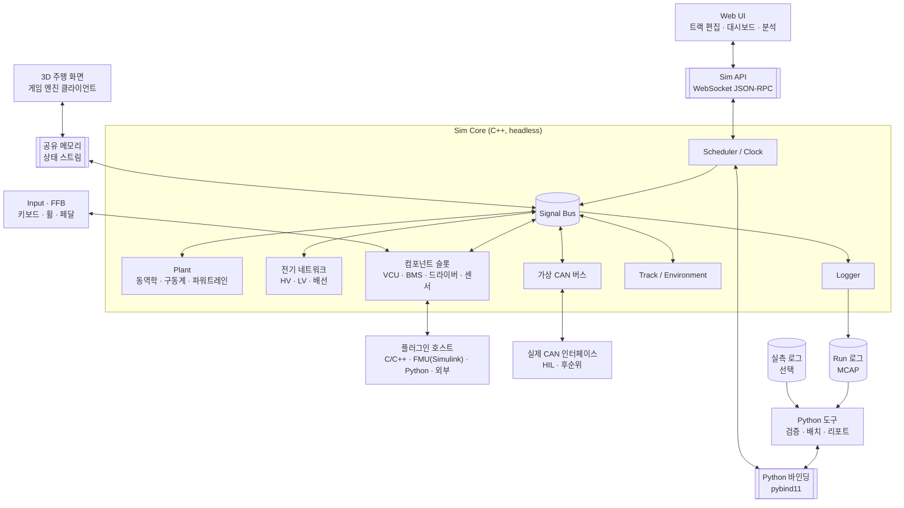
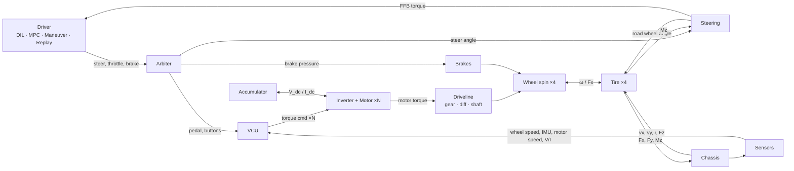
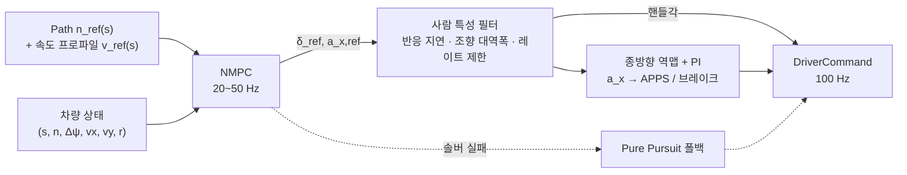

# 전기 포뮬러 차량 시뮬레이터 — 설계 문서

| 항목 | 내용 |
|---|---|
| 상태 | **Draft v0.3** (검토 대기) |
| 최종 수정 | 2026-10-21 |
| 초안 | Claude |
| 검토 | @tkdgusqkr-g |
| 관련 문서 | [차량 파라미터 요청 목록](vehicle_parameters.md) |

**목차**: [0 사용법](#0-이-문서-사용법-리뷰-방식) · [1 요약](#1-요약-tldr) · [2 목표](#2-목표와-범위) · [3 요구사항](#3-요구사항) · [4 아키텍처](#4-시스템-아키텍처) · [5 동역학](#5-차량-동역학-모델) · [6 구동계·파워트레인](#6-구동계--전기-파워트레인) · [7 제어](#7-제어-vcu) · [8 드라이버](#8-드라이버-시스템) · [9 플러그인](#9-플러그인--사용자-코드-통합) · [10 CAN·배선·기판](#10-전기-시스템-can-배선-기판) · [11 검증](#11-검증-워크플로-vv) · [12 트랙](#12-트랙--경로-편집) · [13 런타임](#13-시뮬레이션-코어-런타임) · [14 UI](#14-시각화-ui-데이터) · [15 스택](#15-기술-스택-제안) · [16 저장소](#16-저장소-구조-제안) · [17 마일스톤](#17-마일스톤-제안-순서-조정-가능) · [18 리스크](#18-리스크) · [19 결정](#19-설계-결정-목록) · [20 질문](#20-질문) · [21 이력](#21-변경-이력)

---

## 0. 이 문서 사용법 (리뷰 방식)

이 문서는 **사용자 수정 → Claude 검토 → 반영**을 반복하며 발전시킵니다.

- 모든 항목에 ID가 붙어 있습니다: 요구사항 `R-xx`, 비기능 요구사항 `N-xx`, 설계 결정 `D-xx`, 질문 `Q-xx`, 검증 케이스 `V-xx`.
  대화할 때 "D-19는 ngspice 대신 자체 해석기로 가자"처럼 ID로 부르면 됩니다.
- 결정 상태: 🟢 확정 / 🟡 제안 (검토 필요) / 🔴 미정 (사용자 답변 필요)
- 수정 방법은 아래 중 편한 것을 쓰면 됩니다.
  1. 본문을 직접 고치기 (삭제, 추가, 수치 변경 모두 가능)
  2. 고치기 애매한 곳에 `> 💬 코멘트 내용` 남기기
  3. 채팅으로 "Q-12 답: ..."처럼 보내기
- 다음 라운드에서 Claude가 변경점(diff)을 검토하고, 반영 결과와 답변을 `> 🤖 ...`로 남긴 뒤 정리합니다.
- 변경 이력은 맨 아래 [§21](#21-변경-이력)에 기록합니다.

---

## 1. 요약 (TL;DR)

v0.3에서 제안하는 핵심 설계는 다음과 같습니다.

1. **아세토 코르사 수준의 풀카 시뮬레이터**로 차량을 가상 검증합니다. 사람이 운전하는 주행부터 동역학, 전기 분석까지 한 시뮬레이터에서 다룹니다.
2. **C++ 실시간 코어 + Python 도구층**: 시뮬레이션 루프 · 모델 · 드라이버 · 플러그인 호스트는 C++이고, 테스트 · 분석 · 배치 · 리포트는 Python 바인딩으로 같은 코어를 씁니다.
3. **모든 기능 블록은 교체 가능한 슬롯**입니다. VCU, BMS 로직, 드라이버, 센서, 배터리·모터 모델 같은 슬롯에 **C/C++, Simulink(FMU 또는 생성 코드), Python, 외부 프로세스** 코드를 끼울 수 있습니다 (§9).
4. **CAN 통신과 배선도를 모델링**합니다. DBC 기반 가상 CAN 버스(타이밍, 버스 부하, 고장 주입)와 HV/LV 전기 네트워크(전압 강하, 퓨즈, 프리차지, 셧다운 회로, 단선·단락 주입)를 제공합니다. 기판은 회로도 수준 연동과 MCU 에뮬레이션까지만 하고, 레이아웃 물리 해석은 범위 밖입니다 (§10).
5. **차량 모델 기본값은 2-track 7-DOF**이고, 14-DOF와 타이어 열모델까지 단계적으로 올립니다.
6. **구동계는 그래프로 정의**해서 4WD 인휠(기본)부터 단일 모터 + 디퍼렌셜까지 한 구조로 다룹니다.
7. **전기 파워트레인은 준정적 모델**(배터리 등가회로, 모터 토크 envelope과 손실맵, 집중 열모델)에서 시작합니다.
8. **MPC 드라이버는 두 모드**입니다: 사람처럼 경로를 따라가는 **추종 모드**와 차량 한계까지 쓰는 **한계 주행 모드(MPCC)** (§8.5).
9. **실측 로그는 선택 사항**입니다. 시뮬레이터를 만들고 돌리는 데는 필요 없고, 시뮬레이션 결과가 실차와 맞는지 확인하고 보정할 때만 씁니다 (§11.1).
10. **주행 화면은 게임 엔진 클라이언트**(Godot 4 제안)로 만들고, 물리는 항상 C++ 코어가 담당합니다. 트랙 편집기와 대시보드는 Web UI입니다.

---

## 2. 목표와 범위

### 2.1 목적

4WD 인휠 전기 포뮬러 차량(다른 구동 토폴로지도 지원)을 **가상으로 검증하는 풀카 시뮬레이터**를 만듭니다. 아세토 코르사처럼 사람이 운전할 수 있으면서, 엔지니어링 분석 도구 역할도 합니다.

- 주행: 사람(DIL) 또는 MPC 드라이버
- 동역학: 차체, 타이어, 서스펜션, 구동계
- 전기: 배터리, 인버터, 모터, HV/LV 전기 네트워크, CAN 통신
- 제어: 실차 제어 코드(Simulink, C/C++, Python)를 그대로 연결
- 트랙과 주행 경로 편집

### 2.2 사용 시나리오

| ID | 시나리오 | 예시 |
|---|---|---|
| UC-1 | 가상 주행 | 드라이버가 휠/페달로 주행하며 차량 거동과 제어 체감 확인 |
| UC-2 | 설계/성능 검증 | 기어비, 배터리 구성, 공력을 바꿨을 때 랩타임·에너지·온도 예측. 모터/배터리의 전류·온도 여유 확인 |
| UC-3 | 제어 검증 | 실차 VCU 코드(Simulink 등)를 연결해 TV/TC/회생 로직을 표준 시험과 트랙 주행으로 판정 |
| UC-4 | 전기 시스템 검증 | CAN 버스 부하·지연, 프리차지·셧다운 동작, 배선 전압 강하, 단선·단락 시 제어기 반응 |
| UC-5 | 회귀 테스트 | 파라미터나 코드가 바뀔 때마다 테스트 스위트 자동 실행 → 리포트 |
| UC-6 | 트랙 설계 | 편집기나 GPS 데이터로 트랙 생성 |
| UC-7 | 실측 상관성 (선택) | 실측 데이터가 있을 때, 시뮬레이션과 실차를 비교해 모델 보정 |

### 2.3 범위 밖 (Non-goals)

- 대회 규정 준수 판정
- 사운드, 멀티플레이, 다중 차량
- 멀티바디 서스펜션 (K&C는 룩업 테이블로 근사)
- 인버터 스위칭 수준의 전기 시뮬레이션 (µs 단위). 회로도 수준 연동은 §10.4 참고
- **기판 물리 해석** (레이아웃, 신호 무결성, EMI, 기판 발열): 전용 EDA 도구의 영역
- 카메라/LiDAR 센서 시뮬레이션 (→ Q-07)
- 모션 플랫폼
- AI 에이전트 연동 (Model Context Protocol). Sim API가 있으므로 필요하면 나중에 추가 가능

---

## 3. 요구사항

### 3.1 기능 요구사항

**차량 동역학**

| ID | 요구사항 |
|---|---|
| R-01 | 차량 모델은 fidelity 단계별로 교체할 수 있어야 한다 (kinematic / single-track / 2-track 7-DOF / 14-DOF) |
| R-02 | 타이어는 Pacejka Magic Formula (combined slip)를 지원하고 `.tir` 파라미터 파일을 읽을 수 있어야 한다. 후순위로 타이어 열·공기압 효과 |
| R-03 | 공력(Cl, Cd, 압력중심)을 반영하고, 다운포스가 하중 분배에 반영되어야 한다 |
| R-04 | 구동계는 모터 1~4개, 감속기, 디퍼렌셜(open / LSD / locked), 축 컴플라이언스를 조합해 정의할 수 있어야 한다. 기본값은 4WD 인휠 |

**전기 파워트레인**

| ID | 요구사항 |
|---|---|
| R-05 | 배터리: 등가회로 모델(OCV–R0–RC), SoC, 전압 강하, 온도 |
| R-06 | 인버터/모터: DC 전압에 따른 토크–속도 envelope, 효율(손실)맵, 열 디레이팅 |
| R-07 | 회생제동, 배터리 출력단 에너지 계량, 설정 가능한 출력 제한 |

**제어**

| ID | 요구사항 |
|---|---|
| R-08 | 참조 VCU: 페달맵, 출력 제한, TC, TV, regen blending, launch control, 센서 plausibility |
| R-09 | 제어기는 슬롯이며 사용자 코드로 교체할 수 있어야 한다 (§9) |
| R-10 | 센서 모델(지연, 노이즈, 양자화, 샘플링)을 켜고 끌 수 있어야 한다 |

**드라이버**

| ID | 요구사항 |
|---|---|
| R-11 | 모든 드라이버 소스는 공통 입력 인터페이스를 쓴다 (steer, throttle, brake, buttons) |
| R-12 | DIL: 키보드, 게임패드, 스티어링 휠/페달 입력 및 Force Feedback 출력 |
| R-13 | MPC 드라이버: **추종 모드**(경로·속도 추종, 사람 특성 설정)와 **한계 주행 모드**(MPCC) |
| R-14 | 기본 드라이버(Pure Pursuit + PI): 디버깅과 MPC 폴백용 |
| R-15 | Replay: 기록된 입력 재생. 실측 로그의 입력 재생 포함 |
| R-16 | 드라이버 소스 혼합·전환 (예: 조향은 Maneuver, 속도는 PI 속도 유지) |
| R-34 | Maneuver 드라이버: 표준 시험용 스크립트 입력 (스텝, 램프, 사인, 사인 위드 드웰, 속도 유지) |

**플러그인 (신규, §9)**

| ID | 요구사항 |
|---|---|
| R-35 | 모든 기능 블록(드라이버, VCU, BMS 로직, 센서, 배터리·모터 모델 등)은 슬롯이며, 기본 구현 또는 사용자 코드로 채울 수 있어야 한다 |
| R-36 | 지원 형식: C/C++ 공유라이브러리, FMU (FMI 2.0/3.0, Simulink·Modelica 등), Python, 외부 프로세스 |
| R-37 | 플러그인 포트는 Signal Bus 신호 또는 CAN 메시지에 연결할 수 있어야 한다. 단위를 선언하면 자동 변환 |
| R-38 | 플러그인 실행 시간을 측정하고, 실시간 모드에서 초과하면 경고한다 |

**전기 시스템 (신규, §10)**

| ID | 요구사항 |
|---|---|
| R-39 | 가상 CAN: 여러 버스, DBC 기반 인코딩/디코딩, 노드(내장 모델 / 플러그인 / 실제 장치) |
| R-40 | CAN 충실도 단계: 이상적 전달 / 타이밍(전송 시간, 중재, 버스 부하) / 고장(프레임 손실, 지연, bus-off) |
| R-41 | 실제 CAN 인터페이스 연결 (SocketCAN, PCAN 등): 실제 ECU를 책상 위에서 시뮬레이터와 연결 (후순위) |
| R-42 | 전기 네트워크: HV/LV 회로를 넷리스트로 정의하고 해석 (전압 강하, 퓨즈, 릴레이·컨택터, 프리차지, 셧다운 회로) |
| R-43 | 고장 주입: 단선, 단락, 커넥터 저항 증가, 퓨즈 단선, 릴레이 고착, CAN 메시지 손실을 시나리오에서 지정 |
| R-44 | 회로도 수준 연동: SPICE 넷리스트(기판 회로)를 ngspice로 연동 (후순위, 실시간 아님) |
| R-45 | 가상 ECU: 실제 펌웨어 바이너리를 MCU 에뮬레이터로 실행하고 가상 CAN에 연결 (후순위) |

**트랙/경로**

| ID | 요구사항 |
|---|---|
| R-17 | 트랙 편집: 센터라인 control point, 좌우 폭, 콘, 출발/결승선, 섹터 |
| R-18 | 주행 경로(레이싱 라인) 편집 및 자동 생성 |
| R-19 | Import/Export: 센터라인 CSV, 콘 CSV, GPS 데이터(lat/lon), 배경 이미지 트레이싱 |
| R-20 | 트랙 템플릿: 직선 가속, 원선회 패드, 8자, 슬라럼, 레인 체인지 |

**런타임/데이터**

| ID | 요구사항 |
|---|---|
| R-21 | 시간 모드: real-time / fast (최대 속도) / step (lockstep) |
| R-22 | 결정론적 재현: 같은 시나리오 + 같은 입력 → 같은 결과 |
| R-23 | 텔레메트리 로깅, 라이브 플롯, export (CSV / MAT / Parquet) |
| R-24 | 시나리오 파일 = 차량 + 트랙 + 드라이버 + 플러그인 + 초기조건 + 종료조건 + 고장 + 로깅 설정 |
| R-25 | 파라미터 sweep / 배치 실행 |

**검증**

| ID | 요구사항 |
|---|---|
| R-30 | 테스트 케이스: 시나리오 + 판정 기준 → pass/fail. 스위트 실행과 리포트 |
| R-31 | 표준 시험 라이브러리 (정상원선회, 스텝 조향, 주파수 응답, 레인 체인지 등) |
| R-32 | 추적성: 모든 run에 파라미터 해시, 시뮬레이터 버전(git commit), 플러그인 버전, 입력 데이터 해시 기록 |
| R-33 | 불확실성: 파라미터 sweep, 몬테카를로 |
| R-26 | (선택) 실측 로그 import: 형식 어댑터 + 채널 매핑 |
| R-27 | (선택) 상관성 비교: 정렬, overlay 플롯, 오차 지표 |
| R-28 | (선택) 서브시스템 분리 상관성 |
| R-29 | (선택) 파라미터 식별 |

### 3.2 비기능 요구사항

| ID | 요구사항 | 목표치 (제안) |
|---|---|---|
| N-01 | Real-time 성능 | 물리 1 kHz, FFB 500 Hz~1 kHz, 렌더 ≥ 60 Hz, 입력→화면 지연 < 50 ms |
| N-02 | Fast 모드 성능 | L2 모델 + MPC 드라이버 포함 실시간의 ≥ 20배 (26분 주행 → 80초 이내). 전기 네트워크·CAN 타이밍을 켜면 별도 측정 |
| N-03 | 플랫폼 | DIL은 Windows 10/11, 배치는 Linux도 지원 (→ Q-05) |
| N-04 | 단위/좌표계 | SI 단위, 각도는 내부 rad, ISO 8855 좌표계 |
| N-05 | 테스트 | 모델별 단위 테스트 + 검증 케이스(§5.5) + 결정론 회귀 테스트 |
| N-06 | 결정론 범위 | 같은 플랫폼·같은 빌드·같은 플러그인에서는 비트 단위 동일. 플랫폼이 다르면 허용 오차 기반 비교 |

---

## 4. 시스템 아키텍처

### 4.1 설계 원칙

| ID | 원칙 | 이유 |
|---|---|---|
| P-1 | **Headless 코어**: 시뮬레이션은 UI 없이 돈다 | 배치·테스트·CI에서 그대로 사용 |
| P-2 | **하나의 코어 API, 여러 frontend** | Web UI, 3D 클라이언트, CLI, Python 도구가 같은 기능을 쓴다 |
| P-3 | **Plant는 연속계로 함께 적분, 나머지는 이산 블록** | 휠 회전–구동계–모터–타이어가 강하게 결합되어 있어서 분리 적분하면 불안정하다 |
| P-4 | **이름 기반 Signal Bus** | 모든 신호가 이름으로 노출되므로 로깅, 플롯, 플러그인 연결, sweep이 추가 코드 없이 된다 |
| P-5 | **데이터 주도** | 차량/트랙/시나리오/테스트/플러그인 연결은 파일로 정의하고 코드 수정 없이 교체한다 |
| P-6 | **결정론** | 고정 스텝, 시드 고정, 입력은 sim time 기준으로 기록한다 |
| P-7 | **검증 가능성** | 모든 결과는 재현할 수 있어야 하고, 출처(파라미터·버전·입력)를 추적할 수 있어야 한다 |
| P-8 | **슬롯 기반 확장** | 기본 구현과 사용자 코드가 같은 인터페이스를 쓴다. 기본 구현은 "참조 구현"일 뿐 특별 취급하지 않는다 |

### 4.2 구성도



### 4.3 한 스텝 안의 신호 흐름



- 가상 CAN을 켜면 VCU ↔ 인버터 / BMS / 센서 사이의 신호가 Signal Bus 대신 CAN 프레임으로 오갑니다 (§10.2).
- 전기 네트워크를 켜면 배터리 ↔ 인버터 사이에 배선, 퓨즈, 컨택터, DC-link 커패시터가 들어갑니다 (§10.3).

### 4.4 구성요소와 언어 (D-05)

| 구성요소 | 언어 | 역할 |
|---|---|---|
| `vsim-core` | C++20 | 스케줄러, 모델, 드라이버(MPC 포함), 플러그인 호스트, 가상 CAN, 전기 네트워크, 입력/FFB, Sim API 서버, 로거 |
| `vsim` (Python 패키지) | Python + pybind11 | 코어를 in-process로 실행(배치, fast), 테스트·분석·리포트, 로그 변환, Python 플러그인 SDK |
| `ui` | TypeScript | 트랙 편집기, 대시보드, 분석 화면 |
| `viewer` | 게임 엔진 (Godot 4 제안) | 3D 주행 화면 (렌더링만, 물리 없음) |
| MPC 코드 생성 | Python (CasADi) → acados C 코드 | 빌드 시 생성해서 코어에 링크 |
| 사용자 플러그인 | C/C++, Simulink, Python 등 | §9 |

**실행 방식 두 가지**
- (a) **독립 실행** `vsim-core`: DIL, UI 연동, real-time. Python 플러그인이 있으면 인터프리터를 내장해서 실행
- (b) **Python 라이브러리로 로드**: 배치, 테스트, 분석. 프로세스 간 통신이 없어서 빠름

pybind11은 확장 모듈(b)과 인터프리터 내장(a)을 모두 지원하므로, v0.2의 nanobind 대신 pybind11로 통일합니다.

**스레드 구성 (real-time 모드)**
- 물리 스레드: 높은 우선순위, 1 kHz tick (플러그인 호출 포함)
- 입력/FFB 스레드: 500 Hz~1 kHz
- 네트워크 스레드: Sim API (비동기 I/O)
- 로거 스레드: lock-free 링버퍼 → 디스크

fast / step 모드는 단일 스레드로 돌려 결정론을 보장합니다.

**C++을 택한 이유**

엄밀히는 Python + Numba로도 실시간은 가능합니다. 그래도 C++을 택한 이유는 다음과 같습니다.
- GC/GIL이 없어 타이밍이 예측 가능함 (FFB 1 kHz, 향후 HIL)
- C/C++ 코드, Simulink 생성 코드, FMU, acados 생성 코드를 같은 프로세스에서 직접 호출 가능
- 모델 fidelity가 올라가도(14-DOF + 열 + MPC + 전기 네트워크 동시 실행) 성능 여유가 있음

대가는 개발 속도입니다. 그래서 실시간이 필요 없는 테스트·분석·리포트는 Python으로 작성합니다.

---

## 5. 차량 동역학 모델

필요한 파라미터는 [vehicle_parameters.md](vehicle_parameters.md) §2~§8에 정리했습니다.

### 5.1 좌표계 / 명명

- 차량 좌표계 ISO 8855: x 전방, y 좌측, z 상방, yaw는 반시계 방향이 양수
- 지면 좌표계: ENU (트랙 원점 기준 local)
- 바퀴 인덱스: `fl`, `fr`, `rl`, `rr`

### 5.2 Fidelity 단계

| Level | 모델 | 상태 (DOF) | 용도 |
|---|---|---|---|
| L0 | Kinematic bicycle | x, y, ψ, v | 초기 골격(M0), 저속 |
| L1 | Dynamic single-track + 비선형 타이어 | vx, vy, r + 휠 2개 | 빠른 계산, **MPC 드라이버의 예측 모델** |
| **L2** | **Two-track 평면 + 준정적 하중 이동** | **vx, vy, r + 휠 4개 = 7 DOF** | **v1 기본값.** TV/TC 검증 가능 |
| L3 | 14-DOF (차체 6 + 비현가 상하 4 + 휠 회전 4) | 14 DOF | 롤/피치 과도 응답, 댐퍼·차고, 연석 |

(모든 단계에 위치 x, y, ψ의 기구학 적분이 추가됩니다. 구동계 그래프에 따라 회전 자유도가 추가될 수 있습니다, §6.1.)

**D-02 제안: v1 기본 모델은 L2, 이후 L3를 추가합니다.**
- TV/TC 검증에는 바퀴별 슬립과 힘이 필요하므로 최소 two-track이어야 한다
- 포뮬러 차량은 서스펜션이 단단하고 롤이 작아서 준정적 하중 이동으로도 꽤 정확하다
- 아세토 코르사 수준의 주행 체감(피치·롤 움직임, 연석 충격)과 댐퍼 분석에는 L3가 필요하다 → M8

### 5.3 L2 모델 상세

**하중 (Fz)**
- `Fz_i = 정적 하중 + 공력 다운포스(압력중심으로 앞뒤 분배) + 종방향 하중 이동 + 횡방향 하중 이동`
- 종방향: `ΔFz = m · ax · h_cg / L`
- 횡방향: 앞/뒤 롤 강성 비율로 분배하고, 롤센터 높이가 있으면 기하학적 하중 이동도 반영
- 가속도 → 하중 → 가속도의 algebraic loop는 **가속도에 1차 지연 필터를 넣어** 끊습니다 (서스펜션 동특성의 근사 역할도 함)

**타이어**
- Pacejka MF 6.1 (또는 5.2) combined slip, `.tir` 파일 로딩
- 단순 대안: 단순화 MF(B, C, D, E) + 마찰 타원 (파라미터가 부족할 때)
- **Relaxation length**(슬립의 1차 지연) 적용: 저속 수치 안정성과 과도 응답 현실성 확보
- 저속(약 1~2 m/s 이하)에서는 슬립 정의가 특이해지므로 저속 감쇠 블렌딩 적용
- 노면 μ 스케일: 구간별(surface zone) + 시나리오 전체

**휠 회전**
- `I_w · ω̇ = T_drive − T_brake − Fx · R_eff − T_roll`
- 구동 측 관성(모터 로터, 감속기)은 구동계 그래프가 반사 관성으로 합산 (§6.1)

**조향**
- 핸들각 → 바퀴 조향각: 좌/우 바퀴별 측정 테이블 (Ackermann 효과 포함) 또는 기어비 + Ackermann 비율
- 토(toe) 고정값, 조향 컴플라이언스는 v1에서 무시

**공력**
- `F_down = ½ ρ Cl A v²`, `F_drag = ½ ρ Cd A v²`, 압력중심 x 위치
- 차고/피치 민감도 맵은 L3 이후

**브레이크**
- 유압 → 바퀴별 토크 (전후 배분, 디스크 유효반경, 패드 μ), 1차 지연
- 휠 락은 타이어 모델이 자연스럽게 표현함
- 브레이크 온도는 후순위

**적분기 (D-12 관련)**

휠 회전 동역학은 저속에서 stiff합니다. 대략 계산해 보면:

```
고유값 λ ≈ C_κ · R² / (I_w · v)
대표값: C_κ ≈ 20,000 N, R ≈ 0.2 m, I_w ≈ 0.35 kg·m² (반사 관성 포함)
v = 1 m/s → λ ≈ 2,300 1/s
explicit Euler 안정 조건 dt < 2/λ ≈ 0.87 ms
RK4 안정 조건      dt < 2.8/λ ≈ 1.2 ms
```

따라서 **dt = 1 ms + RK4 + relaxation length + 저속 블렌딩**을 기본으로 제안하고, M1에서 정지 상태 출발과 정차 시나리오로 안정성을 검증합니다. 문제가 생기면 휠 회전만 sub-stepping하거나 semi-implicit 방식으로 바꿉니다.

### 5.4 L3와 확장 (후순위)

- 14-DOF, 서스펜션 K&C는 룩업 테이블 (캠버 게인, 롤센터 높이, 모션비)
- 비선형 댐퍼 커브, 안티롤바, 범프 스톱
- 차고/피치 의존 공력 맵
- 3D 트랙(고도, 뱅크, 연석)
- **타이어 열·공기압 모델**: 표면/카커스 온도 → 그립, 공기압 변화. 아세토 코르사도 이런 효과를 모델링하며, 엔듀런스 주행에서 의미가 있음

### 5.5 모델 구현 검증 케이스

실측 상관성(§11.4) 이전에, 구현이 수식대로 동작하는지 확인하는 케이스입니다.

| ID | 케이스 | 기준 |
|---|---|---|
| V-01 | 저속 정상상태 선회 | 해석적 bicycle 모델의 understeer gradient와 비교 |
| V-02 | 직선 가속 0–75 m | 손 계산 (트랙션 한계 구간 → 출력 한계 구간)과 비교 |
| V-03 | 에너지 보존 | 배터리 출력 에너지 = 운동에너지 증가 + 손실 합 (오차 < 1%) |
| V-04 | 결정론 | 같은 시나리오 + 입력 → 로그가 비트 단위로 동일 |
| V-05 | 정지 출발/정차 | 저속에서 진동이나 발산 없음 |
| V-06 | 구동계 토폴로지 | 4WD 인휠과 단일 모터 + open diff에서 토크 분배·속도 구속이 해석해와 일치 |
| V-07 | 전기 네트워크 | 프리차지 RC 응답, 직렬 저항 전압 강하가 해석해와 일치 |
| V-08 | CAN 타이밍 | 프레임 전송 시간과 버스 부하가 손 계산과 일치 |

---

## 6. 구동계 & 전기 파워트레인

필요한 파라미터는 [vehicle_parameters.md](vehicle_parameters.md) §9~§12에 정리했습니다.

### 6.1 구동계 그래프 (D-14)

모든 구동 토폴로지를 하나의 구조로 다루기 위해, 구동계를 요소의 연결 그래프로 정의합니다.

| 요소 | 파라미터 | 비고 |
|---|---|---|
| `motor` | 모터 모델 참조, 로터 관성 | §6.3 |
| `gear` | 감속비, 효율, 관성, (백래시) | |
| `diff` | 종류(open / lsd / locked), LSD: preload, 토크 감응 계수(ramp) | |
| `shaft` | 비틀림 강성, 감쇠 (선택) | 생략하면 강체 연결 |
| `wheel` | 코너(fl/fr/rl/rr) | 휠 관성은 차량 쪽 파라미터 |

**설정 예시**

```yaml
# 기본: 4WD 인휠
driveline:
  - {motor: m_fl, gear: {ratio: 14.0, eff: 0.97}, wheel: fl}
  - {motor: m_fr, gear: {ratio: 14.0, eff: 0.97}, wheel: fr}
  - {motor: m_rl, gear: {ratio: 14.0, eff: 0.97}, wheel: rl}
  - {motor: m_rr, gear: {ratio: 14.0, eff: 0.97}, wheel: rr}

# 다른 예: 단일 모터 + 후륜 LSD
driveline:
  - motor: m_rear
    gear: {ratio: 4.2, eff: 0.96}
    diff: {type: lsd, preload_nm: 20, ramp: 0.3}
    outputs:
      - {shaft: {k: 8000, c: 5}, wheel: rl}
      - {shaft: {k: 8000, c: 5}, wheel: rr}
```

**풀이 방법**
- 강체로 연결된 관성(로터 → 감속기 → 휠)은 하나의 자유도로 합칩니다 (반사 관성 `J · i²`).
- 디퍼렌셜은 속도 구속 `ω_carrier = (ω_L + ω_R) / 2`를 추가합니다.
  - open: 양쪽 토크가 같음
  - LSD: 속도차에 반대 방향으로 잠금 토크 `T_lock = preload + ramp · |T_in|`. 정지마찰 불연속은 smoothing(tanh)으로 처리
  - locked: `ω_L = ω_R`
- 축 컴플라이언스를 켜면 비틀림 상태가 추가됩니다 (stiff해지므로 기본은 강체).
- 로드 시 그래프에서 축약 좌표의 관성 행렬을 만들고, 매 스텝 작은 선형계(관성 8개 이하)를 풉니다.

**제어와의 연결**: TV 할당기는 그래프에서 "독립적으로 토크를 줄 수 있는 바퀴 그룹"을 자동으로 뽑아서 제약으로 씁니다. 4WD 인휠은 4개 바퀴 독립, 단일 모터 + open diff는 TV 불가로 판단됩니다.

### 6.2 Accumulator (배터리)

- **셀 등가회로**: `V_cell = OCV(SoC, T) − I·R0(SoC, T) − Σ V_RCi`, `dV_RCi/dt = −V_RCi/(R_i C_i) + I/C_i` (RC 1~2개)
- **팩**: 직렬 N_s × 병렬 N_p (v1은 셀 균일 가정, 셀 불균형은 후순위)
- **SoC**: 쿨롱 카운팅 `dSoC/dt = −I_pack / (3600 · Q_cell_Ah · N_p)`
- **열**: 집중 모델 `m·c·dT/dt = I²·R + RC 손실 − h·A·(T − T_amb)`
- **한계**: 셀 전압 상·하한, 방전/충전(회생) 전류 한계, 온도 → BMS 디레이팅 커브
  → `bat.lim.p_dis_max`, `bat.lim.p_chg_max` 신호로 내보내고 VCU가 준수
- **전력 algebraic loop 처리**: 요구 전력 P에 대해 `P = (OCV' − I·R0)·I`를 I에 대한 2차식으로 풀어 해를 구합니다 (`OCV'`는 RC 전압을 뺀 값). 판별식이 음수면 그 전력은 낼 수 없는 것이므로 한계로 처리합니다. 전기 네트워크(§10.3)를 켜면 이 계산은 네트워크 해석기로 넘어갑니다.
- **에너지 계량**: 배터리 출력단 `P = V_pack · I_pack`, 누적 에너지, 회생 에너지 별도 집계
- **보조 부하**: 전기 네트워크를 끄면 상수 `P_aux`로 근사, 켜면 LV 네트워크의 부하로 계산

### 6.3 인버터 + 모터

**Level A (v1 기본, 준정적) — D-03**
- 토크 명령 추종: 1차 지연(τ ≈ 1~5 ms) + 변화율 제한
- 토크 envelope `T_max(ω, V_dc)`: 정토크 영역 → 약계자(정출력) 영역. base speed는 V_dc에 비례해 스케일링하므로, 배터리 전압이 처지면 고속에서 토크가 줄어드는 현상이 표현됩니다.
- 손실: 모터 + 인버터 손실맵 `P_loss(T, ω, V_dc)` (또는 효율맵 η)
- `P_dc = T·ω + P_loss` (회생 시 T·ω < 0) → `I_dc = P_dc / V_dc` → 배터리(또는 전기 네트워크)로 전달
- 열: 권선 / 인버터 집중 열모델 → 디레이팅 커브
- 모터 개수와 배치는 구동계 그래프가 결정 (§6.1)

**Level B (후순위, 선택)**
- dq축 PMSM 모델 + FOC 전류 제어, multi-rate (10~20 kHz sub-stepping)
- 인버터 제어 코드 검증이 목적일 때 필요. 계산 비용이 큼

---

## 7. 제어 (VCU)

### 7.1 참조 VCU 기능 파이프라인

시뮬레이터에 내장하는 VCU는 **참조 구현**입니다. 실차 VCU 코드는 같은 슬롯에 플러그인으로 연결합니다 (§9).

1. **입력 처리**: APPS 2채널 plausibility, 브레이크 센서, 조향각
2. **드라이버 토크 요구**: 페달맵 `T_req_total = f(pedal, v)`, 브레이크 페달/리프트오프 회생
3. **상태 추정**: 차속 추정(휠속 + IMU), 바퀴별 슬립률. 후순위: 횡슬립각, μ 추정
4. **토크 벡터링**:
   - yaw rate 기준값 `r_ref = vx·δ / (L + K_us·vx²)`, 상한 `|r_ref| ≤ k·μ·g / vx`
   - yaw moment 명령: PI (v1) → LQR/MPC (후순위, §8.5의 acados 인프라 재사용 가능)
   - 토크 분배: 규칙 기반 (v1) → 제약 QP (모터 한계, Fz 가중 마찰 한계, 구동계 토폴로지 제약) (후순위)
5. **트랙션 컨트롤**: 바퀴별 목표 슬립률, PI로 토크 감소 (회생 시 ABS 유사 동작 포함)
6. **출력 제한**: `Σ P_elec ≤ min(설정 출력 한계, BMS 한계)`. 전기 출력은 모터 손실모델로 예측하고, 측정된 팩 전력으로 피드백 보정합니다.
7. **출력**: 모터별 토크 명령. 기계식 브레이크는 페달 직결이고, regen blending은 옵션입니다.
8. **안전 로직**: 센서 plausibility, Ready-to-Drive 상태 머신, 타임아웃

### 7.2 센서 모델 (R-10)

- 센서별 샘플링 주기, 지연, 가우시안 노이즈, 바이어스, 양자화, (dropout)
- 기본값은 꺼짐(이상적인 센서)으로 두고, 강건성 테스트에서 켭니다
- 전기 네트워크를 켜면 아날로그 센서는 배선을 거쳐 전압으로 전달됩니다 (단선·단락 주입 가능, §10.3)

### 7.3 실행 주기

- VCU 기본 100 Hz (실차 VCU 주기에 맞춰 1 kHz까지 설정 가능), 출력은 zero-order hold

---

## 8. 드라이버 시스템

### 8.1 공통 인터페이스

```cpp
struct DriverCommand {
    double steer;      // 핸들각 [rad]
    double throttle;   // 0..1 (APPS)
    double brake;      // 0..1 → 페달맵으로 브레이크 압력 변환
    Buttons buttons;   // regen_level, tc_mode, tv_mode, launch, ready_to_drive
};
```

모든 소스는 이 형식만 출력하므로, **VCU 입장에서는 누가 운전하는지 구분할 수 없습니다.** 공정한 비교와 검증을 위한 의도적인 설계입니다.

### 8.2 드라이버 소스

| 소스 | 설명 | 주 용도 |
|---|---|---|
| DIL | 키보드, 게임패드, 휠/페달 (§8.4) | 사람 주행 |
| MPC | MPC 드라이버 모델, 추종 / 한계 주행 (§8.5) | 트랙 주행, 성능 평가 |
| Pure Pursuit + PI | 단순 경로·속도 추종 (§8.6) | 디버깅, MPC 폴백 |
| Maneuver | 시간/거리 기반 스크립트 입력 + 속도 유지 (§8.6) | 표준 시험 |
| Replay | 기록된 입력 재생 (실측 로그 포함) | 재현 |
| 사용자 플러그인 | 팀이 만든 드라이버 모델 (§9) | 자유 |

### 8.3 Arbiter

- **채널별 소스 선택**: steer / longitudinal(throttle+brake) / buttons를 각각 다른 소스에서 받을 수 있음
  - 예: 스텝 조향 시험에서 조향은 Maneuver, 속도는 PI 속도 유지
- **Takeover**: 자동 주행 중 사람 입력이 임계값을 넘으면 사람에게 전환
- 전환 시 급변을 막기 위한 블렌딩

### 8.4 DIL (Driver-in-the-Loop)

**입력**
- SDL3 기반: 키보드, 게임패드, 휠/페달 축
- 장치별 매핑 프로필: 축 번호, 반전, 데드존, 캘리브레이션, 응답 커브. UI에 캘리브레이션 마법사 제공
- 키보드: 디지털 입력을 변화율 제한 램프로 아날로그화 (조향 속도, 센터 복귀, 속도 감응 조향 제한)

**Force Feedback**
- 핸들 토크 = (앞바퀴 Mz + 기계적 트레일 × Fy) / 조향비 × 게인 + 댐핑 + 마찰, 클리핑 및 저역통과 필터
- 전용 스레드에서 500 Hz~1 kHz로 갱신, SDL haptic의 constant force 효과로 출력
- 장치 호환성(G29/G923/Fanatec 등)은 초기에 실기 테스트 필요 → Q-08

**시각** (§14.2)
- 게임 엔진 클라이언트: 콕핏 / 추적 시점, HUD (속도, SoC, 출력, TC/TV 상태, 랩타임, 델타)
- 후순위: 이전 랩 또는 MPC 드라이버 고스트카, 트리플 모니터

**성능**
- DIL 세션은 항상 real-time 모드
- 지연 예산: 입력 샘플 → 물리 → 렌더 < 50 ms (목표)

### 8.5 MPC 드라이버 모델 (D-07)

Q-16 답변에 따라 두 모드를 모두 제공합니다.

| 모드 | 목적 | 방식 |
|---|---|---|
| **추종 모드** | 주어진 라인·속도를 사람처럼 따라감. 드라이버 특성이 반영된 주행 | NMPC 경로·속도 추종 + 사람 특성 필터 |
| **한계 주행 모드** | 차량 한계까지 써서 랩타임 잠재력 평가 | MPCC (Model Predictive Contouring Control, 진행도 최대화) |

**구조 (추종 모드)**



**문제 정의 (추종 모드)**
- 예측 모델: Frenet 좌표 dynamic single-track (L1). 상태 `s, n, Δψ, vx, vy, r, δ`, 입력 `δ̇, a_x`. 단순화 MF 타이어, 저속에서는 kinematic 블렌딩
- 비용: 횡오차 `n − n_ref(s)`, 헤딩 오차, 속도 오차 `v − v_ref(s)`, 입력 크기와 변화율
- 제약: 트랙 경계(여유폭 포함), 조향각·조향 속도, 마찰 타원 (예측 가속도 ≤ g-g 한계 × 공격성)
- 호라이즌 1.5~2 s, N = 30~40 (예측 간격 50 ms)

**한계 주행 모드 (MPCC)**
- 기준 경로 대신 "트랙을 따라 얼마나 빨리 나아가는가(진행도)"를 최대화하고, 트랙 경계와 마찰 한계를 제약으로 둡니다.
- 사람 특성 필터는 끄고, 공격성은 1.0 근처로 둡니다.
- 출력은 추종 모드와 같은 `DriverCommand` 경로를 거칩니다.
- 보조 도구: 랩 전체를 한 번에 푸는 오프라인 최소 랩타임 최적화로 기준 라인·속도를 만들고, 추종 모드의 입력으로 쓸 수 있습니다 (후순위).

**솔버**
- **acados** (SQP-RTI + HPIPM): CasADi로 모델을 정의해서 C 코드를 생성하고 코어에 링크
- 대안: 선형화 LTV-MPC + OSQP (구현이 단순하지만 한계 주행 정확도가 낮음)

**설계 포인트**
- **드라이버의 내부 모델 ≠ Plant**: 내부 모델 파라미터는 차량 설정에서 자동 추정하되 따로 덮어쓸 수 있습니다. 실제 드라이버처럼 차량을 완벽히 "모르는" 상황을 재현할 수 있습니다.
- **종방향 출력**: MPC는 목표 가속도를 내고, 드라이버는 VCU 페달맵을 모른다는 가정 아래 공칭 역맵 + PI 보정으로 페달 값을 만듭니다. 그래서 VCU는 사람 입력과 같은 형태를 받습니다.
- **사람 특성 (추종 모드)**: 반응 지연(0~0.3 s), 신경근 대역폭(2차 필터), 미리보기 시간, 공격성(그립 사용률), 입력 노이즈
- **결정론**: fast/step 모드에서는 솔버를 동기 실행하고 반복 횟수를 고정(RTI)합니다. 결과가 실행 속도와 무관합니다.
- **실패 처리**: 솔버 실패나 불가해 시 해당 tick은 이전 해를 shift해서 쓰거나 Pure Pursuit로 폴백하고, 이벤트로 기록합니다.

**속도 프로파일 생성 (추종 모드)**
- 준정상상태(QSS) 방식: 경로 곡률 + 차량 g-g-v 한계(다운포스, 출력 한계 반영)로 forward/backward pass
- 한계 주행 결과나 사람 주행 기록에서 추출한 속도 프로파일도 사용 가능

### 8.6 Pure Pursuit / Maneuver

- **Pure Pursuit + PI**: 속도 의존 lookahead, PI 속도 추종. 디버깅, M1의 기본 자동 주행, MPC 폴백
- **Maneuver**: 시간 또는 거리 기반 입력 프로파일 (스텝, 램프, 사인, 사인 스윕, 사인 위드 드웰) + PI 속도 유지. 표준 시험(§11.3)에 사용

---

## 9. 플러그인 / 사용자 코드 통합

Q-15 답변에 따라, Simulink · Python · C/C++ 등 어떤 코드든 시뮬레이터에 끼울 수 있게 합니다.

### 9.1 슬롯

시뮬레이터의 기능 블록은 모두 **슬롯**입니다. 각 슬롯은 기본 구현(builtin) 또는 사용자 코드로 채웁니다.

| 슬롯 | 기본 구현 | 교체 예 |
|---|---|---|
| `driver` | DIL / MPC / Pure Pursuit / Maneuver / Replay | 팀이 만든 드라이버 모델 |
| `vcu` | 참조 VCU (§7.1) | Simulink VCU, 실차 C 코드 |
| `bms_logic` | 참조 BMS 로직 (전류·출력 제한) | 실차 BMS 코드 |
| `inverter_ctrl` | Level A 내장 | 인버터 제어 Simulink 모델 |
| `sensors.*` | 센서 모델 (§7.2) | 사용자 센서 모델 |
| `plant.battery` | ECM (§6.2) | Simulink/Modelica 배터리 모델 |
| `plant.motor` | Level A (§6.3) | 사용자 모터 모델 |
| `plant.tire` | Pacejka MF | 사용자 타이어 모델 (C/C++ 권장) |
| `can_node.*` | 내장 노드 (§10.2) | CAN 메시지를 직접 주고받는 사용자 코드 |
| `analysis` | — | 사용자 후처리 (Python) |

### 9.2 플러그인 종류

| 종류 | 대상 | 방식 | 실시간 | 비고 |
|---|---|---|---|---|
| **Native** | C, C++ (C ABI를 내보내면 Rust 등도 가능) | 공유 라이브러리 (.dll / .so) | ✅ | 가장 빠름 |
| **FMU** | Simulink, Modelica(OpenModelica, Dymola), AMESim, GT-Suite 등 | FMI 2.0 / 3.0 (Co-Simulation, Model Exchange) | ✅ (FMU 성능에 따름) | 도구 간 표준 |
| **Python** | Python | 코어에 내장한 인터프리터 (pybind11) | ⚠️ 100~200 Hz 이하 권장 | GIL 때문에 고주기는 비권장 |
| **External** | MATLAB 라이브 실행, ROS 2, LabVIEW 등 아무 프로세스 | 공유 메모리 / UDP, lockstep 프로토콜 | ⚠️ 통신 지연에 따름 | 범용 탈출구 |
| **CAN 노드** | 위 어떤 종류든 | 신호 대신 CAN 프레임으로 통신 (§10.2) | ✅ | 실차 코드에 가장 가까움 |
| **가상 ECU** | 펌웨어 바이너리 (.elf) | MCU 에뮬레이터 (§10.5) | ❌ 대체로 실시간보다 느림 | 후순위 |

### 9.3 Simulink 연동 경로

| 경로 | 방법 | 장점 | 단점 |
|---|---|---|---|
| **FMU export** | Simulink 모델을 FMU(Co-Simulation)로 export | 표준 방식, 실행할 때 MATLAB 불필요 | MATLAB 버전·라이선스에 따라 가능 여부가 다름. 대안으로 오픈소스 FMI Kit for Simulink (→ Q-18) |
| **코드 생성** | Embedded Coder / Simulink Coder로 C 코드 생성 → C ABI 래퍼로 빌드 (Native) | 실차에 들어가는 코드와 같음 → 차량 검증에 가장 적합 | 래퍼와 빌드 설정 필요 (템플릿 제공) |
| 라이브 연결 | MATLAB Engine으로 실행 중인 Simulink에 연결 (External) | 디버깅 편함 | 느림, 실시간 불가, 결정론 어려움 → 비권장 |

**제안**: 평소 개발은 FMU export, 실차 코드 검증은 코드 생성 경로를 씁니다.

### 9.4 연결 설정 (manifest)

플러그인의 포트를 Signal Bus 신호나 CAN 메시지에 연결합니다. 포트 이름은 플러그인 쪽 이름 그대로 쓰고, 연결은 설정 파일에서 합니다.

```yaml
components:
  vcu:
    type: fmu
    path: plugins/vcu_2026.fmu          # Simulink에서 export
    period: 0.01
    ports:
      in:
        APPS1:        drv.cmd.throttle
        WheelSpeedFL: {signal: sens.ws.fl, unit: rpm}   # 단위 자동 변환
      out:
        TorqueCmdFL:  pt.motor.fl.torque_cmd
  bms_logic:
    type: python
    module: team_bms.logic:BmsLogic
    period: 0.01
  battery:
    type: builtin
    model: ecm_2rc
  inverter_fl:
    type: native
    path: plugins/libinv_ctrl.so
    period: 0.001
```

### 9.5 결합 방식과 주의점

- **이산 블록 플러그인**(제어기, 로직): 주기마다 호출하고 출력은 ZOH. 문제 없음
- **Plant 쪽 플러그인**:
  - Native `PlantModel` 구현 또는 FMU Model Exchange: 코어 적분기가 함께 적분하므로 강결합도 안정적
  - FMU Co-Simulation / Python / External: 한 스텝 지연으로 결합됨. 1 ms 스텝에서 대부분 괜찮지만, 강하게 결합된 루프(휠–타이어 등)는 불안정할 수 있어서 로드 시 경고
- **Python**: 실행 시간이 플러그인마다 측정되고, 실시간 모드에서 예산을 넘으면 overrun 경고
- **결정론**: 플러그인이 내부 난수나 벽시계를 쓰면 결정론이 깨집니다. SDK가 sim time과 시드를 제공합니다.
- **추적성**: 플러그인 파일 해시와 버전을 run 메타데이터에 기록합니다 (R-32).

### 9.6 Plugin SDK

- **C 헤더** `vsim_plugin.h` (모든 Native 플러그인의 공통 ABI)
- **C++ 기반 클래스** (헤더 온리)
- **Python 패키지** `vsim.plugin`
- **Simulink 템플릿**: 포트 이름 규칙, FMU export 스크립트, 코드 생성 래퍼
- 언어별 예제 (같은 TV 로직을 C++, Python, Simulink로 구현)

```c
/* vsim_plugin.h — Native 플러그인 공통 ABI (초안) */
typedef struct {
    const char *name;
    const char *unit;
    int         direction;   /* 0 = in, 1 = out */
} VsimPort;

typedef struct {
    int    abi_version;
    int    (*describe)(const VsimPort **ports, int *n_ports);
    void * (*create)(const char *params_json, double period);
    int    (*step)(void *self, double t, const double *in, double *out);
    void   (*destroy)(void *self);
} VsimPluginApi;

VSIM_EXPORT const VsimPluginApi *vsim_plugin_entry(void);
```

```python
# Python 플러그인 예시
from vsim.plugin import Block

class MyTorqueVectoring(Block):
    period = 0.01
    inputs = {"steer": "rad", "vx": "m/s", "yaw_rate": "rad/s"}
    outputs = {"mz_cmd": "N*m"}

    def init(self, params):
        self.kp = params.get("kp", 1.0)
        self.wheelbase = params["wheelbase"]
        self.steer_ratio = params["steer_ratio"]

    def step(self, t, u):
        delta = u["steer"] / self.steer_ratio          # 핸들각 → 바퀴 조향각
        r_ref = u["vx"] * delta / self.wheelbase       # 중립 조향 기준 yaw rate
        return {"mz_cmd": self.kp * (r_ref - u["yaw_rate"])}
```

---

## 10. 전기 시스템: CAN, 배선, 기판

Q-17 답변에 따라 CAN, 배선도, 기판을 다룹니다. 가능한 범위를 먼저 정리합니다.

### 10.1 가능 범위 (D-20)

| 대상 | 가능 여부 | 방법 | 비고 |
|---|---|---|---|
| CAN 통신 | ✅ 권장 | 가상 CAN 버스 + DBC (§10.2) | 타이밍, 버스 부하, 고장 주입, 실제 CAN 연결까지 |
| 배선도 (HV/LV 전기 네트워크) | ✅ | 넷리스트 + 회로 해석기 (§10.3) | 전압 강하, 퓨즈, 프리차지, 셧다운 회로, 단선·단락 주입 |
| 기판 회로 (회로도 수준) | ⚠️ 일부 | ngspice 연동 (§10.4) | µs 단위 해석이라 실시간보다 느림. 특정 회로만 대상 |
| 기판 펌웨어 (MCU) | ⚠️ 일부 | MCU 에뮬레이터 (§10.5) | 지원 MCU·주변장치 확인 필요 |
| 기판 물리 (레이아웃, 신호 무결성, EMI, 발열) | ❌ 범위 밖 | 전용 EDA 도구 | KiCad 내장 도구, HyperLynx 등 |

**ECU를 얼마나 실제에 가깝게 넣을 것인가 (단계)**

| 단계 | 무엇을 실행하나 | 인터페이스 | 예 |
|---|---|---|---|
| E1 알고리즘 | 제어 알고리즘 | Signal Bus (물리 단위) | Python, FMU, C++ 플러그인 (§9) |
| E2 애플리케이션 코드 (SIL) | 실차 소스코드를 PC용으로 컴파일 | CAN 프레임 + I/O 추상화 | Simulink 생성 코드, 직접 작성한 C |
| E3 펌웨어 바이너리 (가상 ECU) | 실제 MCU용 바이너리 | 에뮬레이터 + 가상 CAN / ADC / GPIO | §10.5 |
| E4 실제 하드웨어 (HIL) | 실제 ECU 보드 | 실제 CAN 인터페이스 + I/O 보드 | 후순위 (→ Q-22) |

### 10.2 가상 CAN (D-18)

**구성**

```yaml
can:
  fidelity: timing            # ideal | timing | faults
  buses:
    - {name: can_main, bitrate: 1000000, dbc: data/can/main.dbc}
    - {name: can_inv,  bitrate: 1000000, dbc: data/can/inverter.dbc}
  nodes:
    - {name: VCU,    buses: [can_main, can_inv], impl: {component: vcu}}   # §9 플러그인
    - {name: INV_FL, buses: [can_inv],  impl: builtin.inverter}
    - {name: BMS,    buses: [can_main], impl: builtin.bms}
    - {name: DASH,   buses: [can_main], impl: builtin.recorder}
```

**내장 노드**: 내장 모델(인버터, BMS, 센서)은 DBC에 정의된 메시지와 주기에 맞춰 상태를 송신하고 명령을 수신합니다. 예: `INV_FL_Status.ActualTorque ← pt.motor.fl.torque`. 매핑은 DBC 신호 이름과 Signal Bus 이름을 잇는 표로 정의합니다.

**충실도 단계 (R-40)**

| 단계 | 내용 |
|---|---|
| `ideal` | 송신한 tick에 바로 전달 |
| `timing` | 프레임 길이(비트 스터핑 추정 포함)로 전송 시간 계산, ID 우선순위 중재, 큐 대기 → 메시지 지연, 버스 부하 |
| `faults` | 프레임 손실, 지연·지터 주입, error frame, 노드 bus-off |

**분석 출력**
- 버스별 부하율, 메시지별 지연 (최소/평균/최대)
- 타임아웃 감지 (메시지가 N 주기 이상 안 옴)
- 버스 로그 (candump / ASC / BLF) → SavvyCAN, CANalyzer 같은 기존 도구에서 열 수 있음

**실제 CAN 연결 (후순위, R-41)**
- 어댑터: SocketCAN (Linux), PCAN-Basic / Kvaser / Vector XL (Windows)
- 용도: 실제 ECU를 책상 위에서 시뮬레이터에 연결하고, 시뮬레이터가 나머지 차량 역할을 함 (rest-bus 시뮬레이션) → HIL의 첫 단계

### 10.3 전기 네트워크 / 배선 (D-19)

**범위**
- HV: 배터리, 컨택터(AIR), 프리차지 저항·릴레이, 방전 회로, 퓨즈, HV 케이블, 인버터 DC-link 커패시터
- LV: LV 배터리, DC-DC 컨버터(평균 모델), 퓨즈, 릴레이, 전원 분배, 부하(펌프, 팬, ECU)
- 셧다운 회로: 직렬로 연결된 스위치와 인터록. 회로가 열리면 컨택터가 떨어짐
- 센서 배선: 센서 전원, 신호선, 접지 (아날로그 센서는 배선을 거쳐 전압으로 전달)

**충실도 단계**

| 단계 | 내용 |
|---|---|
| E0 (기본) | 네트워크 없음. 배터리 ↔ 인버터 직결 (§6.2 방식) |
| E1 | DC 저항 네트워크: 전압 강하, 퓨즈, 컨택터·릴레이 상태 |
| E2 | 과도 해석: 커패시터·인덕턴스, 프리차지 곡선 + 고장 주입 |

**넷리스트 예시**

```yaml
electrical:
  level: E2
  components:
    - {id: ACC,    type: battery_model, pos: HV+, neg: HV-}     # §6.2 배터리 모델
    - {id: AIR_P,  type: contactor, a: HV+, b: DC+, coil: SDC}  # 셧다운 회로가 닫혀야 붙음
    - {id: PRE_K,  type: relay, a: HV+, b: n_pre, coil: PRE_CMD}
    - {id: PRE_R,  type: resistor, a: n_pre, b: DC+, r_ohm: 1000}
    - {id: HV_CAB, type: wire, a: DC+, b: INV_DC+, length_m: 1.2, area_mm2: 16}
    - {id: C_LINK, type: capacitor, a: INV_DC+, b: HV-, c_f: 400e-6}
    - {id: INV,    type: inverter_model, pos: INV_DC+, neg: HV-}  # §6.3 모델이 전류원으로 연결
    - {id: F_VCU,  type: fuse, a: LV12, b: LV_VCU, rating_a: 5}
```

**해석기**
- Modified Nodal Analysis (MNA): 스위치는 컨덕턴스, 커패시터·인덕터는 사다리꼴 companion 모델, 비선형 소자(다이오드, 퓨즈 열모델)는 Newton 반복
- 희소 LU 분해 (Eigen). 스위치 상태가 바뀔 때만 재분해
- 시간 간격은 Plant 스텝(1 ms)이 기본, 빠른 과도 구간은 sub-step
- 배터리 모델은 전압원 + 내부 임피던스로, 인버터 모델은 전류원으로 네트워크에 연결

**고장 주입 (R-43)**

```yaml
faults:
  - {at_s: 12.0, type: open,  target: wire.APPS1_SIG}      # APPS 신호선 단선
  - {at_s: 30.0, type: short, target: wire.LV_PUMP, to: GND}
  - {at_s: 45.0, type: can_drop, target: can_main.BMS_Status, duration_s: 0.5}
```

단선·단락이 나면 센서 전압이나 CAN 메시지가 실제처럼 변하고, VCU(실차 코드 포함)가 이를 올바르게 처리하는지 테스트할 수 있습니다.

**출력**: 노드 전압, 지로 전류, 배선 손실과 온도 상승(단순 모델), 퓨즈 여유, 프리차지 시간

**가져오기 (후순위, 검토)**: KiCad 넷리스트, WireViz(하네스 YAML)에서 변환

### 10.4 기판 회로 연동 (후순위)

- 회로도에서 export한 SPICE 넷리스트(KiCad, Altium)를 **ngspice 공유 라이브러리**로 연동합니다.
- 회로의 입출력 단자를 시뮬레이터 신호에 연결합니다. 예: APPS 신호 조절 회로, BMS 셀 전압 측정 회로
- µs 단위로 풀기 때문에 실시간보다 느립니다. fast/step 모드에서 특정 시나리오만 돌리는 용도입니다.
- 스위칭 회로(DC-DC 등)는 평균 모델로 대체하는 것을 권장합니다.

### 10.5 가상 ECU (후순위)

- 실제 펌웨어 바이너리(.elf)를 MCU 에뮬레이터(예: Renode)에서 실행하고, 가상 CAN과 가상 ADC/GPIO에 연결합니다.
- 소스코드가 아닌 **실제 빌드 결과물**로 테스트하므로, 컴파일러·드라이버·RTOS 문제까지 잡을 수 있습니다.
- 에뮬레이터가 지원하는 MCU와 주변장치에 따라 가능 여부가 달라집니다 (→ Q-21).

---

## 11. 검증 워크플로 (V&V)

### 11.1 검증 단계와 실측 데이터의 역할

| 단계 | 질문 | 방법 | 실측 데이터 |
|---|---|---|---|
| 1. 구현 검증 | 코드가 수식대로 동작하는가? | 단위 테스트, 해석해 비교 (§5.5) | 불필요 |
| 2. 차량 검증 | 차량의 설계·제어·전기 시스템이 목표를 만족하는가? | 테스트 케이스 판정 (§11.2~§11.3) | 불필요 |
| 3. 모델 상관성 (선택) | 시뮬레이션 결과를 실차 수치로 믿어도 되는가? | 실측 로그와 비교 (§11.4) | 필요 |

**실측 데이터(데이터로거)는 왜 필요한가 (Q-14 답변)**
- 시뮬레이터를 만들고 돌리는 데는 **필요 없습니다.**
- 시뮬레이션 결과는 입력한 파라미터와 모델만큼만 정확합니다. 실측과 비교하지 않으면 **"설계 A가 B보다 낫다" 같은 상대 비교와 제어 로직 확인은 믿을 수 있지만**, "랩타임 62.3초", "모터 최고 온도 98 °C" 같은 **절대 수치가 실차와 얼마나 다른지는 알 수 없습니다.**
- 그래서 실측 비교는 **선택 기능**으로 두고, 차가 달릴 수 있게 되었을 때 보정용으로 씁니다.
- 별도 데이터로거 장비가 없어도 됩니다. VCU/BMS가 CAN 메시지를 기록하고 있다면 그 로그로 충분하며, 가상 CAN(§10.2)과 같은 DBC로 바로 읽을 수 있습니다.

### 11.2 테스트 케이스 (R-30)

```yaml
test: step_steer_60kph_tv_on
scenario:
  vehicle: data/vehicles/car_2026.yaml
  overrides: {control.tv.enabled: true}
  track: templates/flat_pad
  driver:
    steer: {maneuver: step, at_s: 2.0, amplitude_deg: 45, rate_dps: 400}
    longitudinal: {speed_hold_kph: 60}
  time: {mode: fast, t_end: 8}
checks:
  - name: 횡슬립각 제한
    expr: "max(abs(veh.chassis.beta)) < deg(6)"
  - name: yaw rate 응답 시간
    expr: "rise_time(veh.chassis.r, 0.1, 0.9) < 0.25"
  - name: 모터 온도 여유
    expr: "max(pt.motor.*.temp) < 120"
```

- 판정 함수: `max`, `min`, `mean`, `abs`, `rise_time`, `settle_time`, `overshoot`, `at(t)`, `window(t0, t1)`, CAN 관련(`bus_load`, `msg_latency`, `timeouts`) 등
- 전기·CAN 테스트 예: "APPS 신호선 단선 후 100 ms 이내 토크 0", "프리차지 완료 전 컨택터 닫힘 금지", "can_main 버스 부하 < 60%"
- 스위트 실행 → Markdown/HTML 리포트 (pass/fail, 플롯, 지표, 추적 정보)
- CI 연동 가능: 파라미터나 코드가 바뀌면 회귀 확인
- 테스트 러너와 판정은 Python, 시뮬레이션 실행은 C++ 코어 (D-16)

### 11.3 표준 시험 라이브러리 (R-31)

| 시험 | 참고 표준 | 확인 항목 |
|---|---|---|
| 정상 원선회 | ISO 4138 | understeer gradient, 한계 횡가속 |
| 스텝 조향 | ISO 7401 | yaw rate 응답 시간, 오버슈트 |
| 주파수 응답 (사인 스윕/랜덤) | ISO 7401 | yaw rate / ay 게인·위상 |
| 레인 체인지 | ISO 3888-1 / -2 | 안정성, 통과 속도 |
| 선회 중 제동 | ISO 7975 | 안정성 |
| 사인 위드 드웰 | FMVSS 126 계열 | 안정성 (TV/TC 검증) |
| 직진 가속 / 제동 | — | 0–75 m 시간, 정지거리, TC 슬립 |
| 코스트다운 | SAE J2263 계열 | 공력·구름저항 |

표준은 절차를 참고하는 용도이며, 포뮬러 차량에 맞게 속도와 진폭을 조정합니다.

### 11.4 실측 상관성 (선택, R-26~R-29)

실측 데이터가 생겼을 때 쓰는 기능입니다.

- **Import**: CSV, MDF4 (asammdf), CAN 로그 + DBC (cantools). 채널 매핑 파일로 실측 채널을 시뮬레이터 신호 이름에 연결
- **상관성 모드**

| 모드 | 실측에서 가져오는 입력 | 비교 대상 |
|---|---|---|
| 서브시스템: 파워트레인 | 모터 속도, 모터 토크 | V_dc, I_dc, SoC, 온도 |
| 서브시스템: 차체·타이어 | 휠 토크, 조향각, 브레이크 압력 | ax, ay, r, 휠속 |
| 서브시스템: 제어기 | 실측 센서값 | 토크 명령 |
| 차량 전체 open-loop | 조향각, APPS, 브레이크 | 전체 (짧은 구간) |
| 차량 전체 closed-loop | 실측 주행 라인·속도 → MPC 추종 모드 | 랩타임, 에너지, 온도 |

- 서브시스템부터 맞춰야 오차가 어디서 오는지 구분할 수 있습니다.
- **지표**: RMSE, NRMSE, 피크 오차, 상관계수, 위상 지연, 랩타임·에너지 차이 (랩 비교는 거리 기준 정렬)
- **파라미터 식별**: 대상 파라미터와 범위를 지정하면 최적화(SciPy least_squares, CMA-ES 등)로 오차를 최소화. 서브시스템 단위로 진행하고, 식별에 쓰지 않은 데이터로 교차 검증

### 11.5 추적성과 불확실성 (R-32, R-33)

- run 메타데이터: 파라미터 세트 해시, 코어 버전(git commit), 플러그인 해시·버전, 시나리오, 입력 데이터 해시, 생성 시각
- sweep / 몬테카를로 (파라미터 분포 지정, 예: μ ±5%, 질량 ±2%) → 결과 분포와 판정 통과 확률

---

## 12. 트랙 & 경로 편집

### 12.1 데이터 모델

```text
Track
  id, name, closed: bool
  centerline: [ControlPoint{x, y, z?, w_left, w_right, bank?}]
  interpolation: periodic_cubic_spline | catmull_rom | clothoid
  surface_zones: [{s_start, s_end, mu_scale, name}]
  cones: [{x, y, color: blue | yellow | orange | big_orange}]
  start_finish: s,  sectors: [s, ...]
  geo_ref: {lat0, lon0}                       # GPS import 시
  background: {image, m_per_px, offset, rot}  # 편집기 전용

Path (주행 라인)
  id, track_id, name
  offset: [n(s) control points]   # 센터라인 기준 횡방향 오프셋
  speed_profile?: v(s)            # 선택, 없으면 드라이버가 생성
```

**D-10 제안: 주행 라인을 Frenet 오프셋 n(s)로 저장**
- 트랙 센터라인을 고쳐도 라인이 따라 움직임
- `−w_right ≤ n ≤ w_left` 제약으로 트랙 경계 안에 자연스럽게 묶임
- MPC 드라이버의 Frenet 예측 모델, 최소 곡률 최적화(QP)와 형태가 같음

**런타임 표현**: Δs = 0.25~0.5 m로 재샘플링한 배열 `(s, x, y, ψ, κ, w_l, w_r)` + 차량 위치의 Frenet 투영 `(s, n)`
→ 랩 카운트, 코스 이탈 판정, 드라이버에 사용

**콘 처리**: v1은 **센터라인 우선**(센터라인과 폭을 편집하면 콘이 일정 간격으로 자동 생성)으로 제안합니다. 콘 배치에서 센터라인을 역산하는 방식은 후순위입니다 (→ Q-09).

**3D 표현**: 주행 화면용 노면·연석·콘 메시는 트랙 데이터에서 자동 생성합니다 (§14.2).

### 12.2 GPS 데이터에서 만들기

- GPS(lat/lon) → `geo_ref` 기준 ENU 변환 → 스무딩 → 센터라인 또는 주행 라인으로 저장
- 트랙 경계를 얻는 방법: (a) 콘이나 경계를 GPS로 측량, (b) 주행 라인 ± 기본 폭 가정, (c) 위성사진 배경 트레이싱

### 12.3 편집기 기능 (v1)

- 2D 탑뷰 캔버스: pan/zoom, 그리드, 축척
- Control point 추가 / 사이에 삽입 / 드래그 / 삭제 / 루프 닫기
- 점별 폭 핸들 (드래그 또는 숫자 입력)
- 곡률 색상 표시, 검증: 자기 교차, 경계 겹침, 최소 폭, 최소 회전반경
- 템플릿 (R-20): 직선 가속, 원선회 패드, 8자, 슬라럼, 레인 체인지
- 주행 라인: 오프셋 핸들 편집, 자동 생성(센터라인 / 최소 곡률 / MPCC 한계 주행 결과)
- Undo/Redo, 저장/불러오기
- 편집 연산은 command 패턴으로 구현 (UI와 스크립트가 같은 연산과 undo 이력을 공유)
- 편집은 sim 일시정지 상태에서만 허용 (v1)

### 12.4 파일 형식

| 형식 | 용도 |
|---|---|
| `*.track.json` | 네이티브 포맷 (스키마 버전 포함) |
| CSV `x_m, y_m, w_tr_right_m, w_tr_left_m` | 센터라인 (TUMFTM racetrack-database 호환) |
| CSV `x, y, color` | 콘 맵 |
| CSV / GPX (lat, lon) | GPS 데이터 → ENU 변환 |
| PNG / JPG + 축척 | 위성사진 배경 트레이싱 |

---

## 13. 시뮬레이션 코어 (런타임)

### 13.1 스케줄러와 시간

**주기 (기본값 제안, 모두 설정 가능)**

| 태스크 | 주기 | 비고 |
|---|---|---|
| Plant 적분 | 1 ms (RK4) | |
| 전기 네트워크 | 1 ms (빠른 과도는 sub-step) | E1/E2일 때 |
| 가상 CAN | 이벤트 기반 (sub-tick 타임스탬프) | 수신 노드는 다음 실행 때 처리 |
| 센서 | 센서별 | 지연 버퍼 포함 |
| VCU / 플러그인 | 각자 선언한 주기 | 기본 10 ms |
| Driver | 10 ms | DIL은 최신 입력 샘플 |
| MPC 솔브 | 20~50 ms | Driver 태스크 안에서 실행, 사이 tick은 보간 |
| 로깅 | 10 ms (고속 신호는 1 ms 옵션) | |
| 상태 publish | 3D 화면 공유 메모리: 매 물리 tick / Web UI: 60 Hz | |
| FFB 출력 | 1~2 ms | 전용 스레드 |

**한 tick 안의 실행 순서 (결정론 보장용, 고정)**
1. 입력 소스 샘플링, 예약된 고장 적용
2. 센서가 Plant 출력을 샘플링 (지연 버퍼 반영)
3. 도착한 CAN 프레임을 수신 노드에 전달
4. Driver 태스크 → `DriverCommand`
5. Arbiter
6. VCU와 그 밖의 이산 슬롯 실행 → 명령 (ZOH), 송신할 CAN 프레임은 버스 큐로
7. 전기 네트워크 해석 + Plant를 tick 길이만큼 진행
8. 이벤트 처리 (랩 통과, 코스 이탈, 콘 충돌, 한계 초과, 퓨즈 단선, 버스 타임아웃, 솔버 실패)
9. 로깅, publish (주기가 된 경우)

**시간 모드 (R-21)**
- `realtime`: 벽시계에 맞춤 (고정 스텝 누적기 방식). 처리 시간이 넘치면 overrun을 기록하고, 옵션으로 슬로모션
- `fast`: 대기 없이 최대 속도
- `step`: API의 `step(n)` 호출 때만 진행 (디버깅, 외부 도구 연동, 가상 ECU)
- 런타임 중 모드 전환 가능

**결정론**: 입력은 벽시계가 아니라 sim time 기준으로 기록합니다. DIL 입력도 driver tick마다 샘플한 값을 저장하므로 replay가 정확히 재현됩니다.

### 13.2 블록 인터페이스

```cpp
// 연속계: 상태 → 미분. 적분기, MPC 모델 생성, FMU export에 재사용
class PlantModel {
public:
    virtual ~PlantModel() = default;
    virtual std::size_t state_size() const = 0;
    virtual void derivatives(double t, std::span<const double> x,
                             const PlantInputs& u, std::span<double> dx) const = 0;
    virtual void outputs(double t, std::span<const double> x,
                         const PlantInputs& u, SignalBus& bus) const = 0;
};

// 이산 블록: VCU, 드라이버, 센서, 플러그인 어댑터 등
class Block {
public:
    virtual ~Block() = default;
    virtual std::string_view name() const = 0;
    virtual double period() const = 0;                 // [s]
    virtual void init(const ParamTree& p, Context& ctx) = 0;
    virtual void step(double t, SignalBus& bus) = 0;   // bus에서 읽고 bus에 씀
};
```

플러그인 호스트(Native, FMU, Python, External)는 모두 `Block` 또는 `PlantModel`을 구현한 어댑터입니다. 그래서 스케줄러는 내장 구현과 플러그인을 구분하지 않습니다.

### 13.3 Signal Bus와 명명 규칙

- 형식: `<domain>.<component>.<signal>[.<corner>]`
  - 예: `veh.chassis.vx`, `veh.tire.fl.fz`, `pt.motor.rl.torque`, `bat.soc`, `ctrl.tv.yaw_ref`, `drv.cmd.steer`, `elec.node.DC+.v`, `can.can_main.load`
- 신호 메타데이터: 단위, 설명, 주기
- 초기화 때 이름을 인덱스로 한 번 변환하고, 런타임에는 인덱스로 접근합니다 (문자열 검색 비용 없음)
- 로깅/조회 대상은 glob 패턴으로 선택 (예: `veh.tire.*.fz`)

### 13.4 파라미터 & 설정

- YAML + JSON Schema 검증 (UI와 Python 도구에서도 같은 스키마 사용)
- 레이어링: 기본 차량 → 차량 variant → 시나리오 override → 런타임 변경
- 파라미터 경로로 접근: `vehicle.aero.cl`, `control.tv.kp` (sweep, 식별에서 사용)
- 파라미터별 **런타임 변경 가능 여부** 플래그 (예: 질량은 reset 필요, 제어 게인은 즉시 반영)
- 파라미터 세트는 버전 관리하고 해시로 식별 (R-32)

### 13.5 시나리오 예시

```yaml
scenario: endurance_mpc_baseline
vehicle: data/vehicles/car_2026.yaml
components: data/components/sil_2026.yaml   # 플러그인 연결 (§9.4)
can: data/can/car_2026.can.yaml              # §10.2
electrical: data/elec/car_2026.elec.yaml     # §10.3
overrides:
  control.power_limit_kw: 60
track: data/tracks/home_track.track.json
driver:
  steer: mpc
  longitudinal: mpc
  mpc: {mode: tracking, path: line_v3, aggressiveness: 0.9, reaction_delay_s: 0.15}
initial: {s: 0.0, v: 0.0, soc: 0.95}
environment: {ambient_temp_c: 25, mu_scale: 1.0}
faults: []
time: {mode: fast, dt: 0.001}
stop: ["laps >= 20", "bat.soc < 0.05"]
logging: {signals: ["veh.*", "pt.*", "bat.*", "ctrl.*", "elec.*", "can.*"], rate_hz: 100}
```

---

## 14. 시각화, UI, 데이터

### 14.1 Web UI

- 트랙 편집기 (Canvas2D / SVG)
- 대시보드: 주요 게이지, 실행 제어, 고장 주입 버튼
- 분석 화면: 테스트 리포트, run 비교
- 라이브 2D 맵 (원격 모니터링, 편집기 미리보기)

### 14.2 3D 주행 화면 (D-08)

아세토 코르사 같은 주행 경험을 목표로 하면 브라우저(three.js)로는 그래픽 품질과 지연 면에서 한계가 있습니다. 그래서 주행 화면은 별도 클라이언트로 만듭니다.

- **게임 엔진 클라이언트**: Godot 4 제안 (오픈소스, 가벼움, C++ 확장 가능). 대안은 Unreal (그래픽 최고, 무거움)
- **역할 분리**: 엔진은 렌더링·HUD·사운드(후순위)만 하고, 물리는 항상 C++ 코어가 계산합니다. 엔진의 물리 엔진은 쓰지 않습니다.
- **연결**: 같은 PC에서는 공유 메모리로 매 물리 tick 상태를 전달 (지연 최소). 원격은 Sim API 스트림
- **에셋**: 차량 3D 모델 (CAD → glTF 변환), 트랙 노면·연석·콘은 트랙 데이터에서 자동 생성, 주변 환경은 단순하게
- 그래픽 수준은 → Q-10
- 후순위 아이디어: 아세토 코르사의 공유 메모리 텔레메트리 형식으로도 내보내면, SimHub 같은 기존 심레이싱 도구(대시보드, 진동 장치)를 재사용할 수 있음 (호환성 확인 필요)

### 14.3 텔레메트리 플롯

- 플로팅 도구를 직접 만들지 않고 기존 도구를 활용: **PlotJuggler**(오픈소스) 또는 **Foxglove** (둘 다 MCAP과 라이브 스트림 지원)
- 테스트 리포트의 플롯은 Python 도구가 생성
- 오프라인 분석: Python 노트북, MATLAB (MAT export)

### 14.4 Run 산출물 (D-11)

```text
runs/2026-10-21T14-03-12_endurance_mpc_baseline/
  meta.json                # 파라미터 해시, git commit, 플러그인 해시, 입력 해시, 시각
  scenario.resolved.yaml   # 모든 override가 적용된 최종 설정
  log.mcap                 # 시계열 (C++ 코어가 기록)
  can/can_main.blf         # 가상 CAN 버스 로그 (CAN을 켠 경우)
  events.jsonl             # 랩, 한계 초과, fault, 고장 주입, 모드 전환, 타임아웃, 솔버 실패
  inputs.jsonl             # replay용 DriverCommand
  summary.json             # 랩타임, 에너지, 최대 출력, 최고 온도, 최저 SoC, 버스 부하
```

Export (Python 도구): Parquet, CSV, MAT

---

## 15. 기술 스택 (제안)

| 영역 | 선택 | 비고 |
|---|---|---|
| 코어 | C++20, CMake | |
| 의존성 관리 | vcpkg | 대안 Conan |
| 수치 | Eigen (희소 LU 포함) | 전기 네트워크 해석에도 사용 |
| MPC | acados + CasADi (모델 정의·코드 생성) | 대안 OSQP (LTV-MPC) |
| Python 바인딩 / 내장 | pybind11 | 확장 모듈과 인터프리터 내장 모두 지원 |
| Sim API 서버 | WebSocket + JSON-RPC 2.0 | 라이브러리는 M0에서 결정 |
| 입력 / FFB | SDL3 | |
| FMU | FMI Library (fmilib) | FMI 2.0 / 3.0 |
| CAN | DBC 파싱 dbcppp (C++), cantools (Python). 실제 장치: SocketCAN, PCAN-Basic | |
| 회로 연동 | ngspice 공유 라이브러리 | 후순위 |
| MCU 에뮬레이터 | Renode | 후순위, 지원 MCU 확인 필요 |
| 3D 주행 화면 | Godot 4 | 대안 Unreal |
| 설정 | YAML (rapidyaml 또는 yaml-cpp) + JSON Schema | |
| 로그 | MCAP (C++ header-only) | Python에서 Parquet/CSV/MAT 변환 |
| 테스트 | GoogleTest (C++), pytest (Python) | |
| Python 도구 | NumPy, pandas, SciPy, asammdf, cantools, matplotlib | |
| Web UI | TypeScript + Vite | |
| MATLAB/Simulink | 플러그인 제작용 (FMU export, 코드 생성) | |

---

## 16. 저장소 구조 (제안)

```text
vehicle_simulation/
├─ docs/
│  ├─ design.md
│  └─ vehicle_parameters.md
├─ core/                      # C++ 코어
│  ├─ include/vsim/
│  ├─ src/
│  │  ├─ sim/                 # scheduler, clock, bus, params, scenario
│  │  ├─ models/
│  │  │  ├─ vehicle/          # chassis, tire, aero, steering, brakes
│  │  │  ├─ driveline/        # 그래프, gear, diff, shaft
│  │  │  ├─ powertrain/       # battery, inverter, motor
│  │  │  └─ sensors/
│  │  ├─ elec/                # 전기 네트워크 (MNA), 고장 주입
│  │  ├─ can/                 # 가상 CAN 버스, DBC, 실제 장치 어댑터
│  │  ├─ control/             # 참조 VCU, 참조 BMS 로직
│  │  ├─ plugin/              # 플러그인 호스트 (native, fmu, python, external)
│  │  ├─ driver/              # mpc, pure_pursuit, maneuver, replay, dil, arbiter
│  │  ├─ track/               # 트랙 모델, spline, frenet, io, templates
│  │  ├─ api/                 # WebSocket JSON-RPC, 공유 메모리
│  │  ├─ io/                  # 입력, FFB
│  │  └─ log/                 # MCAP 로거
│  ├─ apps/vsim-core/         # 독립 실행 파일
│  └─ tests/
├─ sdk/                       # 플러그인 SDK
│  ├─ c/                      # vsim_plugin.h
│  ├─ cpp/
│  ├─ python/
│  └─ simulink/               # 템플릿, FMU export·코드 생성 스크립트
├─ codegen/mpc/               # CasADi 모델 → acados C 코드 생성
├─ python/vsim/               # 바인딩 + 테스트·분석·리포트 도구
├─ ui/                        # Web UI
├─ viewer/                    # 3D 주행 화면 (Godot 프로젝트)
├─ plugins/examples/          # 언어별 예제 플러그인
├─ data/
│  ├─ vehicles/
│  ├─ tires/
│  ├─ tracks/
│  ├─ components/             # 플러그인 연결 설정 (§9.4)
│  ├─ can/                    # DBC, 버스 설정
│  ├─ elec/                   # 전기 넷리스트
│  ├─ scenarios/
│  ├─ tests/                  # 테스트 케이스 (§11.2)
│  └─ mappings/               # 실측 채널 매핑 (§11.4)
└─ tools/
```

---

## 17. 마일스톤 (제안, 순서 조정 가능)

주행과 차량 검증을 먼저, 전기 시스템 상세와 기판 수준은 뒤에 둡니다. 각 마일스톤이 끝나면 그 자체로 쓸 수 있는 상태가 되도록 나눴습니다.

| 단계 | 내용 | 완료 기준 |
|---|---|---|
| **M0** Walking skeleton | CMake 빌드, 스케줄러, bus, L0 kinematic, 키보드 입력, 2D 웹 뷰, MCAP 로깅, Python 바인딩 기본, `Block` 인터페이스 고정 | 키보드로 오벌을 돌고, 같은 시나리오를 Python에서 fast로 실행 |
| **M1** 차량 + 구동계 + 전기 v1 | L2 7-DOF, MF 타이어, 구동계 그래프, 파워트레인 Level A, 배터리 ECM, 참조 VCU, Pure Pursuit, Maneuver | V-01~V-06 통과 |
| **M2** 트랙 + 테스트 | 트랙 편집기, 템플릿, GPS import, 랩 타이밍, 테스트 러너, 표준 시험 일부 | 테스트 스위트 실행 → 리포트 |
| **M3** 주행 (DIL) | 휠/페달(SDL3), FFB, Godot 3D 주행 화면, HUD, real-time 튜닝 | 휠로 주행, 지연 < 50 ms |
| **M4** MPC 드라이버 | 추종 모드 NMPC, 한계 주행 MPCC, 속도 프로파일 | 두 모드로 랩 완주, fast ≥ 20배 |
| **M5** 플러그인 | Native(C ABI), FMU, Python 내장, External, SDK와 예제, Simulink 템플릿 | Simulink FMU VCU와 Python 블록으로 같은 테스트 실행 |
| **M6** 가상 CAN | DBC, 버스·노드, timing/faults, 버스 로그, 실제 CAN 어댑터 | 실차 DBC로 VCU를 CAN 수준(E2)에서 실행 |
| **M7** 전기 네트워크 | HV/LV 넷리스트, MNA 해석기, 프리차지·셧다운, 고장 주입 | 프리차지 시간·전압 강하 계산, 단선 시 VCU 반응 테스트 |
| **M8** 고충실도 + 상관성 | L3 14-DOF, 타이어 열, 모터 Level B, 실측 상관성·파라미터 식별(데이터가 있을 때) | V-07, V-08 + 상관성 리포트 |
| **M9** 기판 수준 + HIL | ngspice 연동, 가상 ECU(Renode), 실제 ECU rest-bus/HIL | 펌웨어 바이너리로 테스트 실행 |

---

## 18. 리스크

| 리스크 | 영향 | 대응 |
|---|---|---|
| **전체 범위가 큼** (주행 시뮬 + 차량 동역학 + 플러그인 + CAN + 전기 네트워크 + 기판) | 일정 | 마일스톤마다 쓸 수 있는 결과물. 인원·일정에 맞춰 범위 조정 (→ Q-12) |
| C++ 개발 속도 | 일정 | 실시간이 필요 없는 부분은 Python. 코어는 인터페이스를 먼저 고정 |
| acados의 Windows 빌드 | DIL에서 MPC 사용 | M0 직후 spike 테스트. 안 되면 LTV-MPC(OSQP) |
| FMU 품질 편차 (도구·버전별) | 플러그인 안정성 | FMU 검사 도구(로드 시 검증), 지원 도구 목록 관리 |
| Python 플러그인 타이밍 | 실시간 모드 jitter | 실행 시간 측정·경고, 고주기 로직은 C/C++ 권장 |
| 전기 네트워크 수치 문제 (스위치 불연속, stiff) | 발산 | 스위치 이벤트 처리, sub-step, 단순 회로부터 검증 (V-07) |
| ngspice·Renode 연동 난이도 | 기판 수준 기능 | 후순위(M9), 대상 회로·MCU를 좁혀서 시작 |
| 저속 타이어 수치 불안정 | 정지·출발 시 발산 | relaxation length, 저속 블렌딩, sub-step (§5.3) |
| 타이어 데이터 부재 | 정확도 | 대표값으로 시작, 실측이 생기면 식별 |
| FFB 장치 호환성 | DIL 체감 | M3 초반 실기 spike 테스트 |
| 3D 에셋 제작 부담 | 주행 화면 품질 | 트랙 메시 자동 생성, 차량은 CAD 변환 |

---

## 19. 설계 결정 목록

| ID | 주제 | 제안 | 상태 |
|---|---|---|---|
| D-01 | 대상 차량 | 4WD 인휠 기본, 구동계 그래프로 모든 토폴로지 지원. 대회 규정은 범위 밖 | 🟢 |
| D-02 | 기본 차량 모델 | L2 (two-track 7-DOF + 준정적 하중 이동), L3는 M8 | 🟡 |
| D-03 | 모터/인버터 모델 | Level A: 준정적 envelope + 손실맵 + 집중 열모델 | 🟡 |
| D-04 | 배터리 모델 | ECM (R0 + RC 1~2개) + 집중 열모델 | 🟡 |
| D-05 | 언어 구성 | C++20 코어 + Python 도구(pybind11) + TypeScript UI + Godot 주행 화면 | 🟢 |
| D-06 | Sim API | WebSocket + JSON-RPC 2.0 (C++ 서버), 같은 PC의 주행 화면은 공유 메모리 | 🟡 |
| D-07 | 자동 드라이버 | MPC 두 모드: 추종(NMPC) + 한계 주행(MPCC), acados. 폴백 Pure Pursuit | 🟢 |
| D-08 | UI | Web UI(편집·대시보드·분석) + 게임 엔진 주행 화면(Godot 4) | 🟡 Q-10 |
| D-09 | 입력/FFB | SDL3, FFB 전용 스레드 | 🟡 Q-08 |
| D-10 | 트랙/경로 표현 | 센터라인 control point + periodic cubic spline + 폭, 주행 라인 = Frenet 오프셋 n(s) | 🟡 Q-09 |
| D-11 | 로그 형식 | MCAP (코어 기록) → Python에서 Parquet/CSV/MAT 변환, CAN은 BLF/ASC | 🟡 |
| D-12 | 적분/주기 | dt 1 ms, RK4, VCU 100 Hz 기본 | 🟡 |
| D-13 | 좌표계/단위 | ISO 8855, SI | 🟡 |
| D-14 | 구동계 | 요소 그래프 + 축약 좌표 풀이 | 🟡 |
| D-15 | 검증 워크플로 | 구현 검증 → 차량 검증(테스트 케이스)이 기본, 실측 상관성은 선택 | 🟢 |
| D-16 | 검증 도구 위치 | 테스트 러너·분석·식별은 Python, 시뮬레이션 실행은 C++ 코어 | 🟡 |
| D-17 | 플러그인 | 슬롯 + 호스트 4종(Native C ABI, FMU, Python 내장, External), manifest로 포트 연결 | 🟡 |
| D-18 | CAN | DBC 기반 가상 버스, 충실도 3단계(ideal/timing/faults), 실제 장치 어댑터 | 🟡 Q-19 |
| D-19 | 전기 네트워크 | 넷리스트 + 자체 MNA 해석기, 충실도 E0/E1/E2, 고장 주입 | 🟡 Q-20 |
| D-20 | 기판 수준 | 회로도 수준은 ngspice 연동, 펌웨어는 MCU 에뮬레이터, 레이아웃 물리는 범위 밖 | 🟡 Q-21 |

---

## 20. 질문

### 20.1 답변 완료

| ID | 질문 | 답변 | 반영 |
|---|---|---|---|
| Q-01 | 대상 대회/규정, 파라미터 확보 | 규정은 신경 쓰지 않음. 파라미터는 구할 수 있음 | 규정 항목 삭제, [파라미터 요청 목록](vehicle_parameters.md) |
| Q-02 | 구동 토폴로지 | 4WD 인휠. 모든 토폴로지를 커버하면 좋겠음 | D-01, D-14 |
| Q-03 | 최우선 용도 | 차량 검증 | §11 |
| Q-04 | 언어 | 실시간을 위해 C++. 필요하면 전부 써도 됨 | D-05 |
| Q-06 | "MCP"의 의미 | model based control | MPC 드라이버(§8.5) |
| Q-11 | 타이어/검증 데이터 | 파라미터 요청 목록으로 통합 | [vehicle_parameters.md](vehicle_parameters.md) |
| Q-13 | "차량 검증"의 범위 | 풀카. 사실상 아세토 코르사처럼 주행부터 동역학, 전기적 분석 전부 | §1, §2 재작성. 주행 화면을 게임 엔진으로(D-08), DIL을 M3로 당김 |
| Q-14 | 실측 로그 | 데이터로거가 왜 필요한지 질문 | §11.1에 이유 설명. 실측 상관성을 선택 기능으로 낮춤 (D-15) |
| Q-15 | 제어 코드 형태 | Simulink, Python, C++ 등 전부 넣을 수 있으면 좋겠음 | §9 플러그인 신설 (D-17) |
| Q-16 | MPC 드라이버 목적 | 둘 다 (재현 + 한계 주행) | §8.5 두 모드 (D-07) |
| Q-17 | HIL / 전기 | CAN이나 배선도 모델링이 되나? 기판까지 되면 베스트 | §10 신설 (D-18~D-20). CAN·배선은 가능, 기판은 회로도 수준·펌웨어까지, 레이아웃 물리는 범위 밖 |

### 20.2 열린 질문

**우선순위 높음**

- **Q-12 일정과 인원**: 범위가 크게 늘어서 가장 중요한 질문이 됐습니다. 몇 명이 언제까지 개발하나요? 가장 먼저 써야 하는 기능은 무엇인가요? (마일스톤 순서를 정하는 기준)
- **Q-10 주행 화면 그래픽 수준**: 아세토 코르사 정도의 그래픽이 필요한가요, 아니면 차량·트랙 형상만 알아볼 수 있으면 되나요? 차량 CAD 모델이 있나요?
- **Q-18 Simulink 환경**: MATLAB 버전과 보유 툴박스(Simulink Coder, Embedded Coder, Simulink Compiler 등)는? FMU export와 코드 생성 중 어떤 경로가 가능한지 정해집니다.
- **Q-19 CAN 구성**: 실차 CAN 버스가 몇 개이고 속도는? (CAN 2.0 / CAN FD) DBC 파일이 있나요?
- **Q-20 배선 모델링 목적**: 아래 중 무엇이 중요한가요? (복수 선택)
  - (a) 전압 강하와 전선 굵기 검토
  - (b) 프리차지·셧다운 회로 동작 검증
  - (c) 단선·단락 시 제어기 반응 시험 (고장 주입)
  - (d) LV 전력 예산 (부하별 소비 전력)
- **Q-21 기판**: 어떤 기판을 시뮬레이션하고 싶나요? (BMS, VCU, 센서 보드 등) 설계 도구(KiCad, Altium)와 MCU 기종은?

**그 외**

- **Q-05 OS**: DIL은 Windows인가요? 배치는 Linux에서도 돌리나요? (acados, Renode 지원과 관련)
- **Q-07 Driverless**: 자율주행까지 고려하나요? (콘 인식, 인지 센서 모델, steer-by-wire 필요)
- **Q-08 DIL 하드웨어**: 갖고 있는 휠/페달 기종은? FFB가 필수인가요? 모니터는 1대인가요, 3대인가요?
- **Q-09 "경로 편집"의 의미**: 트랙 레이아웃(콘/경계) 편집, 주행 라인 편집, 둘 다 중 어느 것인가요? 콘을 먼저 찍는 방식이 필요한가요?
- **Q-22 실제 ECU 연결 (HIL)**: 실차 ECU를 책상 위에서 시뮬레이터에 CAN으로 연결해 시험할 계획이 있나요? 있다면 M9에서 앞당길 수 있습니다.

---

## 21. 변경 이력

| 버전 | 날짜 | 내용 |
|---|---|---|
| v0.1 | 2026-10-21 | 초안 작성 (Claude) |
| v0.2 | 2026-10-21 | Q-01~Q-04, Q-06 답변 반영. 대회 규정 제거, 구동계 그래프 추가, C++ 코어 + Python 도구로 변경, MCP 해석을 MPC 드라이버로 정정, 검증 워크플로 신설, 파라미터 요청 목록 분리 |
| v0.3 | 2026-10-21 | Q-13~Q-17 답변 반영. 아세토 코르사 수준 풀카 시뮬레이터로 목적 재정의, 플러그인 시스템(§9) 신설, CAN·배선·기판(§10) 신설, MPC 드라이버 두 모드(추종 + MPCC), 실측 상관성을 선택 기능으로 변경(이유는 §11.1), 주행 화면을 게임 엔진(Godot)으로 변경, nanobind → pybind11, 요구사항 R-35~R-45 추가, 마일스톤 M0~M9로 재배치, 목차 추가 |
